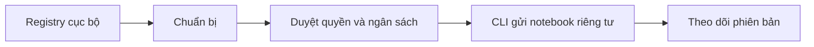
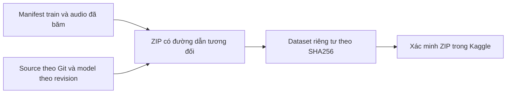
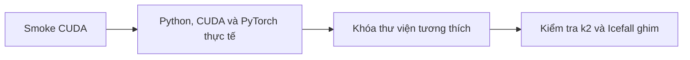
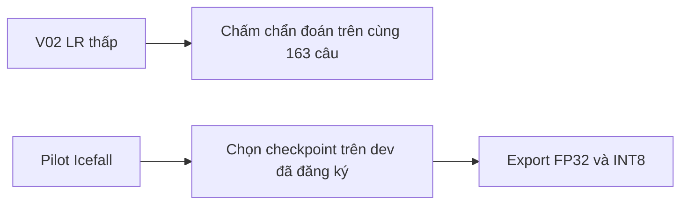
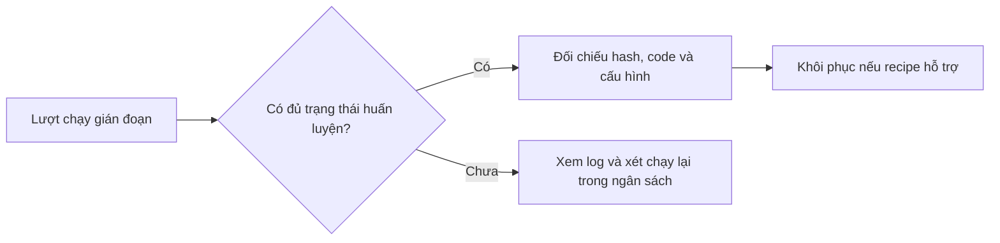
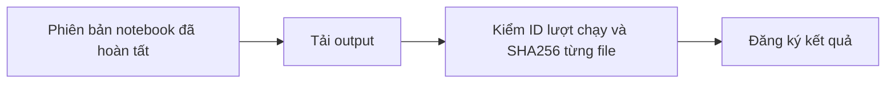
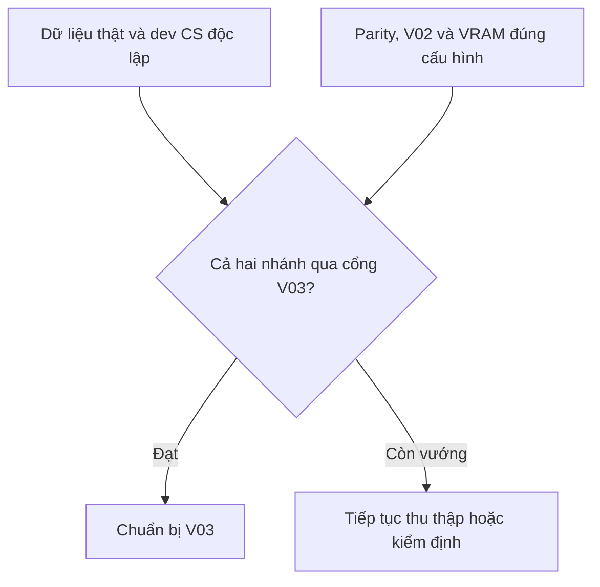

# Thu thập dữ liệu và chạy VietNote trên Kaggle

Dùng nhánh `feature/zip-ft` đang checkout. Kiểm tra các release, benchmark đã khóa và log của đúng phiên bản notebook. [Báo cáo sinh từ artifact](../reports/vietnote_status.md)

## Thu thập và audit

```powershell
$py = '.venv/gipbench-win/Scripts/python.exe'
$env:PYTHONUTF8 = '1'
& $py -m gipbench.dataset.ingest.vietnote fleurs_vi librispeech --discover
& $py -m gipbench.dataset.ingest.vietnote fleurs_vi --resume --hours 12 --byte-budget-mib 900 --max-rows 5500
& $py -m gipbench.dataset.ingest.vietnote librispeech --resume --hours 3 --byte-budget-mib 200 --max-rows 1200
& $py -m gipbench.dataset.ingest.vietnote zerospeech --cache-only --resume --hours 1.5 --max-rows 400
& $py -m gipbench.dataset.release.vietnote_acquired fleurs_vi --workers 2
& $py -m gipbench.dataset.release.vietnote_acquired librispeech --workers 2
& $py -m gipbench.dataset.release.register pool/vietnote_fleurs_vi@v2 pool/vietnote_librispeech_en@v2
& $py -m gipbench.model.research_report report --out reports/vietnote_status.md
```

Audit cần `pyarrow`, `soundfile`, `soxr` và `scipy`. Giới hạn tải tính byte mới của lượt chạy. Giới hạn giờ và số dòng gồm cả ứng viên đã có. Dùng một tiến trình thu thập cho mỗi nguồn. Khi cache có đủ shard, đối chiếu SHA256 với revision đã ghim.

Trên máy này SciPy nằm trong `.venv/vietnote-audit`. Đặt `$env:PYTHONPATH=(Resolve-Path .venv/vietnote-audit).Path` trước lệnh audit để dùng môi trường đã kiểm tra.

Manifest ứng viên, kết quả lọc, lý do loại và phiếu nghe nằm trong `data/work/vietnote/pilots/<nguồn>`. Audit so metadata với benchmark khóa và các release dev cục bộ, rồi đối chiếu dấu vân tay khi có audio tham chiếu. Báo cáo lưu riêng độ phủ audio. FLEURS thuộc nhóm tiếng Việt đọc và LibriSpeech thuộc nhóm tiếng Anh bản ngữ.

## Xác thực và chạy GPU

CLI Kaggle 2.2.5 hỗ trợ OAuth, token API và cấu hình legacy. Lưu token API ở `%USERPROFILE%\.kaggle\access_token`. `doctor` xác thực bằng yêu cầu đọc dataset của tài khoản. [Kaggle API Settings](https://www.kaggle.com/settings/api)

```powershell
$kaggle = 'gipbench.model.execution.kaggle'
& $py -m $kaggle doctor
& $py -m $kaggle plan --experiment smoke
& $py -m $kaggle prepare --experiment smoke --owner <kaggle-user>
& $py -m $kaggle submit --run <run-id> --timeout-seconds <approved-seconds>
& $py -m $kaggle watch --run <run-id> --wait-seconds 300
& $py -m $kaggle logs --run <run-id>
& $py -m $kaggle sync --run <run-id>
```

Smoke dùng notebook riêng tư, tắt internet theo mặc định và không đính kèm dataset. Nó ghi GPU, số thiết bị, VRAM, RAM, driver, CUDA và phiên bản thư viện thực có. Chạy `status --run <run-id>` sau lỗi kết nối khi gửi. Xác minh trạng thái theo đúng phiên bản notebook đã ghi. [Kaggle CLI](https://github.com/Kaggle/kaggle-cli/blob/main/docs/kernels.md)

Chuẩn bị V02 qua `plan --experiment V02 --approval <rights.json> --runtime <lock-directory>` và `prepare --experiment V02 --owner <kaggle-user> --runtime <lock-directory>`. Truyền cùng hồ sơ quyền qua `--approval` khi gửi. Khóa runtime gồm `lock.json` với `python`, `torch`, `cuda` khớp GPU smoke, và `requirements.txt` có hash. Đặt wheel đã duyệt vào `wheels/` để chạy offline. Dùng `--internet` khi chuẩn bị nếu có quyền truy cập mạng cho lượt chạy.

Hồ sơ quyền JSON gồm `experiment` với giá trị `V02`, `train_manifest_sha256`, `cloud_transfer_allowed`, `training_allowed`, `license`, `evidence` là đường dẫn tương đối tới văn bản quyền và `evidence_sha256`. Bản ghi hoặc benchmark ngoài protocol nằm ngoài bundle. [Kaggle CLI notebook metadata](https://github.com/Kaggle/kaggle-cli/blob/main/docs/kernels_metadata.md)

## Export và TTS

```powershell
& $py scripts/diagnostics/vietnote_reexport.py --icefall <pinned-icefall-archive> --checkpoint <fine-tuned-pt> --out <export-directory>
& $py scripts/dataset/vietnote_neural_tts.py --engine vieneu --score --out data/work/vietnote/tts/vieneu_pilot
```

Exporter dùng runtime huấn luyện hoặc export có PyTorch, k2, ONNX và ONNX Runtime tương thích. Có thể dùng `--average-manifest` với JSON gồm `model_revision`, `base_checkpoint_sha256` và mảng `checkpoints`. Mỗi checkpoint có `path` và `sha256`. Hệ số downsampling được tính lại từ trọng số được chọn. Đối chiếu pretrained V01 tiếp tục dùng quy trình đã khóa.

Các phiếu nghe mù của ZeroTTS và VieNeu-TTS nằm cạnh `asr_metrics.json` trong `data/work/vietnote/tts`. Xác minh phát âm tiếng Anh, đúng span, độ tự nhiên và độ khớp transcript trước khi phát hành dữ liệu.

## Vòng đời

### Điều khiển Kaggle



### Gói dữ liệu



### Môi trường GPU



### Huấn luyện và chọn checkpoint



### Checkpoint và phục hồi



Checkpoint V02 hiện lưu trọng số để chấm lại hoặc export. Checkpoint pilot Icefall cục bộ đọc được trên Windows và có optimizer, scheduler, GradScaler, sampler và bộ đếm. Không tìm thấy trạng thái RNG trong checkpoint đó. Kiểm chứng phục hồi đầy đủ trên Kaggle còn mở.

### Đồng bộ



### Quyết định nghiên cứu


