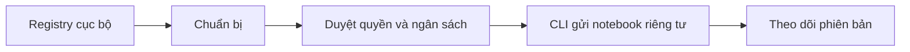
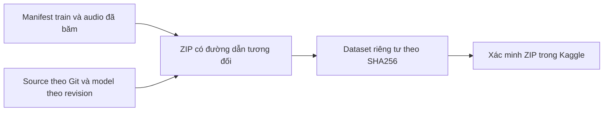
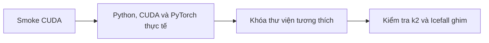
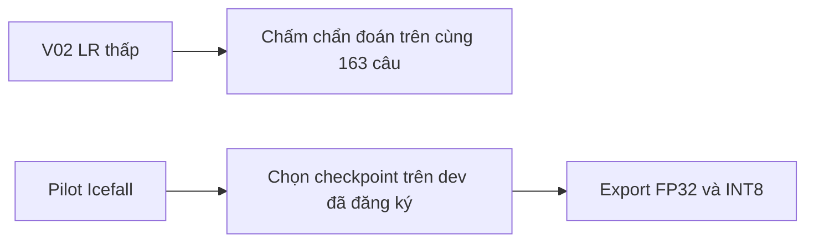
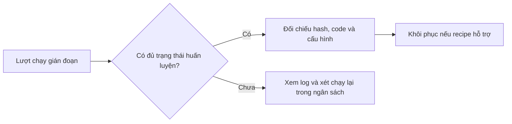
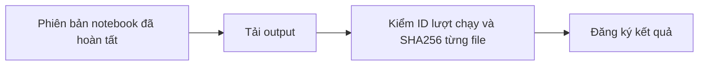
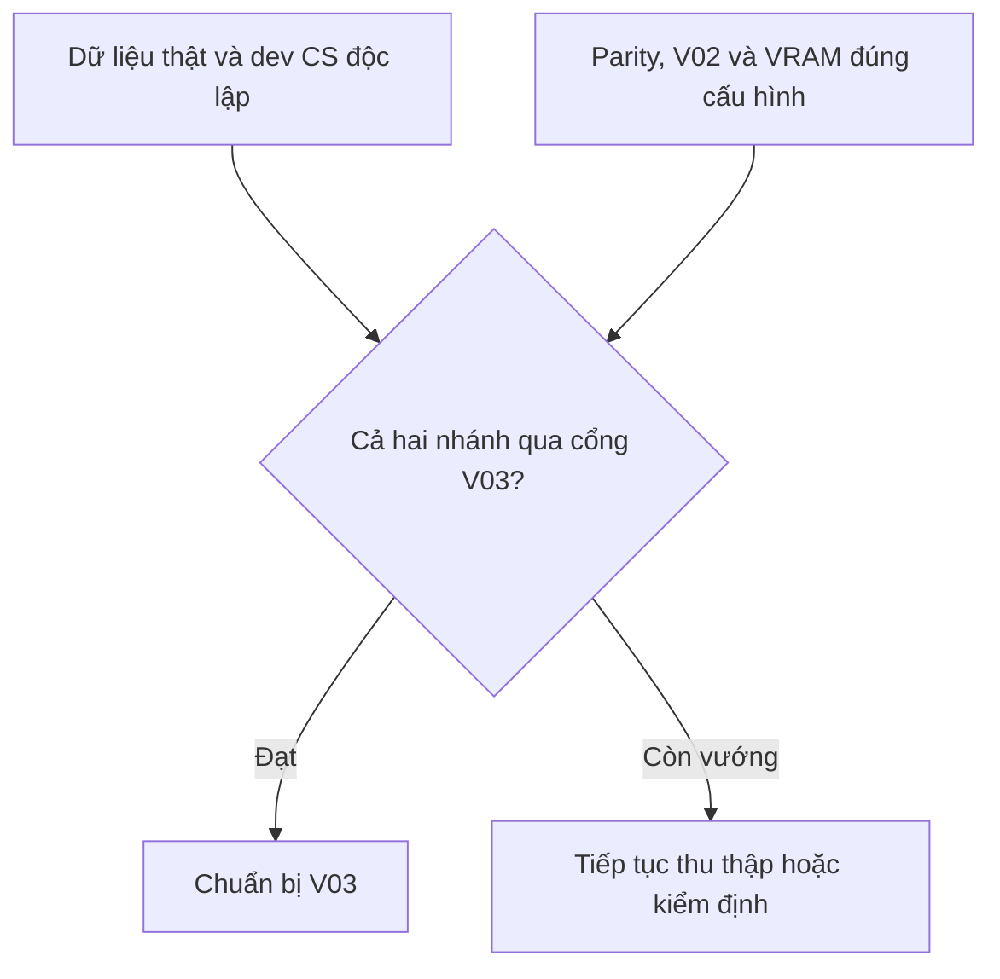

# Thu thập dữ liệu và chạy VietNote trên Kaggle

Dùng nhánh `feature/zip-ft` đang checkout. Kiểm tra các release, benchmark đã khóa và log của đúng phiên bản notebook. [Báo cáo sinh từ artifact](../reports/vietnote_status.md)

## Thu thập và audit

```powershell
$py = '.venv/gipbench-win/Scripts/python.exe'
$env:PYTHONUTF8 = '1'
& $py -m gipbench.dataset.ingest.vietnote fleurs_vi librispeech --discover
& $py -m gipbench.dataset.ingest.vietnote fleurs_vi --resume --hours 12 --byte-budget-mib 900 --max-rows 5500
& $py -m gipbench.dataset.ingest.vietnote librispeech --resume --hours 3 --byte-budget-mib 200 --max-rows 1200
& $py -m gipbench.dataset.ingest.vietnote zerospeech --cache-only --resume --hours 1.5 --max-rows 400
& $py -m gipbench.dataset.release.vietnote_acquired fleurs_vi --workers 2
& $py -m gipbench.dataset.release.vietnote_acquired librispeech --workers 2
& $py -m gipbench.dataset.release.register pool/vietnote_fleurs_vi@v2 pool/vietnote_librispeech_en@v2
& $py -m gipbench.model.research_report report --out reports/vietnote_status.md
```

Audit cần `pyarrow`, `soundfile`, `soxr` và `scipy`. Giới hạn tải tính byte mới của lượt chạy. Giới hạn giờ và số dòng gồm cả ứng viên đã có. Dùng một tiến trình thu thập cho mỗi nguồn. Khi cache có đủ shard, đối chiếu SHA256 với revision đã ghim.

Trên máy này SciPy nằm trong `.venv/vietnote-audit`. Đặt `$env:PYTHONPATH=(Resolve-Path .venv/vietnote-audit).Path` trước lệnh audit để dùng môi trường đã kiểm tra.

Manifest ứng viên, kết quả lọc, lý do loại và phiếu nghe nằm trong `data/work/vietnote/pilots/<nguồn>`. Audit so metadata với benchmark khóa và các release dev cục bộ, rồi đối chiếu dấu vân tay khi có audio tham chiếu. Báo cáo lưu riêng độ phủ audio. FLEURS thuộc nhóm tiếng Việt đọc và LibriSpeech thuộc nhóm tiếng Anh bản ngữ.

## Xác thực và chạy GPU

CLI Kaggle 2.2.5 hỗ trợ OAuth, token API và cấu hình legacy. Lưu token API ở `%USERPROFILE%\.kaggle\access_token`. `doctor` xác thực bằng yêu cầu đọc dataset của tài khoản. [Kaggle API Settings](https://www.kaggle.com/settings/api)

```powershell
$kaggle = 'gipbench.model.execution.kaggle'
& $py -m $kaggle doctor
& $py -m $kaggle plan --experiment smoke
& $py -m $kaggle prepare --experiment smoke --owner <kaggle-user>
& $py -m $kaggle submit --run <run-id> --timeout-seconds <approved-seconds>
& $py -m $kaggle watch --run <run-id> --wait-seconds 300
& $py -m $kaggle logs --run <run-id>
& $py -m $kaggle sync --run <run-id>
```

Smoke dùng notebook riêng tư, tắt internet theo mặc định và không đính kèm dataset. Nó ghi GPU, số thiết bị, VRAM, RAM, driver, CUDA và phiên bản thư viện thực có. Chạy `status --run <run-id>` sau lỗi kết nối khi gửi. Xác minh trạng thái theo đúng phiên bản notebook đã ghi. [Kaggle CLI](https://github.com/Kaggle/kaggle-cli/blob/main/docs/kernels.md)

Chuẩn bị V02 qua `plan --experiment V02 --approval <rights.json> --runtime <lock-directory>` và `prepare --experiment V02 --owner <kaggle-user> --runtime <lock-directory>`. Truyền cùng hồ sơ quyền qua `--approval` khi gửi. Khóa runtime gồm `lock.json` với `python`, `torch`, `cuda` khớp GPU smoke, và `requirements.txt` có hash. Đặt wheel đã duyệt vào `wheels/` để chạy offline. Dùng `--internet` khi chuẩn bị nếu có quyền truy cập mạng cho lượt chạy.

Hồ sơ quyền JSON gồm `experiment` với giá trị `V02`, `train_manifest_sha256`, `cloud_transfer_allowed`, `training_allowed`, `license`, `evidence` là đường dẫn tương đối tới văn bản quyền và `evidence_sha256`. Bản ghi hoặc benchmark ngoài protocol nằm ngoài bundle. [Kaggle CLI notebook metadata](https://github.com/Kaggle/kaggle-cli/blob/main/docs/kernels_metadata.md)

## Export và TTS

```powershell
& $py scripts/diagnostics/vietnote_reexport.py --icefall <pinned-icefall-archive> --checkpoint <fine-tuned-pt> --out <export-directory>
& $py scripts/dataset/vietnote_neural_tts.py --engine vieneu --score --out data/work/vietnote/tts/vieneu_pilot
```

Exporter dùng runtime huấn luyện hoặc export có PyTorch, k2, ONNX và ONNX Runtime tương thích. Có thể dùng `--average-manifest` với JSON gồm `model_revision`, `base_checkpoint_sha256` và mảng `checkpoints`. Mỗi checkpoint có `path` và `sha256`. Hệ số downsampling được tính lại từ trọng số được chọn. Đối chiếu pretrained V01 tiếp tục dùng quy trình đã khóa.

Các phiếu nghe mù của ZeroTTS và VieNeu-TTS nằm cạnh `asr_metrics.json` trong `data/work/vietnote/tts`. Xác minh phát âm tiếng Anh, đúng span, độ tự nhiên và độ khớp transcript trước khi phát hành dữ liệu.

## Phiếu nghe và quyền nguồn

Mở [trình duyệt phiếu nghe](../src/gipbench/dataset/label/review_bench.html), chọn CSV và thư mục audio cạnh phiếu. Nghe trước khi đối chiếu transcript. Ghi `ok`, `fix` hoặc `drop`, phiên âm sửa với thẻ `<en>` khi cần và ghi người duyệt. Ghi danh tính người nói đã xác minh, domain, loại giọng và hồ sơ quyền riêng theo nhóm bản ghi.

| Lô | Việc cần duyệt |
| --- | --- |
| VietSuperSpeech | Bắt đầu với 192 câu có domain cụ thể trong phiếu 1.076 câu. Ưu tiên tech, business và hội thoại đời thường. Cột `v02_recording` đánh dấu 162 câu trong phạm vi V02 có mặt tại hàng đợi này. Dùng danh sách quyền 163 câu để xác định phạm vi V02. [Phiếu VSS](../data/work/vietnote/execution_review/vss/listen.csv), [phạm vi quyền V02](../data/work/vietnote/v02/rights-scope.csv) |
| LSVSC | Kiểm 119 câu hiện mang nhãn giọng đọc. Xác minh riêng đoạn phỏng vấn hoặc hội thoại và bản quyền đơn vị thu. [Phiếu LSVSC](../data/work/vietnote/execution_review/lsvsc/listen.csv) |
| code_switch_OM | Kiểm quyền theo từng video và sửa transcript đối chiếu audio. [Phiếu OM](../data/work/vietnote/execution_review/code_switch_om/listen.csv) |
| ViMedCSS | Duyệt 72 câu đã giữ ngoài pool hiện tại. Ghi người nói và video trong hồ sơ kiểm. [Phiếu y khoa](../data/work/vietnote/execution_review/medical/listen.csv) |
| DataHive | Phiên âm 48 đoạn trích từ tám cuộc gọi. Ưu tiên 18 đoạn của ba cuộc dành cho chẩn đoán. Xác minh tiếng Anh thực sự xuất hiện và phát hiện người nói trùng giữa các cuộc trước khi chia tập. [Phiếu DataHive](../data/work/vietnote/execution_review/datahive_vi/listen.csv) |
| TTS | Nghe 24 mẫu theo thứ tự xáo trộn. Điền các cột phát âm tiếng Anh, span, độ tự nhiên, độ khớp transcript và quyết định trên phiếu. [Phiếu nghe mù](../data/work/vietnote/execution_review/tts/listen.csv) |

Tài khoản hiện có quyền đọc VietSpeech và viVoice. VietSpeech cần hồ sơ gắn bản ghi với nguồn thu và người nói. viVoice yêu cầu dùng cho nghiên cứu theo CC BY-NC-SA 4.0 và cần kiểm quyền theo kênh. VietSuperSpeech, code_switch_OM, LSVSC và ViMedCSS cần xác minh quyền bản ghi theo nguồn và phạm vi chuyển cloud trước khi đóng gói. L2-ARCTIC cần quyền truy cập theo bản gốc hoặc mirror. Common Voice EN cần chọn release và kiểm điều khoản nguồn phân phối. CanVEC và VietPrism chờ cấp quyền từ tác giả. ZeroSpeech cần quyền văn bản nguồn Blossoms cùng kết quả nghe duyệt. [Registry nguồn](../configs/dataset/vietnote_sources.yaml)

Khóa T4 dựa trên phiên Icefall thành công gồm danh sách 941 distribution và năm wheel có SHA256. Gói V02 được chuẩn bị offline và kiểm digest cả archive lẫn các member khi Kaggle tự giải nén. Phiên V02 còn cần văn bản quyền bao phủ đúng manifest đăng ký. [Khóa runtime](../data/work/vietnote/kaggle/icefall-t4-lock/lock.json)

Khóa huấn luyện và export của pilot FLEURS ghi 942 distribution cùng sáu wheel, gồm ONNX Runtime 1.32.0. [Khóa export](../data/work/vietnote/kaggle/icefall-fleurs-t4-lock/lock.json)

### Probe bộ nhớ FP32 với FLEURS

`icefall-memory` dùng `pool/vietnote_fleurs_vi@v2` để đo ba bước cập nhật trên T4 với giới hạn 200 giây sau padding. Mỗi batch có ít nhất một câu từ 25 giây. Probe gọi trực tiếp bước tính loss và cập nhật của recipe đã ghim để đo câu dài. Kết quả nằm trong `output/engineering-memory.json` của lượt Kaggle đã đồng bộ. Đây là kiểm tra kỹ thuật và cổng V03 vẫn cần bằng chứng trên dữ liệu đăng ký.

## Vòng đời

### Điều khiển Kaggle



### Gói dữ liệu



### Môi trường GPU



### Huấn luyện và chọn checkpoint



### Checkpoint và phục hồi



Checkpoint V02 hiện lưu trọng số để chấm lại hoặc export. Pilot FLEURS trên Kaggle nạp lại optimizer, scheduler và GradScaler từ checkpoint epoch 1, rồi hoàn tất epoch 2 ở bước thứ 8. Cuối epoch 2, scheduler và GradScaler khớp lượt liên tục. Trọng số và optimizer còn lệch. Checkpoint lưu sampler và thiếu trạng thái RNG. [Kết quả resume](../data/work/vietnote/kaggle/gipbench-icefall-pilot-94a84b5d2b072dcb/output/pilot.json)

Phân tích cơ chế cho thấy phục hồi (resume) hoạt động chức năng nhưng **không đồng nhất số học** với lượt chạy liên tục do: (1) `icefall.checkpoint.save_checkpoint` không lưu trạng thái RNG của Python/NumPy/PyTorch CPU/CUDA, (2) `scan_pessimistic_batches_for_oom()` chạy lại trên lượt resume và ở chế độ mid-epoch (`--start-batch > 0`) làm tiêu hao iterator của sampler đã khôi phục, (3) tính bất định của kernel CUDA/cuDNN và phép chọn `chunk_size`/SpecAugment/PerturbSpeed. Khi cần tái lập nghiêm ngặt hơn, dùng cờ `--save-rng-state` của `scripts/diagnostics/vietnote_logged_cli.py` để lưu/khôi phục trạng thái RNG cạnh checkpoint và bỏ qua `scan_pessimistic_batches_for_oom` khi `start_batch > 0`.

### Chính sách thời lượng huấn luyện

Recipe `finetune.py` ghim từ Icefall cứng hóa bộ lọc `remove_short_and_long_utt` ở `1.0s <= duration <= 20.0s` (cùng điều kiện khung sau subsampling `T >= len(tokens)`), trong khi cấu hình `vietnote_v03.yaml` cho phép `features.max_duration: 45` và `vi_datamodule.py` áp dụng `PerturbSpeed([0.9, 1.1], p=2/3)` khi `--on-the-fly-feats 1`. `scripts/diagnostics/vietnote_logged_cli.py` cho phép cấu hình tường minh `--min-utt-duration` và `--max-utt-duration` (mặc định giữ nguyên `1.0` và `20.0` làm đối chứng upstream) và ghi thống kê trước/sau lọc vào `duration-filter.json`.

### Hai nhánh V02 đối chứng LR

Khi hồ sơ quyền 163 bản ghi V02 được cấp, `gipbench.model.execution.kaggle prepare --experiment V02 --arm A` (`LR=0.0045`) và `--arm B` (`LR=0.0015`) tạo hai lượt chạy độc lập, cùng checkpoint gốc, cùng 163 câu, seed 0, FP32, 489 bước và lưu kết quả riêng tại `data/work/vietnote/v02/tiny_kaggle_lr0045` và `data/work/vietnote/v02/tiny_low_lr`.

## Nhánh thăm dò tách biệt V03 (Curation, V02A & VE01)

Quy trình thăm dò tái sử dụng kho dữ liệu sẵn có theo mức rủi ro nguồn gốc, giữ nguyên rào cản quyền bản ghi, giới hạn chuyển cloud và cổng xác nhận `V03`:

```powershell
# 1. Tuyển lọc tự động theo nguồn gốc (audit, tách VAD DataHive, ghép cặp 2 teacher & lọc từ khóa/rò rỉ)
& $py scripts/dataset/vietnote_auto_curate.py --out data/work/vietnote/curation

# 2. Thí nghiệm fine-tuning thăm dò VE01 trên Kaggle T4 (chỉ dữ liệu CC-BY-4.0 / CC0-1.0)
& $py -m gipbench.model.execution.kaggle prepare --experiment expl-ft --owner <kaggle-user> --runtime data/work/vietnote/kaggle/icefall-fleurs-t4-lock
& $py -m gipbench.model.execution.kaggle submit --run <run-id> --timeout-seconds 7200
& $py -m gipbench.model.execution.kaggle watch --run <run-id> --wait-seconds 300
& $py -m gipbench.model.execution.kaggle sync --run <run-id>

# 3. Xuất ONNX (WSL) & đánh giá Sherpa-ONNX cục bộ (Windows, offline & streaming FP32/INT8)
& $py scripts/diagnostics/vietnote_ve01_eval.py `
  --ve01-export data/work/vietnote/ve01/export `
  --authorized-dev data/work/vietnote/kaggle/<run-id>/output/valid.jsonl `
  --out data/work/vietnote/ve01
```

Giao thức `V02A` (`configs/model/experiments/vietnote_v02a_validation.yaml`) và cấu hình `VE01` (`configs/model/experiments/vietnote_ve01_exploratory.yaml`) chỉ phục vụ thăm dò (`allow_generalization_claims: false`) và không thay thế `V02` hay `V03`.

### Đồng bộ



### Quyết định nghiên cứu


