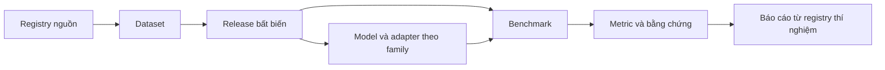
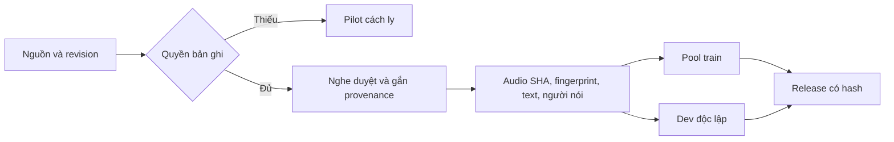
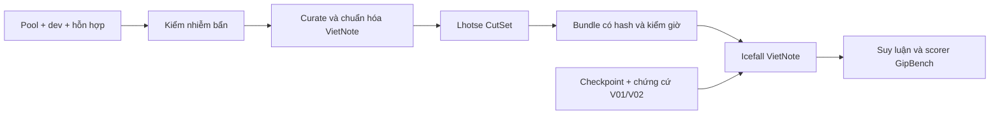
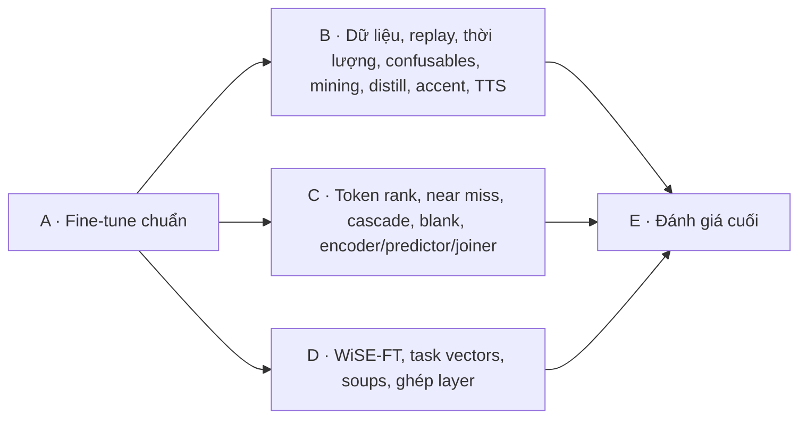
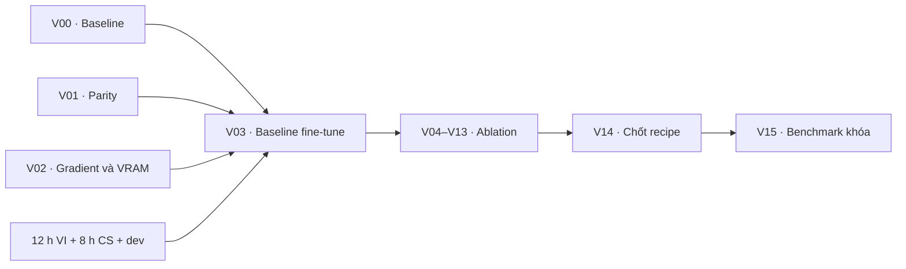
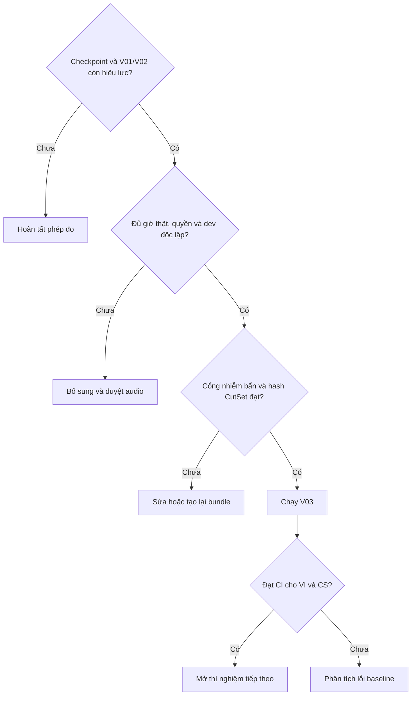

# VietNote ASR — Nhật ký triển khai và lộ trình nghiên cứu

Ngày bắt đầu 25/11/2026. Nhánh làm việc `feature/zip-ft`. VietNote-Zipformer-78M là model nghiên cứu chính. GipFormer là baseline lịch sử và nguồn đối chiếu cho nghiên cứu cơ chế, chấm ASR và distillation. Hồ sơ GipFormer nằm trong [RESEARCH_RECOVERY.md](../RESEARCH_RECOVERY.md), [IMPLEMENTATION.md](../IMPLEMENTATION.md), [TODO.md](../TODO.md) và [TODO_rea.md](../TODO_rea.md).

## Trạng thái hiện tại

Quy trình thu thập song song và điều khiển GPU từ Windows dùng lệnh trong [hướng dẫn Kaggle](VIETNOTE_KAGGLE.md). Cổng V03 dùng kết quả bộ nhớ từ chính backend đã chọn và tiếp tục yêu cầu dev CS độc lập.

[Báo cáo trạng thái sinh từ artifact](../reports/vietnote_status.md) ghi kết quả hiện tại. V00 đã có quick baseline, full dev vẫn mở. V01 đạt parity sau khi exporter tính softmax FP32 từ `encoder.encoders.3.downsample.bias` của checkpoint gốc trước khi lượng tử hóa. INT8 offline tăng từ 81/113 lên 113/113 transcript khớp bản phát hành, streaming tăng từ 95/113 lên 113/113. Trên 24 câu dài, thời điểm phát chữ đầu tiên trùng nhau và không câu nào mất lượt phát chữ sau nửa câu. Kết quả và transcript từng câu nằm trong `data/work/vietnote/v01/parity_softmax/`. V03 vẫn bị chặn bởi điều kiện dữ liệu, dev CS độc lập và các kiểm tra V02.

Đối chiếu INT8 dùng 113 câu đã khóa. Bản chính thức và các biến thể cùng chạy trên một runtime Windows với Sherpa-ONNX 2.0.1, beam 4 và 4 luồng CPU. Báo cáo hiển thị riêng phép lượng tử hóa lại FP32 chính thức, phép hoán đổi thành phần và re-export toàn bộ.

Artifact đối chiếu nằm tại `data/work/vietnote/v01/int8_isolation/matched_runtime.json`. Cờ `--verify-runtime` của `scripts/diagnostics/vietnote_int8_isolate.py` đọc lại manifest, kiểm SHA256, rồi giải mã lại tất cả biến thể trong một tiến trình. Dùng một thư mục isolation mới nếu cần tái lập và giữ kết quả cũ.

Phép thử hằng FP32 lấy encoder re-export làm điểm xuất phát, khôi phục riêng hệ số nhân downsampling và nhóm bảng mã hóa vị trí từ encoder phát hành, rồi thử khôi phục cả hai. Mỗi biến thể độc nhất dùng 113 câu đã khóa và cùng runtime Windows. Biến thể trùng SHA256 với đối chứng dùng lại transcript đã khóa của đối chứng đó. [Báo cáo](../reports/vietnote_status.md) ghi kết quả từng phép thử.

## Mốc trước đợt refactor ngày 25/11/2026

| Hạng mục | Trạng thái và bằng chứng |
| --- | --- |
| V00 và artifact gốc | Đã tải xong PyTorch, BPE, vocab và bốn bộ ONNX. Đã xác minh 32 đường dẫn có trong `models/vietnote78/model_card.json`. Đã chấm bốn biến thể VietNote và GipFormer INT8 trên hai quick dev với cấu hình 4 luồng. |
| V01 và Icefall | Đã tải archive Icefall đúng commit, kiểm SHA256 và chạy `make_recipe.py` trong Ubuntu. Strict-load checkpoint gốc thành công với 77.686.775 tham số. PyTorch và ONNX FP32 offline cho 12/12 transcript greedy giống hệt nhau. Đã tạo lại bộ streaming INT8 từ FP32 gốc và kiểm phát chữ trên câu dài. |
| V02 GPU smoke | Một bước FP32 trên RTX 3050 dùng clip train y khoa dài 3 giây. Loss và toàn bộ gradient hữu hạn, Joiner đã cập nhật trọng số, checkpoint lưu và strict-load lại thành công. Peak CUDA allocated 1,91 GiB. Bằng chứng ở `data/work/vietnote/torch_checks/gpu_smoke_report.json`. |
| Pilot có audio | FLEURS 100 câu / 0,329 giờ, LibriSpeech 120 / 0,425 giờ, LSVSC 120 / 0,204 giờ và ZeroSpeech 120 / 0,365 giờ đã qua giải mã và kiểm kỹ thuật ban đầu. Lọc metadata bỏ 1 câu LSVSC gần trùng văn bản với benchmark. Báo cáo tải và lọc ở `data/work/vietnote/pilots/`. Các con số là giờ ứng viên trước đăng ký pool. |
| Pool CS y khoa | Đã đăng ký `pool/vietnote_vimedcss_cs@v1` gồm 3.035 câu và 5,952 giờ audio, lấy từ `pool/vimedcss_train@v4`. Khớp SHA256 ở cả 3.035 file audio. Đã lọc trùng SHA, thuật ngữ giữ riêng và kiểm lại sáu bench khóa cùng ba dev. Nguồn được ghi là video và chỉ dùng trong nghiên cứu. SHA256 manifest `9a8870dbab391482e009544ac9d9b60aafc8670a2c3af3e39c23d1d5af8e17f6`. |
| Pool tiếng Anh mới | Đã đăng ký `pool/vietnote_librispeech_en@v1` gồm 106 câu và 0,376 giờ. Trong 120 câu pilot, không có cặp dấu vân tay trùng trên 58.511 audio tham chiếu đọc được, và 14 câu bị loại do chứa thuật ngữ giữ riêng. Đây là audiobook tiếng Anh bổ trợ cho ablation. SHA256 manifest `28bb3bc56969986c321252a29fb03015afc337985eb89673986d16ba8dba3f5f`. |
| Pool replay tiếng Việt mới | Đã đăng ký `pool/vietnote_fleurs_vi@v1` gồm 96 câu và 0,313 giờ. Đã dùng SHA256, dấu vân tay và lọc thuật ngữ giữ riêng. FLEURS vi train là giọng đọc, pilot chưa có ID người nói. SHA256 manifest `3fc636850df7e992f642073966e5274b1875c105e00152396e2899c36819bb82`. |
| Dev độc lập | Phiếu y khoa có 72 câu để nghe. Chưa có đủ domain và người nói đã xác minh để tạo `dev/dev_v2_cs@1`. Hai quick dev đã khóa hash và đang được dùng cho chẩn đoán. |
| TTS | eSpeak NG tạo 120 câu, khoảng 0,08 giờ. GipFormer giữ 0 câu. Lượt đối chiếu GipFormer và VietNote với ngưỡng ít nhất một hệ đồng ý giữ 1/120 câu. Còn 119 câu bị cờ span Anh sai. Giữ pilot để phân tích, chưa phát hành pool. Báo cáo ở `data/work/vietnote/tts/espeak_control/two_family_review.jsonl.report.md`. |
| Kiểm thử và train | Bộ kiểm thử WSL chạy qua pipeline, scorer, converter, TTS và adapter. Hai bài cơ chế GipFormer thiếu `jiwer` ở lượt WSL đã được chạy lại thành công trên Windows với `jiwer==4.0.0` cài riêng. V03 dry-run thành công. Stage 0 thực tế dừng khi resolve `dev/dev_v2_cs@1`. |

## Nhật ký triển khai

| Bước | Việc đã chạy | Bằng chứng |
| --- | --- | --- |
| Kiểm tra workspace | Đọc roadmap, hợp đồng dữ liệu, runbook, registry model và release, pipeline TTS, distillation, confusable và diagnostics. Kiểm tra GPU, dung lượng đĩa và trạng thái Ubuntu WSL. | RTX 3050 Laptop 4 GiB VRAM, khoảng 5,8 GiB RAM WSL, khoảng 31 GiB trống ở đầu phiên. Kiểm tra tiến trình trong Ubuntu sau khi mở lại cho thấy X0 không chạy. Icefall có sẵn ở commit `f8c8578c9dbfa1183cc949b89b5d21bd33aa2ce1`. |
| Ghim model | Đọc cây tệp HF và Git upstream. Xác minh BPE 6.144 mục, blank 0, unknown 2, chuẩn SentencePiece `nmt_nfkc`. Tải các tệp recipe chuẩn hóa, huấn luyện, export và quantization. | [Khóa artifact](../configs/model/vietnote.json). `models/vietnote78/` lưu tệp, `.part` và card sau xác minh. |
| Rà pool | Resolve và kiểm hash manifest các release hiện có. Kiểm file audio, gộp theo SHA đã ghi hoặc đường dẫn đã phân giải, lấy mẫu kỹ thuật và so phân mảnh BPE. | `data/work/vietnote/corpus.json`. |
| Pilot nguồn mới | Đọc schema và tải vùng byte từ train, giải mã audio và lưu transcript gốc, provenance, hash, tình trạng kiểm tra. | [Khóa nguồn và trạng thái truy cập](../configs/dataset/vietnote_sources.yaml). `data/work/vietnote/pilots/<nguồn>/acquisition.json`. |
| Chuẩn bị dev | Chạy `make_dev_split` trên 1.714 dòng ViMedCSS validation với sáu bench khóa và các pool/dev liên quan. Giữ 72 câu y khoa, 67 video và 0,145 giờ sau lọc metadata, SHA khả dụng và gần trùng văn bản. | `data/work/vietnote/dev/medical_candidates.jsonl.report.json`. Phiếu nghe và audio ở `data/work/vietnote/dev/medical_review/`. Cần xác minh người nói, dấu vân tay audio và duyệt nhãn trước khi phát hành. |
| Quick dev | Cố định seed 0 và chọn theo corpus, domain, dải thời lượng và sự có mặt của span Anh. | `data/work/vietnote/dev/{vi_quick,interim_cs_quick}.lock.json`. VI 36/1.691 câu, CS tạm 65/323 câu. Cần đối chiếu lỗi theo lát với full dev trước khi dùng chọn checkpoint. |
| Pilot TTS | Dùng catalog train và danh sách 820 thuật ngữ giữ riêng để tạo 269 kịch bản. Tạo pilot đối chứng eSpeak NG với ba giọng quy tắc Bắc, Trung, Nam ở 160 từ/phút. | `data/work/vietnote/tts/script/`, `data/work/vietnote/tts/espeak_control/`. Metadata mỗi câu ghi seed, nguồn catalog, giọng và SHA256. |
| Chuẩn bị huấn luyện | Thêm nhánh chuẩn hóa VietNote khi tạo CutSet và cấu hình V03 theo loader, leak gate và mixer hiện có. Kiểm dry-run prepare và lệnh chính thức. | [Cấu hình V03](../configs/model/experiments/vietnote_v03.yaml). Trạng thái `blocked` chờ dữ liệu, dev độc lập, smoke và parity. |

## Artifact và recipe

HF revision `69eec0a86fef25639996813d3e10fbe656659650`, Git upstream `fd4dcde6f41ca888823a0c50fcce8cf8d274487c`, Icefall `9c966762e058bd7ba79d9da71e42fc06b64b703e`. Model Apache-2.0 theo upstream. Checkpoint dùng Zipformer2 causal transducer, khoảng 78 triệu tham số công bố, feature 80 chiều ở 16 kHz, Predictor context 2. Fine-tune dùng chunk `16,32,64,-1` và left context `64,128,256,-1`. Export streaming chuẩn dùng chunk 32, left context 128 và bước audio 640 ms. Hỗ trợ greedy và modified beam search. Chuẩn nhãn `vnasr.text.normalize_text` phiên bản 1.3 sinh chữ thường, chuẩn hóa thanh điệu và đọc số thành lời tại bước tạo CutSet.

Bốn bộ artifact tính Encoder, Decoder, Joiner và vocab. Streaming INT8 83,3 MiB, offline INT8 88,5 MiB, streaming FP32 274,0 MiB và offline FP32 278,8 MiB. Checkpoint PyTorch gốc có 311.199.896 byte.

Recipe dùng pruned RNN-T, ScaledAdam, Eden và warm-up loss 2.000 batch tại Icefall đã pin. Upstream export trung bình checkpoint theo epoch và quantize động QInt8 theo kênh trên MatMul. V01 phải đo cả tiến trình phát chữ trên câu dài vì upstream ghi nhận bản quantize mặc định có thể dừng phát chữ. Upstream công bố dùng train FLEURS và VIVOS, cùng nguồn cho CS dev của họ. Danh mục pretraining đầy đủ chưa có. [Model card VietNote](https://huggingface.co/Kaisye/VietNote-Zipformer-78M-Streaming) · [Recipe đã ghim](https://github.com/kaisye/vietnote-asr/blob/fd4dcde6f41ca888823a0c50fcce8cf8d274487c/docs/FINETUNE.md)

Metadata ONNX INT8 gốc ghi `decode_chunk_len=64`, cửa sổ đầu vào `T=77` và cache left context từng stack `128,64,32,16,32,64`. Các độ dài frame này được đọc từ graph streaming đã xác minh.

## V00 trên quick dev

Sherpa-ONNX 2.0.1, INT8, modified beam search beam 4, batch 1, 4 luồng CPU, scorer `gipbench_strict_v1`. Hai tập con đều có hash cố định. Bootstrap ghép cặp dùng 1.000 vòng với seed 0. RTF đo tại chỗ trong khi có các tác vụ khác.

| Hệ | CS tạm WER | CS-WER | CS-WER-SD | Recall từ/cụm Anh | VI WER | RTF CS / VI |
| --- | ---: | ---: | ---: | ---: | ---: | ---: |
| GipFormer offline | 4,52% | 38,05% | 34,51% | 68,57% | 9,06% | 0,032 / 0,034 |
| VietNote streaming, đệm đuôi 660 ms | 6,45% | 46,90% | 29,20% | 68,57% | 12,63% | 0,074 / 0,074 |
| VietNote offline | 5,93% | 41,59% | 25,66% | 73,33% | 10,18% | 0,049 / 0,043 |

Phép đo riêng theo FP32 dùng cùng beam 4, batch 1 và 4 luồng. VietNote streaming đạt WER 6,61% trên CS tạm và 11,51% trên VI. VietNote offline đạt 5,82% và 9,22%. CS-WER lần lượt là 48,67% và 41,59%. RTF CS/VI là 0,079/0,117 cho streaming và 0,034/0,047 cho offline. Thư mục GipFormer hiện có artifact gốc INT8.

So với GipFormer, VietNote streaming tăng WER 1,93 điểm trên CS tạm (CI 95% ghép cặp 0,97–3,03) và 3,57 điểm trên VI (1,76–5,66). VietNote offline tăng tương ứng 1,41 điểm (0,48–2,41) và 1,12 điểm (−0,71–3,20). Offline có ít lỗi thay thế và xóa token Anh hơn theo CS-WER-SD. CS tạm chỉ bao phủ nguồn VSS và có lịch sử lọc bằng ASR. Cần full dev để đối chiếu lát lỗi và dev CS độc lập để đánh giá tổng quát hóa.

Lượt streaming ban đầu dùng vòng lặp trong README upstream và không có đệm đuôi, WER 9,53% trên CS tạm và 15,50% trên VI. Sau khi đối chiếu script transcribe chính thức, đã thêm 660 ms im lặng trước `input_finished()` cho VietNote và chấm lại bằng thư mục `*_pad660`. Lượt offline GipBench đưa cả câu vào một stream để đo hành vi câu dài. Ví dụ CLI upstream chia file offline theo đoạn 20 giây. [Script giải mã chính thức](https://github.com/kaisye/vietnote-asr/blob/fd4dcde6f41ca888823a0c50fcce8cf8d274487c/examples/transcribe_file.py)

VietNote streaming INT8 gốc tiếp tục thay đổi văn bản sau nửa câu ở cả 12 câu VI dài từ 20 giây. Lần phát chữ đầu xuất hiện sau khi đã đưa vào từ 0,8 đến 1,5 giây audio. Đây là thời điểm theo audio đã nạp ở bước feed 100 ms. Kết quả và transcript từng lần phát ở `results/vietnote/v00/quick_t4/streaming_emission.json`. V01 sẽ lặp phép đo trên FP32 và INT8 re-export.

Đã chạy script quantization upstream với ONNX Runtime 1.32.0 trên toàn bộ bộ streaming FP32 gốc. SHA256 của Encoder INT8 tái tạo trùng bản phát hành. Decoder và Joiner có SHA256 khác. Hai bộ INT8 cho 12/12 transcript cuối giống hệt nhau và đều có cập nhật chữ sau nửa câu trên cả 12 câu dài. Bằng chứng ở `results/vietnote/v00/quick_t4/streaming_pad660_quant_full.json`. Lượt kiểm tra riêng Decoder và Joiner nằm trong `streaming_pad660_quant_shared.json`.

PyTorch offline dùng chunk và left context `-1` cùng greedy, FP32 và bốn luồng CPU. Trên 12 câu dài 1,301–30,026 giây, cả 12 transcript khớp chính xác với ONNX offline FP32. Manifest, hash giả thuyết và danh sách sai khác nằm ở `data/work/vietnote/torch_checks/parity12.jsonl` và `offline_parity.json`. Phép đối chiếu PyTorch theo từng bước streaming và kiểm tra parity trên tập lớn hơn vẫn nằm trong V01.

V02 dùng một lượt forward/backward với pruned RNN-T, ScaledAdam và Eden từ recipe ghim. Loss tổng 21,27697, pruned loss 9,49669, thay đổi tối đa của trọng số được kiểm trong Joiner là 0,00030136. Checkpoint smoke có 932.875.669 byte và được lưu riêng trong `data/work/vietnote/torch_checks/gpu_smoke_report.pt`. Đánh giá khả năng ghi nhớ bộ tiny nhiều câu vẫn mở.

## Dữ liệu và thành phần corpus

| Pool cục bộ | Câu manifest | Giờ audio duy nhất trong pool | P50 / P90 giây | Vai trò |
| --- | ---: | ---: | ---: | --- |
| `pool/vimedcss_train@v4` | 3.868 | 7,527 | 7,0 / 11,0 | Việt và CS y khoa, khoảng 5,98 giờ có span Anh |
| `pool/vss_cs@v5` | 1.087 | 4,010 | 13,6 / 15,0 | Hội thoại và phát ngôn video, nhãn giả có đối chiếu |
| `pool/distill@v6` | 1.394 | 5,018 | 13,15 / 14,9 | Nhãn chuỗi GipFormer, giữ riêng khỏi dữ liệu người gán |
| `pool/vivos_train@v3` | 10.555 | 13,956 | 4,03 / 8,13 | Giọng đọc, CC BY-NC-SA 4.0 |
| `pool/cv_other@v3` | 859 | 1,035 | 4,07 / 6,23 | Đọc prompt, phần lớn chưa có phiếu xác nhận |
| `pool/confusable_train@v3` | 586 | 0,865 | 4,56 / 8,81 | Những clip VIVOS dùng lại để nhấn trọng số |
| `pool/tts_train@e4_v1` | — | — | — | Có công thức đăng ký và kịch bản E4. Release cục bộ chưa có. |

Hợp các pool trên có 17.762 clip với 31,546 giờ audio tại chỗ. Đếm bỏ 587 dòng trùng theo SHA đã ghi và đường dẫn. Các pool được kiểm ở mức manifest và audio khả dụng, với kiểm âm học trên mẫu. Kết quả này là kích thước kho hiện hữu trước augmentation. Giờ huấn luyện đã xác minh cho hỗn hợp V03 và exposure thực tế còn trống. Có 1.986 từ xuất hiện trong span Anh, 1.554 từ có tối đa bốn lần xuất hiện. Trung vị phân mảnh từ Anh là 2 piece ở VietNote và 4 piece ở GipFormer; P90 lần lượt là 4 và 8. Đo trên từng từ tách khỏi ngữ cảnh.

Pool ViMedCSS dẫn xuất nằm trong 31,546 giờ trên. Với mục tiêu 8 giờ CS thật, phần đã đăng ký còn thiếu 2,048 giờ và chỉ phủ y khoa. Bộ 163 câu người nghe đã duyệt của recovery khớp ID và SHA với `vss_cs@v5`, qua kiểm trùng metadata và văn bản với bench/dev, và qua danh sách thuật ngữ giữ riêng. Tổng 0,601 giờ, dùng để thiết kế V02 trong phạm vi nghiên cứu khi đủ điều kiện model và quyền bản ghi.

Hai pool mới từ audio ngoài kho cũ bổ sung 202 câu và khoảng 0,689 giờ sau lọc. Lượt acoustic dùng chung đã đối chiếu 339 câu FLEURS, LSVSC và ZeroSpeech với 58.511 audio tham chiếu, ngưỡng BER 0,30 và phần chồng lấn tối thiểu 1 giây. Lượt này ghi 0 cặp khớp. LSVSC và ZeroSpeech tiếp tục ở khu vực pilot do các điều kiện nhãn và nguồn gốc. Báo cáo ở `data/work/vietnote/pilots/acoustic_remaining/acoustic_report.json`.

Báo cáo corpus sau khi gộp ba pool VietNote ghi 17.964 clip duy nhất và 32,236 giờ có file audio tại chỗ sau khử trùng. Theo provenance nhãn trong kho đã có khoảng 22,173 giờ nhãn người, 1,035 giờ prompt Common Voice, 4,010 giờ nhãn giả VSS và 5,018 giờ distillation. Số giờ của hỗn hợp huấn luyện V03 còn chờ kiểm tra.

| Nguồn | Phân loại và quyết định |
| --- | --- |
| code_switch_OM | Audio YouTube, train khoảng 49,7 nghìn dòng trong viewer. Giữ ngoài corpus khi quyền bản ghi gốc và độ đúng transcript chưa xác minh. [Thẻ dữ liệu](https://huggingface.co/datasets/nhatminh/code_switch_OM) |
| VietSuperSpeech | Dùng lại audio cục bộ. Thẻ ghi nhãn Zipformer và MIT. Kiểm quyền video gốc riêng trước các mục đích ngoài phạm vi nghiên cứu hiện có. [Thẻ dữ liệu](https://huggingface.co/datasets/thanhnew2001/VietSuperSpeech) |
| ViMedCSS | Dùng release train cục bộ, giữ validation và test ngoài train. Video y khoa có và không có CS. [Thẻ dữ liệu](https://huggingface.co/datasets/tensorxt/ViMedCSS) |
| CanVEC | Repo chỉ cung cấp đoạn mẫu transcript công khai, tác giả yêu cầu liên hệ để xin truy cập bản ghi. [CanVEC](https://github.com/Bak3rLi/CanVEC) |
| VietSpeech | Nguồn xã hội nhiều vùng giọng, thẻ ghi Apache-2.0 và có bước chấp thuận truy cập. [Thẻ dữ liệu](https://huggingface.co/datasets/NhutP/VietSpeech) |
| ViMD | CC BY-NC-ND 4.0. Chờ xác định cách dùng phù hợp. Chỉ xem xét train; validation đã nằm trong `dev_v2_vi`, test thuộc benchmark. [Thẻ dữ liệu](https://huggingface.co/datasets/nguyendv02/ViMD_Dataset) |
| viVoice | Bản ghi từ nhiều kênh YouTube, gated, CC BY-NC-SA 4.0. [Thẻ dữ liệu](https://huggingface.co/datasets/capleaf/viVoice) |
| LSVSC | Bản ghi Internet gồm chủ yếu tin tức, cùng truyện đọc, audiobook và các chủ đề khác. Mirror ghi còn lỗi chính tả và từ ngoại quốc phiên âm. Pilot chờ nghe duyệt và xác định quyền bản ghi gốc. [Thẻ dữ liệu](https://huggingface.co/datasets/doof-ferb/LSVSC) · [Bài báo gốc](https://www.mdpi.com/2079-9292/13/5/977) |
| VIVOS | Giọng đọc. Dùng lại audio và `COPYING` đi cùng corpus cục bộ. Chỉ là một phần nguồn replay. [Phát hành chính thức](https://zenodo.org/records/7068130) |
| FLEURS vi | Giọng đọc, CC BY 4.0. Tách audio từ phần đầu archive train đã ghim, kiểm metadata prompt ở TSV. Độ đại diện theo thứ tự lưu trữ còn giới hạn. [Thẻ dữ liệu](https://huggingface.co/datasets/google/fleurs) |
| Common Voice vi | Dùng release CV27 đã có, giữ khoảng cách client ID và câu nhắc với dev/test, lưu nhãn `human_prompt`. [Mozilla Common Voice](https://commonvoice.mozilla.org/) |
| L2-ARCTIC | Ưu tiên Việt-L1, có giọng đọc và một phần nói tự nhiên. Nguồn chính yêu cầu điền thông tin tải, mirror gated. Chọn một nguồn sau khi được cấp quyền. [L2-ARCTIC](https://psi.engr.tamu.edu/l2-arctic-corpus/) · [Mirror](https://huggingface.co/datasets/KoelLabs/L2Arctic) |
| LibriSpeech | Audiobook tiếng Anh, CC BY 4.0, pilot từ train-clean-100. Dùng bổ trợ ở một nhánh ablation. [OpenSLR](https://www.openslr.org/12) |
| Common Voice en | Giọng đọc, chờ chọn bản phát hành và xác minh truy cập. [Mozilla Common Voice](https://commonvoice.mozilla.org/) |
| ZeroSpeech | Audio tổng hợp từ ZeroTTS, CC BY-NC 4.0. Giới hạn pilot ở `kind=mixed` và nguồn chữ hội thoại Blossoms. Ghi ID giọng, nguồn chữ và trạng thái giấy phép nguồn chữ. [ZeroSpeech](https://huggingface.co/datasets/zeroweight-ai/ZeroSpeech) |

## Cách chạy lại

PowerShell từ gốc repo:

```powershell
$env:PYTHONIOENCODING = 'utf-8'
$env:PYTHONUTF8 = '1'
$py = '.\.venv\gipbench-win\Scripts\python.exe'
& $py -m gipbench.model.vietnote --dry-run
& $py -m gipbench.model.vietnote --variant streaming/int8
& $py -m gipbench.model.vietnote
& $py -m gipbench.dataset.ingest.vietnote --dry-run
& $py -m gipbench.dataset.ingest.vietnote fleurs_vi --byte-budget-mib 112 --max-rows 100 --seed 0
& $py -m gipbench.dataset.report.vietnote
& $py scripts/dataset/vietnote_medical_pool.py
& $py -m gipbench.dataset.release.register pool/vietnote_vimedcss_cs@v1
& $py -m gipbench.model.run configs/model/experiments/vietnote_v03.yaml --stages 0-3 --seed 0 --dry-run
```

Mỗi lệnh tải pilot dùng cache theo revision và SHA256 upstream, giới hạn số byte tải mới, số câu và giờ. SHA256 của shard đầy đủ là định danh của upstream. Kết quả tải theo vùng xác minh `Content-Range`, độ dài vùng và SHA của từng đoạn audio thu được. Trước khi đưa vào pool, chạy `gipbench.dataset.release.clean_pool` với mọi bench khóa, dev, nguồn đã giữ lại và pool train đã dùng. Dùng `register` để ghi release bất biến. Đọc SHA, số câu và giờ từ `release.json` sau đăng ký.

Lệnh giải mã và chấm quick dev VI. Dùng YAML `*_t4.yaml` trong `data/work/vietnote/` để tái lập cấu hình 4 luồng. Các YAML mặc định trong `configs/bench/asr_models/` giữ 16 luồng để đối chiếu với các lượt recovery.

```powershell
$dev = 'data/work/vietnote/dev/vi_quick.jsonl'
$out = 'results/vietnote/v00/quick_t4/vi_quick/vietnote78_streaming_int8_pad660'
& $py -m gipbench.bench.transcribe --model data/work/vietnote/vietnote78_streaming_int8_t4_pad660.yaml --manifest $dev --out $out
& $py -m gipbench.bench.evaluate --manifest $dev --catalog data/releases/catalog/train-v1/catalog.tsv --hyps "$out/hyps.jsonl" --out "$out/score" --seed 0 --iters 1000
```

Dùng Ubuntu WSL cho Icefall. Archive GitHub ở đúng commit được kiểm SHA256 trước khi bung. Lệnh `--stage recipe` chỉ sinh thư mục mới.

```bash
export PYTHONIOENCODING=utf-8
ICE=models/vietnote78/upstream/icefall/9c966762e058bd7ba79d9da71e42fc06b64b703e.tar.gz
CFG=configs/model/experiments/vietnote_v03.yaml
RECIPE=data/work/vietnote/recipe
~/.venvs/gipbench-ft/bin/python -m gipbench.model.train.vietnote_icefall "$CFG" --icefall "$ICE" --recipe "$RECIPE" --stage recipe
~/.venvs/gipbench-ft/bin/python -m gipbench.model.train.vietnote_icefall "$CFG" --icefall "$ICE" --recipe "$RECIPE" --stage strict
```

Để tái lập parity PyTorch offline và smoke GPU từ gốc repo trong WSL:

```bash
export PYTHONPATH=src:data/work/vietnote/recipe:models/vietnote78/upstream/src:models/vietnote78/upstream/icefall/icefall-9c966762e058bd7ba79d9da71e42fc06b64b703e
~/.venvs/gipbench-ft/bin/python scripts/diagnostics/vietnote_torch_check.py offline --manifest data/work/vietnote/torch_checks/parity12.jsonl --out data/work/vietnote/torch_checks/pytorch_offline_greedy.jsonl
~/.venvs/gipbench-ft/bin/python scripts/diagnostics/vietnote_torch_check.py smoke --manifest data/work/vietnote/torch_checks/gpu_smoke1.jsonl --out data/work/vietnote/torch_checks/gpu_smoke_repeat.json
```

Khi V03 qua các cổng, stages 0–3 tạo CutSet và file thống kê số lượt lấy mẫu. Chuẩn bị `train.jsonl.gz` từ `train_mix_cuts.jsonl.gz` và `valid.jsonl.gz` từ CutSet dev đã khóa. Dùng `gipbench.model.train.vietnote_icefall --dry-run --cuts <dir> --output <dir>` để lấy lệnh chính xác trước khi chuyển lên GPU phù hợp. Dành 4 GiB VRAM cục bộ cho smoke có batch nhỏ. Phép đo retention dùng nhiều nguồn replay và giữ các dải ít nhất 15, 20 và 25 giây. X0 đã cho thấy deletion tăng theo thời lượng trong khi replay thiên về clip đọc ngắn. Các yếu tố như độ lớn cập nhật, dữ liệu đọc và blank dominance vẫn cần thử riêng.

Đã tạo thật 8 CutSet mẫu từ pool CS y khoa và đối chiếu toàn bộ supervision với `vnasr.text.normalize_text` 1.3. Bản ghi ở `data/work/vietnote/cuts_smoke/smoke_utf8_cuts_raw.jsonl.gz`. Lượt đầu trên Windows gặp mã hóa CP1252 khi Lhotse ghi gzip. Chạy lại với `PYTHONUTF8=1` thành công và đã bật chế độ này cho stage feature của VietNote.

## Registry và tiêu chí nghiên cứu

Mỗi lần chạy chốt seed, checkpoint khởi đầu, hash dữ liệu và config, giờ audio thực tế theo nguồn và theo augmentation, decoding, sai số theo lát, bootstrap ghép cặp, diễn giải và bước kế. Đo FP32 và INT8 theo các nhóm có cùng precision, beam 4, batch 1 và 16 luồng CPU ở baseline. Dùng scorer hiện có cho WER, CER, CS-WER, CS-WER-SD, recall, lỗi S/D/I và hallucination. Dùng log emission cho thời điểm phát chữ đầu và tiến trình trên câu dài. Ghi RTF, kích thước model và peak memory khi runtime cung cấp được.

[Registry thí nghiệm](../configs/research/vietnote.yaml) giữ mã thí nghiệm, phụ thuộc và các đường dẫn bằng chứng. [Registry chiến lược](../configs/research/vietnote_strategies.yaml) giữ giả thuyết, tiền đề, baseline, biến kiểm soát, metric và quy tắc quyết định cho từng nhánh.

V03 đăng ký trước điều kiện `ΔVI WER ≤ +0,3` điểm phần trăm với cận trên CI 95% ≤ +0,5. Cận trên CI 95% của `ΔCS-WER` trên dev độc lập phải nhỏ hơn 0. Kiểm thêm recall thuật ngữ chưa thấy, tên riêng, phân nhóm người nói, domain, accent, deletions theo thời lượng và hallucination trước khi chọn ứng viên. Phần quick dev cần đối chiếu thứ hạng và hướng thay đổi theo lát trên full dev. Chỉ dùng dữ liệu ngoài phần giữ lại để khai thác lỗi, pseudo-label và thiết kế TTS.

## Sơ đồ nghiên cứu

### Kiến trúc



### Thu nhận và kiểm chất lượng



### Huấn luyện VietNote



### Cây chiến lược



### Phụ thuộc thí nghiệm



### Quyết định theo bằng chứng



## Duyệt dữ liệu và phát hành

1. Dùng nguồn cố định revision và giữ ID clip gốc, video hoặc buổi thu, người nói đã xác minh, domain, nguồn transcript và hồ sơ quyền bản ghi. Chia theo cả người nói và nguồn ghi trước khi nghe duyệt. Dành business, tech, hội thoại đời thường và giáo dục cho dev phi y khoa.
2. Dùng phiếu nghe có `id`, `audio` và `text_tagged`. Reviewer nghe trước khi xem gợi ý ASR, rồi chọn `ok`, `fix` hoặc `drop`. Sửa đúng chính tả span Anh và gắn `<en>`. Người thứ hai giải quyết bất đồng và kiểm các danh tính người nói chưa rõ. Ghi transcript gốc, bản sửa và người duyệt.
3. Mở `src/gipbench/dataset/label/review_bench.html` để nghe phiếu y khoa tại `data/work/vietnote/dev/medical_review/`. Sau khi xuất `listen_reviewed.csv`, dùng `gipbench.dataset.release.holdout_dev apply`. Bổ sung danh tính người nói đã xác minh trước khi gộp các lô. Dùng `make_dev_split --candidates … --kind cs --exclude-from …` để kiểm tất cả pool train và bench khóa. Chỉ phát hành `dev/dev_v2_cs@1` khi tối thiểu 1.500 câu, bốn domain, 100 người nói và đủ kiểm âm học. Bộ 65 câu CS tạm và subset V01 dùng chẩn đoán kỹ thuật.
4. Với pool V03, gắn `recording_rights` vào nguồn đã xác minh trong registry với `evidence`, `sha256`, `license` và `training_allowed`. Đăng ký release mới với `flags.vietnote_v03` gồm `source`, `source_revision`, `kind`, `transcripts_verified` và `speakers_verified`. Release giữ cờ kiểm audio và fingerprint. Trỏ hỗn hợp vào release vừa phát hành.

| Ưu tiên | Công việc thu nhận |
| --- | --- |
| VietSpeech | Chủ tài khoản Hugging Face chấp nhận bước truy cập cho nguồn đã ghim. Kiểm một shard về quyền audio, speaker và nhãn trước khi mở rộng. [VietSpeech](https://huggingface.co/datasets/NhutP/VietSpeech) |
| VietSuperSpeech | Sàng lọc theo video phi y khoa đã có cục bộ, giữ nguồn độc lập trước khi duyệt thủ công. Thẻ MIT và nhãn Zipformer cần kiểm riêng với quyền ghi âm. [VietSuperSpeech](https://huggingface.co/datasets/thanhnew2001/VietSuperSpeech) |
| code_switch_OM | Xác minh quyền theo video và đối chiếu transcript người nghe với phụ đề dùng align. [code_switch_OM](https://huggingface.co/datasets/nhatminh/code_switch_OM) |
| LSVSC | Xem lại pilot 119 dòng qua lọc metadata, ưu tiên phỏng vấn và hội thoại có nguồn và người nói xác định. [LSVSC](https://huggingface.co/datasets/doof-ferb/LSVSC) |
| VietPrism | Chờ tác giả chấp thuận điều khoản cho phần audio thật. [VietPrism](https://arxiv.org/abs/2609.30005) |

## Lệnh xác minh và chuẩn bị V03

PowerShell từ gốc repo.

```powershell
$env:PYTHONUTF8 = '1'
$py = '.\.venv\gipbench-win\Scripts\python.exe'
& $py -m gipbench.model.research_report report --out reports/vietnote_status.md
& $py scripts/diagnostics/vietnote_parity.py --export data/work/vietnote/v01/checkpoint_export_softmax --out data/work/vietnote/v01/parity_softmax --rescore
& $py -m gipbench.model.run configs/model/experiments/vietnote_v03.yaml --stages 0-3 --seed 0 --dry-run
```

Ubuntu WSL từ gốc repo. Mỗi lượt mới dùng thư mục mới.

```bash
FT=~/.venvs/gipbench-ft/bin/python
ICE=models/vietnote78/upstream/icefall/9c966762e058bd7ba79d9da71e42fc06b64b703e.tar.gz
ICE_DIR=models/vietnote78/upstream/icefall/icefall-9c966762e058bd7ba79d9da71e42fc06b64b703e
export PYTHONPATH=src:data/work/vietnote/recipe:models/vietnote78/upstream/src:$ICE_DIR
$FT scripts/diagnostics/vietnote_reexport.py --icefall "$ICE" --softmax-python .venv/gipbench-win/Scripts/python.exe --out data/work/vietnote/v01/checkpoint_export_repeat
PYTHONPATH="$PYTHONPATH:$PWD/$ICE_DIR/egs/librispeech/ASR/zipformer" $FT scripts/diagnostics/vietnote_fp32_tensors.py --icefall "$ICE_DIR" --export data/work/vietnote/v01/checkpoint_export_repeat --manifest data/work/vietnote/v01/parity/dev.jsonl --out data/work/vietnote/v01/tensors_repeat.json
$FT scripts/diagnostics/vietnote_train_validation.py tiny --out data/work/vietnote/v02/tiny_repeat
$FT scripts/diagnostics/vietnote_train_validation.py memory --out data/work/vietnote/v02/memory_repeat
```

Sau khi export, chạy parity từ PowerShell ở gốc repo. Cả bản phát hành và bản mới được giải mã trên cùng runtime Windows.

```powershell
& .venv/gipbench-win/Scripts/python.exe scripts/diagnostics/vietnote_parity.py --locked-parity data/work/vietnote/v01/parity --export data/work/vietnote/v01/checkpoint_export_repeat --out data/work/vietnote/v01/parity_repeat
```

Để tái lập phép đối chiếu INT8 của exporter cũ, chuẩn bị các biến thể với ONNX Runtime 1.32.0 trong WSL.

```bash
PYTHONPATH=src "$FT" scripts/diagnostics/vietnote_int8_isolate.py --parity data/work/vietnote/v01/parity --export data/work/vietnote/v01/checkpoint_export --out data/work/vietnote/v01/int8_isolation_repeat
```

Sau đó giải mã cả bản chính thức và các biến thể từ PowerShell.

```powershell
& $py scripts/diagnostics/vietnote_int8_isolate.py --parity data/work/vietnote/v01/parity --export data/work/vietnote/v01/checkpoint_export --out data/work/vietnote/v01/int8_isolation_repeat --verify-runtime
```

Để tái lập phép thử hằng FP32 với các artifact gốc đã khóa, chạy từ PowerShell với thư mục kết quả mới.

```powershell
& $py scripts/diagnostics/vietnote_encoder_constants.py --out data/work/vietnote/v01/encoder_constants/repeat
```

Khi dữ liệu và dev đủ, chạy stages 0–3 theo từng seed rồi dựng bundle dưới đây. Lượt hiện tại dừng ở các cổng V03.

```bash
CFG=configs/model/experiments/vietnote_v03.yaml
$FT -m gipbench.model.run "$CFG" --stages 0-3 --seed 0
$FT -m gipbench.model.research_report bundle --seed 0 --staged data/work/model/vietnote_v03/seed-0/lhotse --out data/work/vietnote/v03/bundle-seed-0
$FT -m gipbench.model.train.vietnote_icefall "$CFG" --icefall "$ICE" --recipe data/work/vietnote/recipe --cuts data/work/vietnote/v03/bundle-seed-0 --seed 0 --output exp/vietnote/v03/seed-0 --dry-run
```
