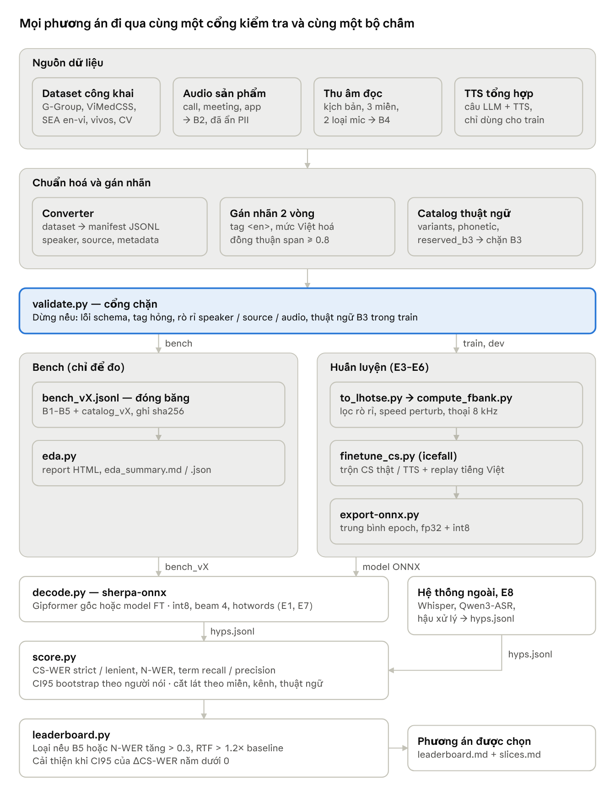

# Kiến trúc hệ thống bench

Nov 14, 2026 · @God Goose

Mọi dữ liệu đi qua một định dạng manifest và một cổng kiểm tra; mọi phương pháp, dù là fine-tune, hotwords, model ngoài hay hậu xử lý, đều chỉ cần xuất ra một file hyps.jsonl để được chấm bằng cùng một bộ chấm.

## Tổng quan



Dữ liệu từ bốn nguồn được chuẩn hoá về cùng một manifest, đi qua validate.py, rồi tách thành hai nhánh không bao giờ trộn lại: bench chỉ dùng để đo, train/dev chỉ dùng để huấn luyện. Hai nhánh gặp lại ở decode.py, và mọi hệ thống (kể cả model ngoài, hậu xử lý) được chấm bởi cùng score.py và leaderboard.py.

## Các thành phần

Mỗi thành phần là một script độc lập, giao tiếp với nhau chỉ qua file; không script nào gọi trực tiếp script khác, nên thay một khâu không ảnh hưởng các khâu còn lại.

| Tầng | Thành phần | Đầu vào | Đầu ra | Trách nhiệm |
| --- | --- | --- | --- | --- |
| Dữ liệu | converters/conv\_\*.py, build\_bench\_v0.py | Dataset gốc | Manifest JSONL | Đổi tên trường, gắn `source` theo quy ước chung, đề xuất tag `<en>` |
| Dữ liệu | Tool gán nhãn (Label Studio hoặc tương đương) | Manifest nháp | Manifest đã duyệt | Hai vòng gán, ghi annotator / reviewer |
| Dữ liệu | configs/catalog.tsv | — | Danh mục thuật ngữ | Chuẩn hoá, hotwords, chặn B3 |
| Cổng | validate.py | Bench, train, dev, catalog | Báo cáo LỖI/CẢNH BÁO, mã thoát | Schema, tag, thời lượng, rò rỉ |
| Bench | eda.py | Bench, catalog, train (tuỳ chọn) | eda\_report.html, eda\_summary.md/.json | Mô tả bench, kiểm tra mục tiêu |
| Huấn luyện | ft/to\_lhotse.py | Manifest train/dev, bench, catalog | CutSet Lhotse chưa có đặc trưng | Lọc rò rỉ, chuẩn text IN HOA, speed perturb, mô phỏng thoại |
| Huấn luyện | ft/compute\_fbank.py | CutSet | CutSet + fbank 80 chiều | Đặc trưng giống recipe icefall |
| Huấn luyện | ft/wrap\_ckpt.py, ft/patch\_finetune.py | model.pt, icefall | init\_ft.pt, zipformer/finetune\_cs.py | Cho icefall nạp checkpoint và dữ liệu của bạn |
| Huấn luyện | icefall finetune\_cs.py, export-onnx.py | CutSet có fbank, init\_ft.pt, bpe.model | encoder/decoder/joiner .onnx + .int8.onnx | Fine-tune, trung bình checkpoint, export |
| Đánh giá | decode.py | Bench, thư mục model ONNX, catalog (hotwords) | hyps.jsonl, decode\_summary.json | Giải mã như production, đo RTF |
| Đánh giá | Hệ thống ngoài, hậu xử lý E8 | Audio hoặc hyps.jsonl | hyps.jsonl | Chỉ cần đúng định dạng `{id, hyp}` |
| Đánh giá | score.py | Bench, catalog, hyps.jsonl | utt\_scores.jsonl, summary.json, slices.md | Chuẩn hoá, căn chỉnh, quy lỗi theo span, CI |
| Quyết định | leaderboard.py | results/\*/utt\_scores.jsonl, decode\_summary.json | leaderboard.md/.csv/.html | So cặp với baseline, áp luật, xếp hạng |

Thư viện dùng chung trong `lib/`: `textnorm.py` (chuẩn hoá, số → chữ, catalog, tách span), `align.py` (căn chỉnh và quy lỗi), `manifest.py` (đọc/ghi JSONL), `svgcharts.py` (biểu đồ của report). eda.py, score.py, validate.py và to\_lhotse.py dùng chung một bộ chuẩn hoá, nên text train và text chấm điểm không thể lệch quy ước.

## Hợp đồng dữ liệu

Sáu định dạng file là toàn bộ giao diện giữa các thành phần; giữ đúng sáu định dạng này thì thay bất kỳ khâu nào cũng được.

| File | Định dạng | Người ghi | Người đọc |
| --- | --- | --- | --- |
| Manifest (bench, train, dev) | JSONL, mỗi dòng một utterance (Spec mục 3) | Converter, tool gán nhãn | validate, eda, to\_lhotse, decode, score |
| catalog.tsv | TSV: term, category, variants, phonetic, reserved\_b3 | Người quản lý catalog | Mọi script qua lib/textnorm.py |
| hyps.jsonl | JSONL `{"id", "hyp"}`; kiểu chữ và dấu câu tuỳ ý | decode.py, hệ thống ngoài, E8 | score.py |
| utt\_scores.jsonl | JSONL theo câu: số token, lỗi S/D/I, lỗi theo span, số thuật ngữ khớp, metadata | score.py | leaderboard.py |
| decode\_summary.json | RTF, số luồng, cấu hình giải mã, file model | decode.py | leaderboard.py (ràng buộc RTF) |
| CutSet Lhotse (`*_cuts.jsonl.gz`) | Định dạng chuẩn của Lhotse | to\_lhotse, compute\_fbank | finetune\_cs.py |

Vì leaderboard.py so cặp theo `id`, mọi hệ thống phải được chấm trên cùng một file bench; score.py báo cảnh báo nếu thiếu hypothesis cho câu nào (câu đó tính như hypothesis rỗng).

## Cấu trúc thư mục

Code (gipbench) tách khỏi dữ liệu và kết quả; mỗi phiên bản bench có thư mục kết quả riêng.

```text
project/
├── gipbench/                  # code (zip đã gửi)
│   ├── validate.py  eda.py  decode.py  score.py  leaderboard.py
│   ├── lib/                   # textnorm, align, manifest, svgcharts
│   ├── ft/                    # to_lhotse, compute_fbank, wrap_ckpt, patch_finetune, run_e3.sh
│   ├── tools/                 # check_gipformer_tokenizer, make_toy_data, selftest.sh
│   └── SCHEMA.md  README.md  requirements.txt
├── configs/catalog_v1.0.tsv
├── data/
│   ├── raw/<dataset>/         # dataset gốc, không sửa
│   ├── bench_v1.0.jsonl  bench_v1.0.sha256
│   ├── train_cs.jsonl  train_vi.jsonl  train_tts.jsonl  dev_cs.jsonl
│   ├── lhotse/  fbank/         # sinh ra khi fine-tune
├── models/gip15/               # Gipformer 1.5: model.pt, bpe.model, tokens.txt, *.onnx
├── exp/<system>/               # checkpoint + onnx của từng lần FT
├── results/bench_v1.0/<system>/ # hyps.jsonl, decode_summary.json, utt_scores.jsonl, summary.json, slices.md
└── reports/                    # eda_v1.0/, leaderboard_v1.0/, báo cáo
```

Đặt `--results results/bench_v1.0` khi chạy decode.py và leaderboard.py để kết quả của hai phiên bản bench không lẫn vào nhau.

## Điểm mở rộng

Thêm dataset, phương pháp hay metric mới đều không cần sửa các khâu khác.

| Muốn thêm | Làm gì | Không cần đổi |
| --- | --- | --- |
| Một dataset mới | Viết converter ra manifest JSONL, `source` theo quy ước chung; chạy validate.py | eda, to\_lhotse, score |
| Một phương pháp FT mới | Tạo manifest train mới, đưa vào `--train-cuts`, chạy run\_e3.sh với SYSTEM/EXP mới | decode, score, leaderboard |
| Một model ngoài (Whisper, Qwen3-ASR, API) | Xuất `results/<tên>/hyps.jsonl` | Mọi thứ |
| Một bước hậu xử lý (E8) | Đọc hyps.jsonl của hệ thống gốc, ghi hyps.jsonl mới dưới tên `e8_...` | Mọi thứ |
| Một cách giải mã khác (LM, LODR) | Giải mã bằng icefall PyTorch rồi xuất hyps.jsonl; RTF ghi tay vào decode\_summary.json | score, leaderboard |
| Một metric mới | Thêm trường vào `score_utt` / `agg` trong score.py và vào `METRICS` trong leaderboard.py | Manifest, decode |
| Một luật chọn khác | Đổi ngưỡng bằng tham số leaderboard.py; luật mới thì sửa phần `reasons` | Không cần giải mã lại |
