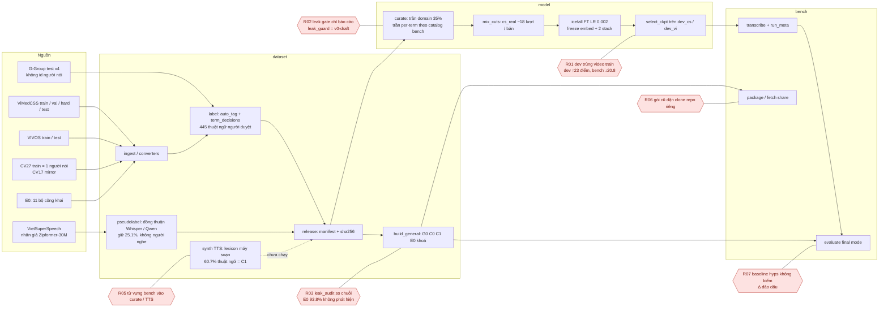

# Audit nghiên cứu và kỹ thuật toàn diện: Gipbench (17/11/2026)

Phạm vi: nhánh `main` @ `2d3b503` (PR #1 `feat/general-asr` đã merge; `refactor/pipelines` cũng đã merge, `git branch --merged main` gồm cả ba nhánh). Working tree có 5 file **chưa commit** (gói `code/` tự chứa cho bản share, xoá nhắc tới VietSuperSpeech trong docstring). Audit này **không sửa** file nào của dự án, không đụng manifest / nhãn / hash / checkpoint đã khoá, không chạy GPU, không dừng job `evalsets` đang tải (PID 2354 trong WSL).

Tài liệu kèm theo:
- [implementation_plan.md](implementation_plan.md): đặc tả sửa, test và thứ tự làm.
- [contamination_matrix.csv](contamination_matrix.csv): ma trận nhiễm bẩn đã phân loại. [contamination_matrix_raw.csv](contamination_matrix_raw.csv): output thô của script.
- [scripts/](scripts/): 4 script chỉ đọc đã dùng cho audit (`a1_bench.py` manifest và hash, `a2_leak.py` ma trận rò rỉ, `a3_norm.py` độ nhạy metric, `a4_ci.py` độ nhạy CI). Chạy từ gốc repo: `PYTHONIOENCODING=utf-8 python reports/audits/scripts/a2_leak.py`. `a1` cần `pyyaml` nên chạy trong `~/.venvs/gipbench`.
- Audit trước: [../benchmark_audit_v1.md](../benchmark_audit_v1.md) (16/11; một số số liệu được sửa ở đây).

**Mức bằng chứng** dùng trong báo cáo:
- **VERIFIED**: tôi chạy lại trên dữ liệu / code hiện có, có lệnh tái lập.
- **DOCUMENTED**: chỉ có trong tài liệu, model card hoặc log; không chạy lại được.
- **UNVERIFIED**: chưa có dữ liệu để kiểm. Kèm cách kiểm.
- **HYPOTHESIS**: giải thích hợp lý, chưa được thí nghiệm chứng minh.

---

## A. Tóm tắt điều hành

**Gipbench làm tốt:**
- **Hạ tầng chấm điểm có kỷ luật hiếm thấy ở dự án cỡ này.** Bốn benchmark được khoá bằng `manifest_sha256`. Tôi tính lại và cả bốn đều khớp (VERIFIED). Có hồ sơ chuẩn hoá có phiên bản, `--mode final` từ chối hyps thiếu / thừa id, khai báo `inference_mode`, và chặn hotwords lấy từ test.
- **Bản share tái lập được từ môi trường sạch.** Tôi cài `code/` của gói v1.1.2 vào một venv mới (Python 3.13, chỉ `numpy` + `pyyaml`), không có repo. Kết quả ra đúng từng số đã công bố (VIVOS 6.68, macro G0 24.99, C0 CS-WER 84.54, C1 82.39) (VERIFIED).
- Dự án đã tự nêu nhiều giới hạn quan trọng: trùng video ViMedCSS, câu đọc VIVOS lặp lại, G-Group cùng tổ chức với Gipformer, hotwords E1 là oracle.

**Chưa xong:**
- Z0 chưa có dữ liệu.
- E0 chưa có kết quả của model nào, và 81.5% số câu E0 chưa có `audio_sha256` / `duration`.
- VieGem + LM chưa chạy. Whisper / Qwen chưa chạy trên bench.
- Không có dev độc lập. Không có danh sách thuật ngữ FT-unseen được đăng ký trước.

**Không đáng tin về mặt khoa học:**
1. **Chọn checkpoint trên dev hiện tại là vô nghĩa với mục tiêu tổng quát.** E3 v1 trên `dev_cs` giảm CS-WER 97.20 → 74.11 (tốt lên 23 điểm). Trên bench B1+B2 thì CS-WER tăng 71.66 → 92.44 (xấu đi 20.8 điểm). Lý do: 91.2% câu ViMedCSS trong `dev_cs` đến từ video có trong train, và `dev_vi` là giọng đọc VIVOS (VERIFIED). Đây là nguyên nhân thất bại **có bằng chứng mạnh nhất**.
2. **Cổng chống rò rỉ không đóng khi lỗi (fail-open), và có đường vượt im lặng:**
   - Stage 0 của `model.run` chỉ ghi báo cáo, không dừng train.
   - `leak_guard` của mọi experiment chỉ trỏ tới `bench/v0-draft`, nên **không** bảo vệ G0 / C1 / E0 v1.
   - `leak_audit` so trùng speaker / source bằng chuỗi chính xác. Với E0 `vimedcss_test`, nó báo **0 trùng video**, trong khi thực tế **1 514 / 1 614 câu (93.8%)** đến từ video có trong ViMedCSS train.
   - Khi không đọc được audio (1 614 / 1 614 câu), nó chỉ đếm vào `stats` và không in ra báo cáo.
3. **C0 (ViMedCSS hard) không đo được tổng quát** cho bất kỳ model nào đã train trên ViMedCSS train: **388 / 658 câu (59.0%)** chung video với train (tài liệu ghi 308 / 201, nhưng không tái lập được từ manifest nào hiện có).
4. **CS-WER phụ thuộc mạnh vào quy ước gắn nhãn và cách quy lỗi chèn**:
   - Đổi bản tag (`text_tagged` ↔ `text_tagged_orig`) làm CS-WER C0 đổi khoảng 6 điểm **theo hai chiều ngược nhau** cho hai model, khiến khoảng cách hai model giảm từ 22.6 xuống 10.3 điểm.
   - Quy lỗi chèn ở ranh giới Việt → Anh về tiếng Việt làm CS-WER C1 của Gipformer giảm 70.25 → 59.01.
   - `summary.json` không ghi đã chấm theo `label_field` nào.
5. **So cặp có thể đảo dấu mà không báo lỗi.** Tôi cắt baseline hyps còn 630 / 1 260 dòng. `--mode final` vẫn thoát mã 0, và Δ CS-WER đổi từ +12.13 sang −2.57 (VERIFIED).

**Đang chặn kết quả FT đáng tin:**
- Không có dev độc lập theo người nói / video, gần với phân phối mục tiêu (lời nói tự nhiên nhiều domain).
- Không có cổng rò rỉ đóng khi lỗi bao phủ mọi bench v1.
- Dữ liệu CS train hầu như không phủ domain mục tiêu: trong train E3 v1 chỉ có 54 câu CS tech, 29 edu, 4 pubadmin, 0 finance, so với 1 567 câu y khoa.
- Kế hoạch TTS (E3 v2) lấy thuật ngữ từ catalog có span của bench: **65 / 107 thuật ngữ lexicon (60.7%) là thuật ngữ của C1**.

**Bench đã share được chưa?**
- **Chấm điểm: gần được.** Gói v1.1.2 chạy độc lập và ra đúng số.
- **Chưa nên share bản cũ.** Gói v1.0.1, v1.1 và v1.1.1 đều hướng dẫn `git clone` repo riêng tư. Ai được cấp quyền repo sẽ xem được toàn bộ lịch sử recipe train, experiment YAML và báo cáo nội bộ.
- Bản v1.1.2 (build từ code chưa commit) đã bỏ lệnh clone, nhưng còn rò ít thông tin nội bộ (mục G.1), README ghi sai số câu không trùng (37 261, đúng là 36 237), và cần rà license ViMD (ND), các bản mirror và các bộ gated.

**Thiếu nhất về nghiên cứu:**
1. Dev và Z0 độc lập theo người nói / video / domain.
2. Nhãn **cách phát âm** cho span tiếng Anh. Hiện không thể trả lời câu hỏi cốt lõi "từ Anh đọc giọng Việt".
3. Danh sách thuật ngữ FT-unseen chốt trước khi dựng dữ liệu.
4. Đo chất lượng nhãn giả bằng người nghe trên một mẫu.
5. Một thí nghiệm "không làm hại" (replay tiếng Việt, LR thấp, không CS) để tách nguyên nhân quên.

---

## 1. Tái dựng trạng thái thực tế

### 1.1 Sơ đồ pipeline và rủi ro chính



### 1.2 Từng giai đoạn: đã cài / đã chạy / đã kiểm khoa học

| Giai đoạn | Đã cài | Đã chạy thật | Kiểm khoa học | Giả định ngầm | Hỏng im lặng có thể | Có thể làm sai kết luận |
| --- | --- | --- | --- | --- | --- | --- |
| Raw → ingest | converter G-Group, ViMedCSS, VIVOS, CV, consensus, `evalsets` (11 bộ) | có | một phần: số câu khớp số công bố | id người nói / video theo định dạng của từng nguồn | E0 `vimedcss_test`: speaker = URL, train = `yt_ID` ([evalsets.py](../../src/gipbench/dataset/ingest/evalsets.py)) | che trùng video (R03) |
| Làm sạch / gắn nhãn | `core.tagging`, `term_decisions` (445 thuật ngữ người duyệt) | có | P/R auto_tag 0.977, nhưng đo trên **vàng do Claude gắn**, phiếu kiểm 30 câu `t02_spotcheck.csv` 0/30 đã điền ([STATUS.md:86](../../docs/STATUS.md#L86)) | `<en>` = "từ Anh", không phân biệt cách đọc | quy ước tag đổi CS-WER ±6 điểm (mục 2.2) | so model trên C0 |
| Nhãn giả | lọc đồng thuận (Qwen3-0.6B / Whisper-large-v3, `min_agree 1`), WER phần Việt ≤ 0.15 | có (giữ 25.1%) | **không**: không có lượt người nghe (`vss_relabel_listen.csv` bị bỏ theo yêu cầu, [STATUS.md:94](../../docs/STATUS.md#L94)) | đồng thuận ASR ≈ đúng | lỗi tương quan giữa các ASR; chọn lệch về từ Anh dễ | dữ liệu CS train lệch "Anh dễ" |
| TTS | `dataset/synth` (make_text, backends, verify) | chỉ test giả | không | lexicon "BẢN NHÁP do máy soạn (chưa ai nghe lại)" ([tts_lexicon.tsv:1](../../configs/dataset/synth/tts_lexicon.tsv#L1)) | thuật ngữ lấy từ `catalog_v0_draft` | ghi nhớ thuật ngữ C1 (R05) |
| Release | `register`, sha256, `releases.yaml` | có (10 release) | một phần | metadata đúng | `confusable_train` ghi `label_source: pseudo:Zipformer` nhưng 590 / 590 là audio VIVOS train trùng `vivos_train` | trùng mẫu trong train |
| Bench v1 | `build_general`, khoá sha256 | có | hash khớp (VERIFIED). E0: 26 252 / 32 203 câu không có `audio_sha256` | lời thoại của bên phát hành là đúng | audio E0 đổi (soxr) mà hash manifest vẫn khớp | E0 |
| Chia train / dev | `prep_e3_v1`, `make_dev_split` | có | **không đạt**: `dev_cs` 91.2% chung video với train; `dev_vi` = 4 người nói đọc VIVOS | dev đại diện cho test | – | **chọn checkpoint sai (R01)** |
| FT | `model.run` stage 0–6, icefall, watchdog | A4, E3 v1 (dừng ở 4 / 6 epoch ảo), E3 v1b (chỉ curate) | không | một seed, phần cứng ổn định | GPU lỗi driver 3 lần, 10 lần resume cùng batch 15495 (`data/e3_v1/segments.log`) | so biến thể |
| Chọn checkpoint | `select_ckpt` (hiện chọn theo `term_acc_macro`) | có | không | – | luật bị đổi sau khi E3 v1 chạy (bảng cũ chọn theo CS-WER) | không tái lập lịch sử |
| Suy luận | adapter Gipformer (lô 1) / VieGem / Whisper / Qwen | Gipformer, VieGem | lệch model card ≤ 0.8 điểm (VieGem VIVOS 6.68 vs 6.63; Gipformer finance 23.11 vs 22.34) | – | kết quả phụ thuộc thành phần lô | so hệ |
| Chấm | `evaluate` (final mode), bootstrap cụm / cặp | có | 30 + 15 + 13 ca test | – | baseline hyps không được kiểm (R07); `label_field` không được ghi | so cặp |
| Báo cáo / share | `package`, `fetch`, datasheet | có | chấm lại từ môi trường sạch: khớp | – | README cũ dặn clone repo; số câu không trùng sai | share |

### 1.3 Kiểm số liệu và phiên bản (VERIFIED trừ khi ghi khác)

| Khẳng định trong prompt / tài liệu | Thực tế |
| --- | --- |
| G0 4 400 câu | **đúng**, `general_v1` v1.0, hash `e908c75a…` khớp. Gồm VIVOS 760, CV27 1 593, G-Group 508 / 495 / 529 / 515 |
| C0 658 câu | **đúng**, `code_switch_v1` v1.0, hash khớp; 404 video; mọi `duration` là số nguyên (metadata, không đo) |
| C1 1 260 câu | **đúng**, `cs_ggroup_v1` v1.0; 100% cùng audio với G0 |
| E0 32 203 câu | **đúng**, `external_v1` v1.0 (bench v1.1), hash `f074d27f…` khớp. 26 252 câu (81.5%: LSVSC, Bud500, GigaSpeech2, ViMD, ViMedCSS test, Speech-MASSIVE dev / test) **không có `audio_sha256` và `duration`** |
| Z0 planned | **đúng**, `zero_shot_v1.yaml`: `manifest: null`, `status: planned` |
| PR #1 đã merge | **đúng**: `2d3b503 Merge pull request #1`; bench v1.1 = G0 + C0 + C1 + E0 |
| ViMD 2 026 câu (câu hỏi bỏ ngỏ phiên trước) | manifest khoá có 2 026 dòng, 1 344 người nói. Datasheet ghi API HF báo 1 550 là sai (DOCUMENTED) |
| CV17 trùng CV27 (câu hỏi bỏ ngỏ) | **1 024 / 1 274 clip CV17 test nằm trong CV27 test** (trùng sha256). 163 clip còn lại ở CV27 dev, 1 clip đã bị CV27 xếp `invalidated`. 0 clip nằm trong pool `cv_train` |
| "Số câu không trùng 37 261" (README gói v1.1.x) | **sai**: 4 400 + 658 + 32 203 − 1 024 (CV17 ∩ CV27) = **36 237** (C1 đã là tập con của G0) |
| Test suite | 15 / 16 nhóm ĐẠT trên working tree. **`test_boundaries` HỎNG** vì code chưa commit ở `package.py:66,68` (chuỗi `gipbench.bench` / `gipbench.model` trong `CODE_ROOTS` / `CODE_FORBIDDEN`) |

---

## B. Ma trận trạng thái triển khai

| Thành phần | Đã cài | Đã test | Đã kiểm khoa học | Bằng chứng | Việc còn thiếu |
| --- | --- | --- | --- | --- | --- |
| Registry + khoá sha256 | Có | Có (12 ca) | Có (hash tái lập 4 / 4) | `a1_bench.py` | E0: khoá audio từng câu |
| Hồ sơ chuẩn hoá | Có | Có (15 ví dụ) | Một phần | `normprofiles.py` | hash hồ sơ chỉ băm spec, **không băm code** ([normprofiles.py:102](../../src/gipbench/core/normprofiles.py#L102)); E0 có 1 603 câu chứa chữ số chưa đo ảnh hưởng |
| WER / CER | Có | Có | Có | lệch model card ≤ 0.8 điểm (VieGem VIVOS 6.68 vs 6.63; Gipformer finance 23.11 vs 22.34) | – |
| CS-WER / N-WER | Có | Có (30 ca) | **Chưa**: nhạy với quy lỗi chèn và quy ước tag | mục 2.2 | báo S / D / I, lỗi ở ranh giới, nhiều quy ước |
| Term recall / precision | Có | Có | Một phần | `scoring.py` | precision / chèn sai từ Anh chỉ tính khi có catalog (C1 không có catalog) |
| Bootstrap cụm / cặp | Có | Có | Một phần | `a4_ci.py` | FLEURS lặp câu; macro không có CI; baseline hyps không được kiểm |
| Kiểm nhiễm bẩn | Có | Có (13 ca) | **Không** (vượt được) | E0 `vimedcss_test` 93.8% không phát hiện | chuẩn hoá id nguồn, đóng khi lỗi, kiểm audio thiếu |
| Leak gate trong train | Có (chỉ báo cáo) | Không | Không | [run.py:9-10](../../src/gipbench/model/run.py#L9-L10), [e3_v1.yaml](../../configs/model/experiments/e3_v1.yaml) `leak_guard: bench/v0-draft` | dừng train; bao phủ mọi bench khoá |
| Lọc nhãn giả | Có | Có (dữ liệu giả) | **Không** | không có lượt người nghe | mẫu người nghe phân tầng |
| TTS | Có | Có (dữ liệu giả) | Không | lexicon máy soạn | gate thuật ngữ bench, người bản ngữ duyệt |
| Curate / mix | Có | Golden test | Không | E3 v1 | dedupe audio; không dùng catalog của bench |
| FT Gipformer | Có | Có (pipeline) | **Không** (2 lần thất bại) | A4, E3 v1 | dev độc lập, sweep LR, nhiều seed |
| Chọn checkpoint | Có | Golden | **Không** (dev không đại diện) | dev −23 / bench +20.8 | dev mới |
| FT VieGem | Không | – | – | upstream không có code train | code train CTC, GPU ≥ 24 GB (ước tính) |
| VieGem + KenLM | Có adapter | Không | – | thiếu trình biên dịch C++ trong WSL | `apt install build-essential` |
| Whisper / Qwen trên bench | Có adapter | Có (giả) | – | chưa chạy | chạy làm mốc tham chiếu thứ ba |
| Z0 | Chỉ giao thức | – | – | `zero_shot_v1.yaml` | thu dữ liệu |
| Gói share | Có | Có | Chấm lại từ môi trường sạch: khớp | mục G | rà license, bỏ thông tin nội bộ, ghi code hash |
| `fetch` | Có | Có | G0 / C0 / C1 khớp sha256 trên máy dự án (DOCUMENTED). Máy khác: UNVERIFIED | progress §8 | chạy thử trên máy sạch |

---

## 2. Audit chất lượng benchmark

### 2.1 Tính hợp lệ khoa học theo từng track

| Track | Điểm mạnh | Vấn đề (bằng chứng) | Dùng được cho kết luận nào |
| --- | --- | --- | --- |
| **G0** | split test chính thức, lời thoại của bên phát hành, hash khoá | 1) Lệch về giọng đọc: VIVOS + CV = 2.5 / 4.47 h. 2) VIVOS: 194 / 760 câu test trùng lời với VIVOS train (188 câu ≥ 4 token), 0 người nói chung. Model FT trên VIVOS train được lợi thế văn bản. 3) G-Group: speaker = source = id câu ở 2 047 / 2 047 câu. 4) G-Group cùng tổ chức với Gipformer (known_possible). 5) CV27: 7 câu trùng lời trong test | Gipformer vs VieGem trên tiếng Việt phổ thông: kết luận "Gipformer tốt hơn" vững (CI không chứa 0 dù đổi đơn vị bootstrap, mục 2.3), nhưng **không** chứng minh tổng quát độc lập cho Gipformer |
| **C0** | nhãn người; catalog khoá | 1) **388 / 658 câu (59.0%), 248 / 404 video chung với ViMedCSS train**. 2) 71 câu chung video với `dev_cs`. 3) `text_tagged` vs `text_tagged_orig` lệch ở 339 câu; CS-WER đổi ±6 điểm theo chiều ngược nhau. 4) Chỉ y khoa, video giảng | Chỉ in-domain y khoa. **Không** dùng cho "tổng quát sang người nói mới" với VieGem hay bất kỳ model nào FT trên ViMedCSS train. Muốn dùng: tách lát "video không có trong train" (270 câu, 156 video) và báo riêng |
| **C1** | lời nói tự nhiên, 4 domain, tag theo 445 quyết định người duyệt | 1) Tập con của G0: không phải bằng chứng thứ hai. 2) Cùng tổ chức với Gipformer. 3) Không có id người nói / video. 4) Không catalog: mọi biến thể chính tả tiếng Anh tính là lỗi. 5) Không có nhãn cách đọc | Code-switching tự nhiên, nhưng chỉ một họ nguồn |
| **E0** | 11 bộ, phạm vi rộng | 1) 73.8% số câu (23 759) thuộc bộ có trong dữ liệu train VieGem (lọc theo câu, không theo người nói / video). 2) ViMedCSS test: 93.8% câu chung video với ViMedCSS train; 113 video chung với C0. 3) 81.5% số câu không có hash audio. 4) FLEURS: 857 câu nhưng chỉ 347 câu gốc (đọc lặp 2–3 lần), bootstrap theo câu. 5) CV17 ≈ CV27 (1 024 clip). 6) Chưa có kết quả nào | Chỉ để so với số model card VieGem. **Không** dùng cho tổng quát của VieGem. VietMed và Speech-MASSIVE là hai bộ duy nhất không có trong danh sách train của VieGem (vẫn không phải bằng chứng sạch) |
| **Z0** | giao thức tốt (consent, chép lời 2 lượt, chốt reserved_terms trước) | chưa có dữ liệu | – |

**Câu hỏi nghiên cứu nào chưa trả lời được (hiện tại):**

| Câu hỏi | Trả lời được? | Vì sao |
| --- | --- | --- |
| 1. Nhận dạng tiếng Việt phổ thông | **Một phần** | G0 lệch giọng đọc; nguồn tự nhiên duy nhất là G-Group (cùng tổ chức với Gipformer) |
| 2. Từ Anh đọc giọng Việt | **Không** | không manifest nào có nhãn cách đọc. Trường `viet_level` = "chưa gán" ở mọi span; `language_spans` chưa điền |
| 3. Code-switching tự nhiên | **Một phần** | C1, chỉ một họ nguồn, 1 260 câu |
| 4. Tên riêng, brand, viết tắt | **Một phần** | C1 không có `category` cho span; không tách lát được |
| 5. Thuật ngữ Anh chưa thấy khi FT | **Không** | chưa có reserved_terms đăng ký trước. Hàm `freq_slices` trong `core.scoring` có sẵn, nhưng bench v1 chưa gắn `train_freq_*` |
| 6. Tổng quát người nói / domain | **Không** cho C0 / E0-ViMedCSS (trùng video); **yếu** cho G-Group (không id) | |
| 7. Giữ tiếng Việt sau FT | **Một phần** | có G0 và 787 câu G-Group thuần Việt làm đối chứng, nhưng VIVOS trùng lời và chưa có dev thuần Việt nói tự nhiên |

### 2.2 Audit metric

**Căn chỉnh và quy lỗi** ([align.py:38-73](../../src/gipbench/core/align.py#L38-L73)):
- Levenshtein theo token, không biết span. Khi bằng điểm, ưu tiên C/S trước, rồi D, rồi I.
- Lỗi chèn quy về span Anh nếu token ref bên trái là Anh. Nếu không, **xét tiếp token bên phải**.
- Hệ quả: lỗi chèn nằm giữa một token Việt (trái) và một token Anh (phải) luôn tính cho tiếng Anh, kể cả khi đó là một âm tiết Việt bị chèn thừa.

Đo trên C1 (VERIFIED, `a3_norm.py`):

| Hệ | CS-WER báo cáo | Nếu lỗi chèn "chỉ kề phải" tính cho tiếng Việt | Chỉ S + D (không tính chèn) | Chèn "chỉ kề phải" / lỗi EN |
| --- | --- | --- | --- | --- |
| Gipformer 1.5 | 70.25 | 59.01 | 56.37 | 328 / 2 050 (16%) |
| VieGem greedy | 82.39 | 73.27 | 71.56 | 266 / 2 404 (11%) |

Thứ hạng không đổi, nhưng **mức tuyệt đối đổi ~10 điểm** chỉ do quy ước. Mọi so sánh với số của bên khác (định nghĩa khác) là không hợp lệ.

**Quy ước tag** (C0, VERIFIED, chạy `evaluate --label-field` trong venv sạch):

| Hệ | `text_tagged` (quy ước gipbench) | `text_tagged_orig` (tag ViMedCSS) |
| --- | --- | --- |
| Gipformer | 107.12 | 100.62 |
| VieGem | 84.54 | 90.28 |
| Khoảng cách | 22.58 | 10.34 |

Đổi quy ước nào từ là "Anh" (vd `vitamin`, `gen`, từ mượn) làm khoảng cách giữa hai model giảm một nửa. Lý do: model train trên ViMedCSS (VieGem) học đúng quy ước viết của ViMedCSS. `summary.json` **không ghi** `label_field` ([evaluate.py:269-277](../../src/gipbench/bench/evaluate.py#L269-L277)), nên hai kết quả final dùng hai quy ước khác nhau không phân biệt được.

**Chuẩn hoá số**:
- `read_int(24)` = "hai mươi bốn"; người nói thường đọc "hai mươi tư". Tương tự `nghìn` / `ngàn`, `linh` / `lẻ` ([textnorm.py:21-62](../../src/gipbench/core/textnorm.py#L21-L62)).
- G0 / C1: reference viết bằng chữ (chỉ 6 / 4 400 câu có chữ số), nên ảnh hưởng ≤ 0.26 điểm WER (VERIFIED: gộp `tư`→`bốn`, `ngàn`→`nghìn`, `lẻ`→`linh` cho G-Group pubadmin 15.28 → 15.20).
- **E0: 1 603 câu có chữ số** (LSVSC 1 178, ViMedCSS test 221, FLEURS 171). Gipformer và VieGem đều xuất số bằng chữ (0 hyp có chữ số). Một model xuất chữ số (Whisper) sẽ bị chấm khác. **UNVERIFIED** cho tới khi có hyps E0.
- Đề xuất: bảng biến thể đọc số có phiên bản (`tư` ≡ `bốn` ở hàng đơn vị sau `mươi`; `ngàn` ≡ `nghìn`; `lẻ` ≡ `linh`) làm hồ sơ mới `gipbench_strict_v2`, **không sửa** v1.

**Mẫu số và gộp**:
- `wer` là tỉ lệ của tổng (micro) trong từng bộ. Macro theo bộ không có CI.
- Báo cáo tiến độ §10 dùng **micro G0 15.21** làm số chính, trái với giao thức §5 ("không báo micro-WER gộp mọi audio làm số chính"); macro là 16.93.

**Bootstrap** ([evalstats.py:77-130](../../src/gipbench/core/evalstats.py#L77-L130)): đúng về cách lấy mẫu cụm và cặp. Có ba hạn chế:
1. Thiếu `unit_key` thì lặng lẽ rơi về id câu.
2. Phân vị dùng `v[int(0.975·n) − 1]`, lệch nhẹ (chấp nhận được).
3. `paired_bootstrap` không kiểm hai hệ có đủ hyps không.

**Kiểm hyps của baseline**: `evaluate` chỉ chạy `check_hyps` trên hyps chính. Baseline nạp bằng `load_hyps`, câu thiếu tính là rỗng ([evaluate.py:290-306](../../src/gipbench/bench/evaluate.py#L290-L306)). Thí nghiệm đã chạy: cắt baseline còn 630 / 1 260 dòng, kết quả thoát mã 0, Δ CS-WER từ +12.13 thành −2.57 [−5.39, +0.17], không có cảnh báo (VERIFIED).

**Metric cần thêm** (chỉ thêm metric gắn với một câu hỏi cụ thể):

| Metric | Câu hỏi nó trả lời | Đặc tả |
| --- | --- | --- |
| CS-WER tách S / D / I + `boundary_ins_rate` | Lỗi ở ranh giới chuyển ngữ hay ở chính từ Anh? | Đếm lỗi chèn có token ref trái thuộc ngôn ngữ khác token ref phải; báo cùng CS-WER hiện tại; không đổi số cũ |
| CS-WER không quy lỗi chèn (`cs_wer_sd`) | Model có nhận ra đúng từ Anh không, bỏ qua lỗi "chèn âm tiết Việt hoá" | (S_en + D_en) / N_en |
| `vi_only_wer` | FT có làm hỏng tiếng Việt thuần không? | WER trên câu không có `<en>`. Trong G0 có sẵn 787 câu G-Group thuần Việt (Gipformer 18.50, VieGem 31.78) |
| `en_hallucination_rate` | FT có làm model chèn từ Anh vào câu Việt không? | số token hyp toàn ký tự Latin không dấu, không thuộc ref, trên 100 câu thuần Việt; không cần catalog |
| `term_recall` theo lát `seen_real / seen_synth / ft_unseen` | Cải thiện có đến từ ghi nhớ thuật ngữ không? | `core.scoring.freq_slices` có sẵn; cần đếm tần suất từ text FT **đăng ký trước** |
| `accented_en_acc` theo `pron_style` | Câu hỏi cốt lõi: từ Anh đọc giọng Việt | cần nhãn nghe `pron_style ∈ {native_like, vi_accented, vi_loan_reading}` trên span; chưa có dữ liệu |
| CI cho macro + hiệu chỉnh Holm cho nhiều lát | Tránh "có ý nghĩa" do so quá nhiều lát | bootstrap phân tầng theo bộ |

Không đề xuất MER kiểu Trung-Anh. Tiếng Việt viết cách theo âm tiết nên `space_token_v1` đã là tỉ lệ lỗi theo âm tiết; thêm MER chỉ là đổi tên. PIER (point-of-interest error rate, đề xuất gần đây cho code-switching) gần với `cs_wer_sd` + căn chỉnh cục bộ; cần đọc lại bài gốc trước khi dùng tên đó.

### 2.3 Độ nhạy CI theo đơn vị bootstrap (VERIFIED, `a4_ci.py`)

Ánh xạ G-Group sang `speaker_cluster` ước lượng (từ v0-draft, 199 cụm cho C1; 1 655 / 2 047 câu G0 có cụm):

| Bench | Đơn vị | Số đơn vị | Δ VieGem − Gipformer | CI95 | Độ rộng |
| --- | --- | --- | --- | --- | --- |
| C1 CS-WER | câu | 1 260 | +12.13 | [9.24, 14.91] | 5.67 |
| C1 CS-WER | speaker_cluster | 199 | +12.13 | [9.79, 14.15] | 4.36 |
| G-Group WER | câu | 2 047 | +11.06 | [10.32, 11.78] | 1.46 |
| G-Group WER | speaker_cluster | 625 | +11.06 | [10.19, 11.90] | 1.72 |

Kết luận: với hiệu lớn như hiện tại, đơn vị bootstrap **không** làm đổi kết luận. Rủi ro CI hẹp giả chỉ quan trọng khi so các bản FT có Δ nhỏ (1–2 điểm). Đây là chỗ mà một dev có id người nói / video là bắt buộc.

---

## C. Sổ rủi ro

P0 = làm sai kết quả, lộ thông tin không chấp nhận được, hoặc chặn nghiên cứu tin cậy. P1 = rủi ro lớn về chất lượng / phương pháp. P2 = cải thiện quan trọng. P3 = tối ưu tuỳ chọn.

| ID | Vấn đề | Mức | Bằng chứng | Tác động khoa học | Đề xuất sửa | Ưu tiên |
| --- | --- | --- | --- | --- | --- | --- |
| R01 | Dev không độc lập, không đại diện; chọn checkpoint ngược chiều bench | Nghiêm trọng | `dev_cs`: 546 / 599 câu ViMedCSS (91.2%) từ video train, 87% y khoa, 91 câu vss_cs nhãn giả. `dev_vi`: 4 người nói đọc VIVOS. E3 v1: dev CS-WER −23.09, bench B1+B2 +20.78; dev VI +0.29, bench B5 +3.29, pubadmin +10.23 | mọi checkpoint chọn trên dev này đều không có giá trị tổng quát | dev mới: tách theo video / người nói, nói tự nhiên, nhiều domain, thuần Việt + CS (mục D.4, H Phase 1) | **P0** |
| R02 | Leak gate trong train không đóng khi lỗi và không bao phủ bench v1 | Nghiêm trọng | [run.py:9-10](../../src/gipbench/model/run.py#L9-L10) "chỉ báo cáo như `validate || true` cũ"; mọi experiment `leak_guard: bench/v0-draft`; `LeakGuard` không kiểm hash audio | train có thể chứa test G0 v1 / C1 / E0 mà không ai biết | stage 0 gọi `decontam.audit` với **mọi** bench `locked` trong registry, dừng nếu có critical chưa được miễn | **P0** |
| R03 | `leak_audit` bị vượt im lặng | Nghiêm trọng | so chuỗi chính xác ([decontam.py:40-54](../../src/gipbench/core/decontam.py#L40-L54)): E0 `vimedcss_test` speaker = `https://www.youtube.com/watch?v=…`, train = `yt_…`, nên báo 0 trong khi thực tế 1 514 / 1 614 câu (93.8%) trùng. `audio_unreadable` = 1 614 chỉ nằm trong `stats`, không in, không làm fail | "0 critical" không có nghĩa là sạch | chuẩn hoá khoá nguồn (YouTube ID, tên file gốc, client_id CV); `--require-audio-sha` mặc định; in và fail khi thiếu | **P0** |
| R04 | C0 và E0 ViMedCSS không dùng được cho tổng quát | Nghiêm trọng | 388 / 658 (59.0%); E0 1 514 / 1 614 (93.8%); C0 ∩ E0 113 video | kết luận "VieGem tốt hơn trên CS y khoa" là in-domain | báo lát `video_unseen` riêng; ghi vào datasheet bản mới | **P0** (về diễn giải) |
| R05 | Từ vựng của bench lọt vào chọn dữ liệu, chọn checkpoint và TTS | Nghiêm trọng | `catalog: catalog/v0-draft` (1 618 span bench) dùng cho `--max-per-term`, `select_ckpt`, hotwords E1 / E7; `make_text --catalog catalog_v0_draft`; lexicon 65 / 107 thuật ngữ thuộc C1 | cải thiện trên C1 / B1 sẽ là ghi nhớ | cấm catalog `from_bench: true` trong curate / synth / select (fail); dựng catalog từ train | **P0** (chặn E3 v2) |
| R06 | Gói share cũ dặn clone repo riêng tư | Nghiêm trọng (bảo mật) | README v1.0.1, v1.1, v1.1.1 có `git clone -b feat/general-asr https://github.com/vbwork2/Gipbench.git` | ai được cấp quyền sẽ thấy recipe, experiment YAML, `docs/history/PROMPT_OPUS_IMPLEMENT.md`, báo cáo | thu hồi / thay gói; không cấp quyền repo; phát hành repo kit riêng với lịch sử sạch | **P0** (nếu gói đã gửi; chưa xác minh) |
| R07 | So cặp không kiểm baseline | Lớn | cắt baseline: Δ +12.13 → −2.57, exit 0 | kết luận "FT tốt hơn gốc" có thể sai dấu | `check_hyps` cho baseline; final mode fail | **P1** |
| R08 | CS-WER nhạy quy ước | Lớn | ±6 điểm (tag), −11 điểm (quy lỗi chèn) | so với bên ngoài không hợp lệ; so trong nội bộ phải cố định quy ước | ghi `label_field` + định nghĩa vào summary; báo S/D/I + `cs_wer_sd` | **P1** |
| R09 | Không có nhãn cách đọc | Lớn | `viet_level: chưa gán` mọi span; `language_spans` trống | mục tiêu chính của dự án không đo được | gắn nhãn nghe trên dev / Z0 (mục 6) | **P1** |
| R10 | Dữ liệu CS train không phủ domain mục tiêu | Lớn | train E3 v1: câu CS medical 1 567, other 1 264, business 81, tech 54, ent 51, daily 37, edu 29, pubadmin 4, finance 0 | FT không thể cải thiện C1 / B1; dễ làm hại | thu / chọn CS tự nhiên ngoài y khoa; đo trước khi train | **P1** |
| R11 | Chất lượng nhãn giả chưa đo | Lớn | không có lượt người nghe; giữ 25.1% theo đồng thuận; P/R auto_tag đo trên vàng do Claude gắn | nhiễu nhãn và chọn lệch về "Anh dễ" | mẫu nghe phân tầng 200–300 câu (mục E.3) | **P1** |
| R12 | Khoá E0 chưa trọn | Lớn | 26 252 / 32 203 câu không có `audio_sha256` / `duration` | audio sau `fetch` có thể lệch mà hash manifest vẫn khớp | `external_v1.1` có hash audio từng câu sau khi tải đủ | **P1** |
| R13 | Hash hồ sơ chuẩn hoá không gắn với code; gói không ghi commit | Lớn | `Profile.sha256()` băm spec; `git_commit: None` khi chạy từ gói | scorer đổi mà số "khoá" vẫn trông như cũ | `scorer_code_sha256` = sha256 các file nguồn liên quan | **P1** |
| R14 | Replay thiếu đa dạng; dev VI là giọng đọc | Lớn | CV27 train = **1 người nói** (1 848 clip); VIVOS train 42 người nói đọc; `dev_vi` 4 người nói | quên tiếng Việt tự nhiên không lộ ra trên dev | replay từ nguồn tự nhiên nhãn người; dev VI tự nhiên | **P1** |
| R15 | Trùng mẫu trong train, sai metadata | Trung bình | 590 / 590 câu confusable = audio `vivos_train`; `releases.yaml` ghi `label_source: pseudo:Zipformer` | lấy mẫu thừa; nhật ký nguồn sai | dedupe theo audio ở curate; release mới có metadata đúng | **P1** |
| R16 | Lặp mẫu quá nhiều với LR cao | Trung bình | `train_mix_cuts.jsonl.gz.json`: cs_real 18.25 lượt / bản speed-perturb (~55 lượt / audio gốc theo kế hoạch 6 epoch), confusable 19.35; LR 0.002 | ghi nhớ thay vì học (HYPOTHESIS) | trần số lượt; sweep LR | **P1** |
| R17 | So model chưa công bằng | Trung bình | Gipformer beam 4 int8 CPU lô 1 vs VieGem greedy bf16 GPU lô 8; VieGem + LM chưa chạy; chưa có hệ thứ ba | "Gipformer tốt hơn" gắn với cách giải mã | ma trận giải mã (greedy / beam / LM) cho cả hai; thêm Whisper / Qwen | **P1** |
| R18 | Các track không độc lập | Trung bình | C1 ⊂ G0; CV17 ∩ CV27 1 024; C0 ∩ E0 113 video; README sai 37 261 (đúng 36 237) | đếm bằng chứng hai lần | bảng phụ thuộc trong datasheet; không cộng gộp | **P2** |
| R19 | License / nguồn cần rà | Trung bình | ViMD CC-BY-NC-ND (manifest là bản phái sinh?); LSVSC và CV17 là bản đăng lại; Bud500 / Speech-MASSIVE test gated mà vẫn kèm lời thoại; VietMed "MIT (theo HF)" | rủi ro pháp lý khi share | rà pháp lý từng bộ (mục G.4); mặc định không kèm text khi chưa chắc | **P1** (trước khi share rộng) |
| R20 | Thống kê | Trung bình | FLEURS 857 câu / 347 câu gốc, bootstrap theo câu; macro không có CI; báo micro làm số chính | CI hẹp giả; báo cáo lệch | boot_unit = `sentence_id` cho FLEURS; CI macro | **P2** |
| R21 | Tài liệu lệch thực tế | Trung bình | datasheet 308 / 201 (thực tế 388 / 248); luật `select_ckpt` đổi sau khi chạy; STATUS cũ; WIP làm hỏng `test_boundaries` | người đọc tin số sai | sửa ở bản mới; CI test trước khi đóng gói | **P2** |
| R22 | Tái lập FT kém | Trung bình | E3 v1 dừng ở 4 / 6 epoch ảo do lỗi driver GPU; 10 lần resume cùng batch 15495; 1 seed | không biết phương sai giữa các lần chạy | ≥ 2 seed cho mỗi cấu hình quyết định; log sampler state | **P2** |
| R23 | Không có Z0 và reserved_terms | Lớn | `zero_shot_v1.yaml` planned | không có claim tổng quát nào kiểm chứng được | mục 6 | **P1** |
| R24 | Nhãn tự chưng cất / thầy chưa rõ nguồn gốc | Trung bình | `distill` = hyps của chính Gipformer 1.5; VSS gắn nhãn bằng "Zipformer-30M-RNNT-6000h" | củng cố lỗi của model gốc (HYPOTHESIS) | ablation có / không distill | **P2** |
| R25 | `duration` là số nguyên metadata | Nhỏ | C0 658 / 658, VietMed 3 437 / 3 437 | giờ và RTF xấp xỉ | đo lại khi có hash audio | **P3** |
| R26 | Gói v1.1.2 còn để lộ chi tiết nội bộ | Nhỏ–trung bình | `consensus_private` trong `datasets.yaml`; docstring `decode.py` nhắc `model/systems/hotword_distractors.py`, E1; `benchmark_protocol_v1.md` có `/mnt/d/code/ZAIC`, lịch sử B1–B5; `asr_models` nhắc `results/v0_draft/e0_baseline` | lộ hướng nghiên cứu (hotword distractor, consensus riêng) | danh sách cho phép (allowlist) thay vì danh sách cấm | **P2** |

---

## D. Ma trận nhiễm bẩn dữ liệu

Bản đầy đủ: [contamination_matrix.csv](contamination_matrix.csv). Phương pháp (`a2_leak.py`): so id, speaker, source thô, **khoá nguồn chuẩn hoá** (YouTube ID trích từ `youtube:`, `yt_`, URL), text sau `dup_key` (bỏ tag, `canon_v1`, số thành chữ), và gần trùng (Jaccard 5-gram ký tự ≥ 0.8). Hash audio: không pool train nào có `audio_sha256` trong manifest, và 81.5% E0 cũng không có, nên kiểm theo hash chỉ làm được giữa các bench.

### D.1 Tóm tắt theo loại trùng

| Pool train / dev → bench | Trùng audio | Trùng nguồn / video | Trùng người nói | Trùng text chính xác | Gần trùng | Từ vựng lấy từ bench | Trùng pretraining |
| --- | --- | --- | --- | --- | --- | --- | --- |
| ViMedCSS train → **C0** hard | không đo (thiếu hash train) | **388 / 658 (59.0%)**, 248 video | = video | 1 | 0 | – | VieGem: có (~23 h) |
| E3 v1 train đã curate → C0 | – | **259 câu** (v1b: 293) | – | 0 | 0 | trần per-term theo catalog v0 | – |
| `dev_cs` → C0 | – | 71 câu, 48 video | – | 0 | 0 | – | – |
| ViMedCSS train → **E0** `vimedcss_test` | không đo | **1 514 / 1 614 (93.8%)**, 898 / 995 video; `leak_audit` **báo 0** | = video | 44 | 23 | – | VieGem: có |
| `dev_cs` → E0 `vimedcss_test` | – | 273 video chung | – | 4 | 2 | – | – |
| VIVOS train → **G0** vivos | – | 0 | 0 | **194 / 760 (25.5%)** (câu đọc lặp, chủ ý của bộ) | 1 | – | VieGem: not_listed; Gipformer: unknown |
| `dev_vi` → G0 vivos | – | 0 | 0 | 55 | 0 | – | – |
| CV27 train (1 người nói) → G0 CV27 | 0 clip | 0 | 0 | 2 | 0 | – | – |
| G0 CV27 ↔ E0 CV17 (giữa hai bench) | **1 024 / 1 274** | – | 143 / 146 người nói CV17 test thuộc CV27 test | 1 057 | – | – | VieGem: CV17 train |
| G0 ↔ C1 | **1 260 / 1 260** (tập con) | – | – | – | – | – | – |
| vss_cs / distill (VietSuperSpeech) → G0 / C1 G-Group | không đo | **UNVERIFIED** (G-Group không có id video; VSS dùng tiêu đề) | UNVERIFIED | 0 | 0 | – | VieGem: VSS có trong train |
| catalog v0-draft → B1 / B2 (hotwords E1 / E7, curate, select) | – | – | – | – | – | **1 618 span của bench** | – |
| TTS lexicon (kế hoạch E3 v2) → C1 | – | – | – | – | – | **65 / 107 thuật ngữ (60.7%)** | – |
| Text FT E3 v1 → C1 (độ phơi thuật ngữ, không phải leakage) | – | – | – | – | – | 223 / 1 443 thuật ngữ (15.5%); 511 / 2 105 span (24.3%) | – |
| Pretraining VieGem → E0 | – | lọc theo câu, không theo người nói / video | – | – | – | – | **23 759 / 32 203 câu (73.8%)** thuộc bộ có trong train |
| Pretraining Gipformer → G0 / C1 | – | – | – | – | – | – | **UNKNOWN** (cùng tổ chức với G-Group) |
| Z0 | – | – | – | – | – | – | chưa có dữ liệu |

Cần phân biệt các trường hợp:
- **VIVOS 194 câu**: trùng từ vựng có chủ đích của bộ đọc, không phải trùng audio. Đó là "lợi thế văn bản", không phải "nhìn trộm test", nhưng vẫn phải báo lát `text_unseen` (566 câu) khi model đã FT trên VIVOS train.
- **15–24% thuật ngữ C1 / C0 có trong text FT**: là bình thường với ASR tổng quát. Nó chỉ thành vấn đề khi chính danh sách thuật ngữ được chọn **theo bench** (R05).

### D.2 Các rủi ro đã được nêu: kiểm lại

| Rủi ro | Kết quả |
| --- | --- |
| ViMedCSS train vs hard trùng video | **Xác nhận và lớn hơn tài liệu**: 388 / 248 (không phải 308 / 201). Không tái lập được 308 / 201 từ `data/raw/vimedcss*/` |
| VIVOS train / test trùng text | Xác nhận 194 / 760 |
| G0 và C1 chung audio | Xác nhận 1 260 |
| CV17 / CV27 chung clip | Xác nhận 1 024; 163 clip ở dev CV27; 0 clip ở pool train |
| Catalog từ test dùng trong E3 | Xác nhận: `catalog: catalog/v0-draft` trong `e3_v1.yaml`, `e3_v1b.yaml`, `e3_v2.yaml` |
| Dev nhiễm theo video | Xác nhận: 91.2% câu dev ViMedCSS đến từ video train; 48 video chung với C0 |
| E0 trùng nguồn train VieGem | DOCUMENTED (model card) cho 8 bộ. Mức trùng thực tế theo câu: không kiểm được (không có danh sách câu train của VieGem) |
| Gipformer pretraining | UNKNOWN; model card không có mục dữ liệu train |

### D.3 Audit bộ kiểm rò rỉ

| Câu hỏi | Trả lời | Bằng chứng |
| --- | --- | --- |
| Thiếu metadata audio có làm kiểm bị bỏ qua im lặng? | **Có.** `sha()` trả `None` và tăng `stats["audio_unreadable"]`; markdown không in, mã thoát không đổi | [decontam.py:130-141](../../src/gipbench/core/decontam.py#L130-L141), [leak_audit.py:58-76](../../src/gipbench/dataset/release/leak_audit.py#L58-L76). Chạy thật: `audio_unreadable: 1614` |
| SHA256 có bắt được audio đã biến đổi? | **Không.** Resample, cắt khác, đổi container là đều lọt. ViMedCSS train / test cùng đi qua soxr nên cùng đoạn gốc thì khớp, nhưng VSS ↔ G-Group (cắt khác) thì không | docstring tự nêu "trùng âm học không kiểm" |
| Nhóm theo speaker / source có tin được? | **Không** khi định dạng lệch giữa nguồn | E0 `vimedcss_test` 93.8% không phát hiện |
| Thiếu speaker ID xử lý ra sao? | Bộ thiếu id dùng id câu làm speaker, nên trùng speaker luôn bằng 0 (docstring có cảnh báo). Không có trạng thái `unknown` trong báo cáo | `leak_audit.py:13-14` |
| Trùng text chính xác phân loại hợp lý? | **Chưa.** Mọi trùng text đều là `critical`, kể cả câu đọc VIVOS có chủ ý. Nên tách `text_exact_same_audio_family` (critical) với `lexical_overlap_read_corpus` (cần miễn có ghi chép) | |
| Ngưỡng gần trùng có cơ sở? | Heuristic (0.8, 5-gram ký tự, tối thiểu 20 ký tự, top 20 ứng viên). Chưa hiệu chỉnh trên cặp có nhãn. Chấp nhận được làm "review" | |
| TTS / LM / hotwords có được kiểm? | Có qua `--text-files`, `--hotwords`, nhưng **không ai gọi** trong pipeline train. `test_terms` chỉ lấy từ span `<en>`: G0 không có tag nên hotwords lấy từ text G0 không bị phát hiện | |
| Kiểm thất bại có dừng train? | **Không.** Stage 0 chỉ ghi `leak_report.md`. `to_lhotse --bench` loại câu theo `LeakGuard` (chỉ v0-draft, không hash) | [run.py:99-127](../../src/gipbench/model/run.py#L99-L127) |
| Có `|| true`? | Có trong `docs/history/run_e3_v1.sh:44`, `run_e3_v1b.sh:45` (lịch sử). Code hiện tại thay bằng "chỉ báo cáo", tương đương | |
| Kết quả có lưu theo experiment? | `leak_report.md` trong `work_dir`, không có trong `model_card.json` | |
| Đổi định dạng manifest có vượt được? | **Có**: `text` vs `text_tagged`, trường speaker khác tên (vd `client_id`), `source` dạng URL | |

**Ca test được thiết kế để làm bộ kiểm hiện tại thất bại** (thêm vào `tests/core/test_leakage.py`; hiện cả 6 sẽ **HỎNG**):
1. Test có `speaker = "https://www.youtube.com/watch?v=AbCdEfGhIjK"`, train có `source = "youtube:AbCdEfGhIjK"`. Kỳ vọng: `source_norm_overlap` critical.
2. Test không có `audio_sha256` và không có file. Kỳ vọng: finding `audio_unverifiable` (critical khi `--require-audio-sha`), mã thoát ≠ 0.
3. Train là cùng file test nhưng resample 44.1 → 16 kHz. Kỳ vọng: finding `acoustic_near_duplicate` (fingerprint), hoặc ít nhất `review` qua (upstream_id, dataset family).
4. Train là một đoạn 0–8 s và test là đoạn 4–12 s của cùng bản ghi gốc (cùng `source`, id khác, text gần trùng < 0.8). Kỳ vọng: critical theo `source_norm`.
5. Hotwords lấy từ text G0 (không có `<en>`). Kỳ vọng: `test_ngram_in_runtime_vocab` (n-gram hiếm của test có trong hotwords).
6. Experiment YAML với `leak_guard: bench/v0-draft` trong khi registry có G0 v1 `locked`. Kỳ vọng: stage 0 dừng với "bench khoá chưa được kiểm: general_v1, cs_ggroup_v1, external_v1, code_switch_v1".

### D.4 Chính sách đánh giá đề xuất

| Claim | Điều kiện bắt buộc | Bench hiện tại hợp lệ |
| --- | --- | --- |
| ASR tiếng Việt phổ thông | test không chung audio / source với FT; chấp nhận trùng từ vựng nhưng báo lát `text_unseen` | G0 (VIVOS báo thêm lát 566 câu `text_unseen` cho model FT trên VIVOS train) |
| Không phụ thuộc người nói | không chung người nói / video với FT và dev; bộ không có id = **không đủ điều kiện** | VIVOS, CV27 (với pool hiện tại). G-Group: không đủ điều kiện |
| Không phụ thuộc nguồn | không chung video / phiên | C0 lát `video_unseen` (270 câu); E0 ViMedCSS test lát 100 câu |
| Ngoài domain | domain test không có trong FT (holdout đăng ký trước) | G-Group finance cho E3 (finance bị holdout), nhưng G-Group không có id |
| Code-switching | span `<en>` theo quy ước cố định, ghi trong summary | C1, C0 (in-domain) |
| Thuật ngữ FT-unseen | `reserved_terms` chốt **trước** khi dựng dữ liệu FT / TTS / hotwords / LM; `leak_audit --reserved-terms` = 0 | **chưa có** |
| Zero-shot / OOD thật | audio thu mới, người nói / phiên mới, không share audio | Z0 (chưa có) |

Không sửa bản khoá. Đề xuất **phiên bản mới** `code_switch_v1.1` (thêm trường `train_video_overlap: bool` và lát `video_unseen`), `external_v1.1` (hash audio từng câu, `boot_unit: sentence_id` cho FLEURS, chuẩn hoá `speaker` / `source` của ViMedCSS test), và bench mới `dev_v2` / `zero_shot_v1`.

---

## E. Báo cáo chất lượng dữ liệu train

### E.1 Kiểm kê (từ manifest thật, VERIFIED trừ khi ghi khác)

| Bộ | Nguồn | License | Câu | Giờ | Ngôn ngữ | Domain | Giọng / cách đọc | Nhãn | Độ tin nhãn | Trùng | Người nói | Nhiễm bẩn | Đóng góp vào E3 v1 (sau curate) | Đề xuất |
| --- | --- | --- | --- | --- | --- | --- | --- | --- | --- | --- | --- | --- | --- | --- |
| `vimedcss_train@full` | tensorxt/ViMedCSS train | CC-BY-4.0 | 11 832 | 22.95 | Việt + thuật ngữ y khoa Anh | y khoa (video giảng) | người Việt đọc thuật ngữ y khoa | người | cao (nhãn bên phát hành, tag tự động `heuristic`) | – | 2 264 video | **59% C0, 93.8% E0-ViMedCSS theo video** | 3 867 câu / 7.45 h; 2 270 span, 803 thuật ngữ | giữ, nhưng **loại video của C0 / E0 / dev mới** |
| `vss_cs@e3_v1` | VietSuperSpeech (podcast YouTube) | **UNVERIFIED** (không có trong `datasets.yaml`) | 1 566 | 5.76 | Việt + từ Anh đời thường | podcast, kinh doanh (suy luận: `other`) | tự nhiên | **giả** (Zipformer-30M) + lọc đồng thuận | **chưa đo** | – | 336 video | UNVERIFIED với G-Group; VieGem đã train trên VSS | 1 525 câu / 5.61 h; 2 159 span, 784 thuật ngữ | giữ có điều kiện sau khi nghe mẫu |
| `vivos_train@e3_v1` | VIVOS train trừ 4 người nói | CC-BY-NC-SA-4.0 | 10 559 | 13.96 | Việt | đọc | đọc, phòng thu | người | cao | 590 câu trùng confusable | 42 | 194 câu text = G0 VIVOS | 10 559 / 13.96 h (38% giờ) | giữ, giảm trọng số; báo lát `text_unseen` |
| `cv_train@v1` | CV27 vi train | CC0 | 1 807 | 2.27 | Việt | đọc | **1 người nói** | người | cao | – | **1** | 0 | 1 807 / 2.27 h | thay bằng `validated` trừ người nói test / dev (≈ 229 người nói, cần lọc) |
| `distill@e3_v1` | VSS không có từ Anh, nhãn Gipformer 1.5 | theo VSS | 1 889 | 6.78 | Việt | podcast | tự nhiên | **tự chưng cất** | thấp–trung bình (greedy = beam) | – | 119 | – | 1 872 / 6.72 h | ablation; không dùng mặc định |
| `confusable_train@e3_v1` | VIVOS train (câu có âm gần thuật ngữ) | CC-BY-NC-SA | 590 | 0.87 | Việt | đọc | đọc | người (VIVOS); metadata ghi sai là nhãn giả | cao | **590 / 590 trùng `vivos_train`** | 42 | – | 590 / 0.87 h (thêm ~19 lượt / bản) | bỏ nhóm riêng; chỉ dùng làm trọng số lấy mẫu |
| `dev_cs@e3_v1` | ViMedCSS val 599 + vss_cs 91 | – | 690 | 1.49 | | 87% y khoa | | người + giả | | | 512 | **91.2% câu ViMedCSS chung video train** | – | **không dùng làm dev** |
| `dev_vi@e3_v1` | VIVOS train 4 người nói | – | 1 099 | 0.96 | Việt | đọc | đọc | người | cao | 55 câu text = G0 | 4 | – | – | chỉ dùng làm sanity check |
| TTS | – | – | 0 | 0 | | | | | | | | lexicon 60.7% = C1 | 0 | chặn tới khi có gate |
| consensus (riêng) | dữ liệu riêng | `test_only` | 1 299 (v0) | – | | product | | ASR đồng thuận + người duyệt một phần | | | | chặn bằng `leak_block.txt` | 0 (đúng) | giữ test-only |

**Giờ sử dụng được hiệu dụng** (E3 v1, sau curate): **36.88 h**, trong đó:
- nhãn người: 24.55 h (VIVOS 13.96, ViMedCSS 7.45, CV 2.27 một người nói, confusable 0.87 trùng VIVOS);
- nhãn giả / tự chưng cất: 12.33 h.

Phần CS thật chỉ có **8.60 h**: ViMedCSS 2.99 h CS + vss_cs 5.61 h. Sau khi loại thêm các video chung với C0 / E0 / dev mới, phần ViMedCSS sẽ còn ít hơn nữa (UNVERIFIED, cần tính lại khi chốt dev mới).

### E.2 Phân bố train và độ phơi hiệu dụng

- Trần domain 35% cắt giờ CS y khoa 17.59 → 3.01 h, nên tổng giờ CS giảm 24.25 → 8.60 h. Sau đó `mix_cuts` lại đặt cs_real **0.368** trọng số batch trên một pool nhỏ: 18.25 lượt cho mỗi bản speed-perturb. Theo kế hoạch 6 epoch ảo, mỗi audio gốc được thấy khoảng 55 lần; thực tế chạy 4 epoch thì khoảng 36 lần.
- Hệ quả: **trần domain không giảm thiên lệch y khoa trong gradient**. Nó chỉ làm pool nhỏ đi rồi lặp lại nhiều hơn. Đây là trường hợp "lượng dữ liệu che mất mất cân bằng lấy mẫu".
- Ngoài y khoa, CS train là podcast (`other` 1 264 câu). tech / edu / pubadmin / finance chỉ có **87 câu** (finance = 0 do holdout).
- Top-10 thuật ngữ chiếm 13.3% span ViMedCSS (`colagen`, `glucose`, `inulin`, `polyp`…) và 7.9% span vss_cs (`amazon`, `mindset`, `happy`, `camera`…). Không quá tập trung, nhưng khác hẳn tập thuật ngữ của C1.

### E.3 Chất lượng nhãn giả

- **Đồng thuận ASR không phải là bằng chứng đúng.** Luật hiện tại giữ câu khi mọi span `<en>` của nhãn VSS xuất hiện trong ≥ 1 hyp (Qwen3-ASR-0.6B *hoặc* Whisper-large-v3), và WER phần Việt **min** theo các ASR ≤ 0.15 ([agreement_rules.py:30-44](../../src/gipbench/core/agreement_rules.py#L30-L44)). Có ba vấn đề:
  1. `min_agree 1` + lấy *min* là luật lỏng nhất có thể.
  2. Hai model đa ngôn ngữ có lỗi tương quan: cùng xu hướng viết chính tả Anh cho từ mượn.
  3. **Lệch chọn mẫu**: span chỉ được tạo khi nhãn gốc đã viết từ đó bằng chữ Latin (auto_tag `heuristic_span`). Nếu nhãn gốc ghi "mít tinh", không có span để xác nhận, và câu đó đi vào train như tiếng Việt. Bộ lọc giữ "từ Anh mà cả nhãn gốc lẫn ASR đa ngôn ngữ nhận ra", tức là **từ Anh dễ, đọc gần chuẩn**. Đó chính là phần bị bỏ qua của hiện tượng cần học.
- **Kế hoạch nghe mẫu đề xuất** (không gán nhãn toàn bộ):
  - 240 câu vss_cs, phân tầng theo (số span 1 / 2+) × (`vi_wer` 0–0.05 / 0.05–0.10 / 0.10–0.15) × (thuật ngữ tần suất cao / thấp) = 12 ô × 20 câu.
  - Cộng 60 câu *bị loại* ở ranh giới (đối chứng), để ước lượng tỉ lệ loại sai.
  - Đo ba thứ: (a) tỉ lệ span EN sai chính tả hoặc sai từ; (b) WER phần Việt so với nhãn người; (c) tỉ lệ câu có từ Anh bị viết kiểu Việt không được tag.
  - Với p ≈ 0.1, n = 240 cho CI95 khoảng ±3.8 điểm cho tỉ lệ lỗi toàn cục. Mỗi ô 20 câu chỉ đủ phát hiện khác biệt lớn (≥ 20 điểm).
  - Hai người nghe độc lập trên 60 câu chung để đo đồng thuận (kappa).
  - Luật quyết định: lỗi span > 10% (cận dưới CI) thì không dùng vss_cs làm `cs_pseudo`.
- `distill` dạy model chính output của nó. Nó giữ tiếng Việt ổn định, nhưng cũng giữ nguyên lỗi phiên âm từ Anh (R24, HYPOTHESIS; cần ablation X-series có / không distill).

### E.4 Phủ "tiếng Anh giọng Việt"

| Hiện tượng | Có trong train? | Có trong bench? |
| --- | --- | --- |
| Tiếng Anh người bản ngữ | không | không (không có câu thuần Anh đối chứng) |
| Tiếng Anh do người Việt nói | có (ViMedCSS, VSS), không có nhãn | có (C0, C1), không có nhãn |
| Từ Anh đọc theo âm vị Việt ("mít tinh") | có nhưng thường bị viết kiểu Việt và không tag (mục E.3) | quy ước tag theo cách đọc có trong `SCHEMA.md`, chưa có nhãn nghe |
| Từ mượn đọc kiểu Việt (vitamin, gen) | có | quy ước `same_surface` = không EN; ViMedCSS gốc tag khác (339 câu lệch) |
| Tên riêng / brand | có (vss: amazon, tinder) | C1, chưa có category |
| Code-switching trong câu | có | C0, C1 |

**Cách thu bổ sung không overfit vào từ vựng bench:**
- Chọn thuật ngữ theo **danh mục và tần suất ngoài bench**: từ điển chuyên ngành, log tìm kiếm, tài liệu sản phẩm. Loại mọi thuật ngữ trong `reserved_terms` và trong span C0 / C1 / E0.
- Ghi âm nhiều người nói đọc **lời tự do theo kịch bản tình huống** (không đọc câu cố định), ghi `pron_style` sau khi nghe.
- Giữ 30% thuật ngữ mới cho Z0 (không train).

### E.5 TTS tổng hợp

Hiện trạng:
- Lexicon có 229 dòng, 107 thuật ngữ, do máy soạn, chưa người bản ngữ duyệt.
- `make_text` lấy thuật ngữ từ `catalog_v0_draft` (span của bench), nên **60.7% thuật ngữ lexicon thuộc C1**.
- `--holdout-frac 0.3` giữ 30% thuật ngữ *của bench* làm lát "chưa thấy". 70% còn lại của bench sẽ được tổng hợp: C1 sẽ đo khả năng ghi nhớ.
- Chưa có audio TTS nào.

Kiểm soát cần có trước khi dùng:
1. Nguồn thuật ngữ ≠ bench; `leak_audit --text-files tts_text.txt --reserved-terms` = 0.
2. ≥ 3 cách đọc mỗi thuật ngữ (strong / mid / native), người bản ngữ duyệt.
3. ≥ 20 giọng TTS; augment kênh và nhiễu.
4. `synth.verify` bằng ASR **khác** model đang train.
5. Trần `max_synthetic_share` 0.2.

Ablation (cùng ngân sách update, cùng dev mới, 2 seed):
- (a) chỉ dữ liệu thật;
- (b) thật + TTS 10%;
- (c) thật + TTS 30%;
- (d) chỉ TTS cho phần CS.

Metric chính: `term_recall` lát `ft_unseen` trên dev mới, với ràng buộc `vi_only_wer` không tăng. TTS chỉ được coi là có ích khi (b) hoặc (c) tốt hơn (a) **trên thuật ngữ không có trong TTS**. Cải thiện chỉ trên thuật ngữ đã tổng hợp là ghi nhớ.

---

## F. Đánh giá nghiên cứu fine-tune

### F.1 Các lần FT trước: quan sát và nguyên nhân

| Lần chạy | Cấu hình (VERIFIED từ log / YAML) | Kết quả (v0-draft, legacy_v0) |
| --- | --- | --- |
| A4 | 194 step, LR 0.001, 1.07 h vss_cs + 1 h VIVOS, max_duration 150 | CS-WER B1+B2 71.21 (Δ −0.44 [−2.12, +1.12]); B5 11.41 (+1.90); N-WER +2.82 |
| E3 v1 | LR 0.002; freeze `encoder_embed` + stack 0–1; bỏ CTC; mix cs_real 0.35 / cs_pseudo 0.10 / replay 0.25 / distill 0.20 / confusable 0.05 (synth 0.05 không có dữ liệu, tự chuẩn hoá); 6 × 160 h kế hoạch, **dừng ở 4 / 6** do lỗi driver GPU; chọn ck4132 (epoch ảo 1) | CS-WER B1+B2 **92.44** (+20.78); B5 **12.81** (+3.29); pubadmin +10.23; N-WER +3.95; term recall 14.7 (gốc 31.0) |
| E3 v1 trên dev | cùng checkpoint | dev_cs CS-WER 97.20 → 74.11; dev_vi 4.45 → 4.75 |
| E3 v1b | trần domain 50% | chỉ có curate (21 549 câu / 39.46 h); `results/e3_v1b_dev/` chỉ có `base`, không có kết quả FT |
| E1 hotwords | catalog v0-draft (span bench) | CS-WER 60.21: **oracle_bias**, không phải bằng chứng |

Các số baseline (71.66, 9.52, 92.44, 12.81) tái lập đúng bằng `evaluate --benchmark v0_draft` (DOCUMENTED, benchmark_audit_v1 §2). v0-draft là bench nháp và chỉ dùng để so lịch sử.

**Nguyên nhân: tách bằng chứng khỏi giả thuyết**

| Giải thích | Mức | Lý do |
| --- | --- | --- |
| Dev không đại diện, nên chọn checkpoint sai chiều | **Có bằng chứng** | dev và bench ngược dấu, độ lớn ~20 điểm |
| Lệch phân phối dữ liệu CS (y khoa + podcast) so với C1 / B1 (tech / edu / finance / pubadmin) | **Có bằng chứng mạnh** | 87 câu CS trong domain mục tiêu; term recall B1+B2 giảm 31.0 → 14.7 |
| Quên tiếng Việt tự nhiên do replay là giọng đọc | **Có bằng chứng một phần** | dev_vi (đọc) gần như không đổi trong khi pubadmin +10.23; replay = VIVOS + 1 người nói CV |
| LR 0.002 cao cho FT | HYPOTHESIS | chưa có sweep. A4 dùng LR 0.001 cũng quên (+1.90 B5 sau 194 step) nên LR không phải là tất cả |
| Lặp mẫu cs_real ~36–55 lần | HYPOTHESIS (hợp lý) | độ phơi tính từ `train_mix_cuts.jsonl.gz.json` |
| Nhiễu nhãn giả | HYPOTHESIS | chưa đo (E.3) |
| Bỏ head CTC (drop_ctc) làm mất một bộ điều chuẩn | HYPOTHESIS | buộc phải bỏ vì loss CTC phân kỳ ở fp16 (A4); ảnh hưởng chưa đo |
| Freeze sai | Ít khả năng | `patch_finetune` dừng nếu prefix không khớp và ghi số tham số |
| Nạp checkpoint sai | Ít khả năng | model gốc qua `wrap_ckpt` khớp; dev `base` = model gốc |
| Lệch ONNX export | Ít khả năng, chưa kiểm | không có so sánh PyTorch ↔ ONNX trên cùng dev |
| Lệch chuẩn hoá train / suy luận | Ít khả năng | train dùng `model_case_text` (IN HOA, số thành chữ) giống tokenizer |
| Giới hạn tokenizer | HYPOTHESIS cho thuật ngữ dài | BPE 2 000 token, 373 token ASCII. Từ Anh hiếm bị tách thành ký tự |
| Bất ổn phần cứng / resume | Chưa rõ | 10 lần resume cùng `--start-batch 15495`, chưa kiểm trạng thái sampler có được khôi phục không |

### F.2 Kiến trúc và tokenizer (Gipformer 1.5)

- **Tokenizer**: 2 000 BPE IN HOA. 1 623 token có dấu Việt; 373 token chỉ có chữ Latin không dấu, đủ chữ cái đơn (`F`, `J`, `W`, `Z`) và một ít từ nguyên (`▁FACEBOOK`, `▁WEBSITE`, `▁GAZA`). Mọi từ Anh **biểu diễn được** (không có `<unk>` với chữ Latin), nhưng thuật ngữ hiếm bị tách thành chuỗi ký tự dài. Đầu ra RNN-T với nhiều ký tự liền nhau dễ bị prediction network kéo về âm tiết Việt.
- `model/systems/tokenizer_check.py` có sẵn để đo độ phân mảnh trên thuật ngữ. **Chưa chạy trên C1** (UNVERIFIED). Đây là việc rẻ nhất, nên làm trước khi bàn đổi vocab.
- **Không có bằng chứng cần đổi backbone.** Baseline Gipformer đã tốt hơn VieGem trên C1 (CS-WER 70.25 vs 82.39) với cùng chuẩn hoá. Hai lần thất bại có lời giải thích dữ liệu / phương pháp mạnh hơn kiến trúc.

| Chiến lược | Lợi ích kỳ vọng | Rủi ro | Yêu cầu thí nghiệm | Compute (3050 4 GB, đo A4: ~93 h audio / GPU-h) |
| --- | --- | --- | --- | --- |
| A. FT toàn bộ, tokenizer gốc | đơn giản | quên mạnh (đã thấy) | sweep LR 3e-4 / 1e-3, replay tự nhiên | ~10 GPU-h / 160 h epoch |
| B. Đóng băng encoder đầu, train phần còn lại | giữ âm học tiếng Việt | thích nghi âm học từ Anh hạn chế | so freeze 2 / 4 / 6 stack | như A, VRAM thấp hơn |
| C. Chỉ prediction network + joiner | sửa thiên lệch "ngôn ngữ" (viết Việt hoá) mà không động âm học | không học âm mới | rất rẻ; test chẩn đoán tốt: nếu C ≈ A thì lỗi ở decoder | < 1 GPU-h |
| D. Continual FT trộn ngôn ngữ + replay | chuẩn trong ngành | cần replay tự nhiên đúng phân phối | cần dev mới | như A |
| E. Chưng cất / điều chuẩn (KL tới model gốc trên audio Việt, WiSE-FT có sẵn) | giữ tiếng Việt | giảm mức cải thiện CS | WiSE-FT đã có trong stage 6 | +30% |
| F. Mở rộng vocab, resize head | thuật ngữ ít token hơn | khởi tạo token mới; đổi decoder | chỉ khi tokenizer_check cho thấy phân mảnh là nút cổ chai | trung bình |
| G. Chuyển encoder đa ngôn ngữ | – | đổi mọi thứ cùng lúc | **không khuyến nghị** khi chưa có bằng chứng | cao |

### F.3 VieGem-ASR

- CTC 359M: encoder EmbeddingGemma 2 (top 4 lớp FT) + reader 6 block + head 21 031 token Gemma (biểu diễn tiếng Anh tốt hơn BPE 2k).
- **Upstream không có code train** (DOCUMENTED). Code hiện tại chỉ suy luận.
- FT cần: viết vòng train CTC quanh `CTCModel` upstream (encoder frozen hoặc top-k, LoRA tuỳ chọn), dữ liệu 16 kHz ≤ 30 s, kiểm khớp `Units.encode`, GPU ≥ 24 GB (ước tính, chưa đo).
- License: CC-BY-NC-SA + Gemma Terms.
- **So sánh hiện tại chưa công bằng hoàn toàn:**
  1. Gipformer beam 4 vs VieGem greedy (VieGem + KenLM bị chặn vì không có trình biên dịch).
  2. VieGem mất từ cuối ở 10–14.5% câu G-Group (model card tự nêu); đệm 0.3 s chỉ giảm 0.3–1.7 điểm.
  3. Dữ liệu train của VieGem gồm VSS, CV17, ViMedCSS train, phần lớn E0; Gipformer: unknown.
  4. Phần cứng khác nhau, nên không so RTF.

### F.4 Chuỗi thí nghiệm tối thiểu

Nguyên tắc:
- Mỗi thí nghiệm chỉ đổi một yếu tố.
- Ngân sách update bằng nhau.
- Dev = `dev_v2` mới (Phase 1); test khoá chỉ chạy ở mốc đã khai báo, một lần.
- 2 seed cho các cấu hình quyết định.
- Ràng buộc giữ tiếng Việt cho mọi thí nghiệm: cận trên CI95 của ΔWER `dev_v2_vi_spont` ≤ +0.5 và `en_hallucination_rate` không tăng.
- Kiểm rò rỉ cho mọi thí nghiệm: `leak_audit` đóng khi lỗi trên G0 / C0 / C1 / E0 / dev_v2 / Z0 = 0 critical; `reserved_terms` = 0.

| ID | Giả thuyết | Dữ liệu | Thành phần đổi | Đóng băng | Ngân sách | Metric chính | Chấp nhận / bác bỏ |
| --- | --- | --- | --- | --- | --- | --- | --- |
| X0 | Pipeline FT không tự gây hại | chỉ replay tiếng Việt nhãn người (VIVOS + CV validated nhiều người nói + nguồn tự nhiên nếu có), LR 3e-4 | toàn bộ trừ embed | embed + 2 stack | 20 h × 2 epoch | ΔWER dev VI tự nhiên | chấp nhận nếu Δ ≤ +0.3. Nếu không: lỗi nằm ở recipe (LR / scheduler / drop_ctc), dừng mọi thí nghiệm CS |
| X1 | LR quyết định mức quên | như X0 | LR 1e-4 / 3e-4 / 1e-3 | như X0 | như X0 | như X0 | chọn LR lớn nhất còn đạt X0 |
| X2 | Lỗi CS nằm ở prediction network / joiner | X0 + CS thật đã lọc video | chỉ decoder + joiner | encoder | 10 h | CS-WER dev_v2_cs, `cs_wer_sd` | nếu X2 đạt ≥ 50% lợi ích của X3 thì vấn đề chính là thiên lệch ngôn ngữ |
| X3 | CS thật ngoài y khoa giúp C1 | X1 + CS thật (ViMedCSS ngoài video bench + CS tự nhiên mới), trần lượt lặp ≤ 8 | toàn bộ trừ embed | embed + 2 stack | cùng số update với X1 | CS-WER dev_v2_cs theo domain | chấp nhận nếu cận trên CI95 Δ < 0 ở ≥ 2 domain ngoài y khoa |
| X4 | Nhãn giả có giá trị khi đã lọc | X3 + vss_cs (sau E.3) | – | – | – | như X3 | bác bỏ vss_cs nếu không tốt hơn X3 |
| X5 | TTS giúp thuật ngữ FT-unseen | X3 + TTS 10 / 30% | – | – | – | term_recall `ft_unseen` | E.5 |
| X6 | Giải mã / LM tách khỏi train | checkpoint tốt nhất | greedy / beam / LM ngoài test | – | 0 train | Δ do giải mã | – |

---

## 6. Tổng quát hoá và zero-shot

**Bench hiện tại không đủ cho các claim:** tổng quát người nói mới (C1 không có id), thuật ngữ FT-unseen (chưa có reserved_terms), môi trường thu mới, tiếng Anh giọng Việt (không có nhãn), và chống quên trên lời nói tự nhiên (không có dev thuần Việt tự nhiên).

**Z0 là cần thiết.** Thiết kế đề xuất (khuyến nghị, không phải yêu cầu đã chốt):

| Thành phần | Mục tiêu | Ghi chú |
| --- | --- | --- |
| Người nói | ≥ 60 người, không có trong bất kỳ nguồn nào của dự án; cân giới / vùng (Bắc / Trung / Nam ≥ 15 mỗi vùng) | consent lưu ngoài repo |
| Phiên / nguồn | mỗi người ≥ 2 phiên; ≥ 3 loại thiết bị (điện thoại, laptop, headset); ≥ 2 môi trường | `session` bắt buộc |
| Domain | tech, finance, edu, pubadmin, y tế, đời thường: mỗi domain ≥ 30 phút | |
| Câu thuần Việt (đối chứng) | ≥ 30% | đo giữ tiếng Việt |
| Câu CS tự nhiên | ≥ 50% | lời tự do theo tình huống, không đọc câu |
| Câu thuần Anh (đối chứng) | 5–10% | tách "biết tiếng Anh" khỏi "chuyển ngữ" |
| Thuật ngữ | 300–500 thuật ngữ: 50% `ft_unseen` (chốt trước, nằm trong `reserved_terms`), 50% `seen`; mỗi thuật ngữ ≥ 3 người nói | thuật ngữ lấy từ danh mục ngoài bench |
| Nhãn cách đọc | `pron_style ∈ {native_like, vi_accented, vi_loan_reading}` trên từng span, gán **sau khi nghe** | 2 người gán, phân xử |
| Chất lượng chép lời | 2 lượt độc lập + phân xử; WER giữa hai người chép < 3% trên phần Việt | |
| Kích thước | ~6–8 h, ~4 000 câu | đủ cho CI ±1 điểm WER theo cụm người nói (ước lượng thô) |

**Chống Z0 thành dev:**
- Audio và text không bao giờ rời máy chủ chấm.
- Mỗi hệ chỉ được nộp hyps qua bộ chấm **theo lượt** (tối đa N lần mỗi tháng, ghi log).
- Kết quả chỉ trả số tổng hợp + CI, không trả điểm từng câu.
- Cứ 6–12 tháng thay 30% câu (`zero_shot_v1.x`).

Bộ chấm nộp hyps cho đồng nghiệp: dịch vụ nhận `hyps.jsonl` + `run_meta.json`, chạy `evaluate --mode final` trên Z0 riêng, trả `summary.json` đã lược bớt.

---

## 7. Điểm mù nghiên cứu: điều tra độc lập

| # | Vấn đề | Vì sao quan trọng | Bằng chứng | Có thể làm sai kết luận nào | Cách kiểm | Nên đổi gì |
| --- | --- | --- | --- | --- | --- | --- |
| 1 | **Tối ưu sai metric trên dev sai** | luật chọn checkpoint quyết định model nào "tốt" | dev −23 / bench +20.8 | mọi "cải thiện" của FT | chấm lại các checkpoint E3 trên G-Group thuần Việt + C1 (chẩn đoán, không chọn) để xem thứ hạng có đảo không | dev_v2 |
| 2 | **CS-WER một mình không đại diện chất lượng CS** | đo cả lỗi chèn ở ranh giới lẫn quy ước tag | ±6 / −11 điểm | so với bên ngoài; so hai model khác "trường phái tag" | `a3_norm.py` | báo S/D/I, `cs_wer_sd`, term recall, `vi_only_wer` |
| 3 | **Nhãn nhập nhằng từ vựng Anh với cách đọc Anh** | `<en>` gộp ba thuộc tính | `viet_level` rỗng; 339 / 658 câu C0 lệch giữa hai quy ước | "model tốt hơn ở tiếng Anh" thực ra là "khớp quy ước viết hơn" | nghe 100 span, gán `pron_style` | `language_spans` + nhãn nghe ở bản mới |
| 4 | **Quy ước viết của từng bộ chi phối điểm** | VieGem train trên ViMedCSS nên khớp quy ước ViMedCSS | đảo chiều ±6 điểm giữa hai model | C0 | như trên | báo cả hai quy ước cho C0 |
| 5 | **Nhầm lợi ích từ ngôn ngữ (decoder / LM) thành lợi ích âm học** | RNN-T có prediction network như một LM nội | E1 hotwords −11 điểm không đổi âm học | "FT học được âm" | X2 (chỉ decoder), X6 (đổi giải mã) | luôn chạy X2 / X6 làm đối chứng |
| 6 | **Không đủ dữ liệu dev tin cậy** | 690 câu dev CS, 87% y khoa | – | thứ hạng checkpoint | – | dev_v2 ≥ 1 500 câu CS nhiều domain có id người nói |
| 7 | **Siêu tham số chọn theo bench** | luật leaderboard (B5 ≤ +0.3, …) chạy trên v0-draft; E1 điểm hotwords chọn trên bench | leaderboard v0 | "đủ điều kiện" | – | luật chọn chỉ chạy trên dev |
| 8 | **Nhiều track tạo ảo giác bằng chứng độc lập** | C1 ⊂ G0, CV17 ≈ CV27, C0 ∩ E0 113 video | mục D | "tốt hơn trên 4 track" | bảng phụ thuộc | báo theo họ nguồn |
| 9 | **Phân biệt cải thiện âm học thật với ghi nhớ từ vựng** | catalog bench vào curate / TTS | 60.7% lexicon = C1 | mọi cải thiện C1 | lát `ft_unseen` | reserved_terms |
| 10 | **Lượng dữ liệu che mất mất cân bằng lấy mẫu** | trần domain làm pool nhỏ rồi lặp nhiều | 18 lượt / bản | "đã cân domain" | thống kê lượt / audio gốc theo nhóm | báo lượt lặp trong model_card; trần lượt |
| 11 | **Bỏ qua chuyển giao âm (negative transfer)** | FT y khoa có thể làm hỏng finance (holdout) | pubadmin +10.23 | – | báo Δ theo domain trên dev_v2 | luật chọn chặn mọi domain xấu đi > ngưỡng |
| 12 | **So model không công bằng** | decoder, phần cứng, dữ liệu train khác nhau | R17 | "Gipformer tốt hơn VieGem" | ma trận giải mã | – |
| 13 | **Đồng nghiệp có tái lập được số?** | chấm: có; chạy model + fetch trên máy khác: chưa kiểm | venv sạch ra đúng số; `git_commit: None` | – | chạy end-to-end trên máy khác (Docker) | ghi `scorer_code_sha256` |
| 14 | **License bị xem nhẹ** | ND, mirror, gated | R19 | share | rà pháp lý | allowlist |
| 15 | **FT "chạy xong" bị coi là cải thiện khoa học** | E3 v1 đạt luật dev | – | – | – | cổng X0 trước |
| 16 | **Không có câu thuần Anh trong bench** | không tách được "kém tiếng Anh" với "kém chuyển ngữ" | – | – | – | Z0 5–10% câu thuần Anh |
| 17 | **Thiên lệch lời thoại chuẩn của bên phát hành** | G-Group viết "AI" / "ai", số, tên riêng theo quy ước riêng; chưa ai nghe lại | datasheet §7 mục 5 | WER tuyệt đối | nghe 100 câu G-Group, đo tỉ lệ lỗi nhãn | ghi `label_error_rate` ước lượng vào datasheet |
| 18 | **Kết quả phụ thuộc lô suy luận** | sherpa-onnx lô 32: 30 / 140 hyp khác lô 1; VieGem lô 8: 83 / 1 260 hyp khác | datasheet §7 mục 9 | Δ nhỏ giữa các bản FT | – | cố định lô 1 cho mọi so sánh FT |
| 19 | **Một seed, phần cứng bất ổn** | không biết phương sai giữa các lần chạy | E3 dừng 4 / 6 | Δ < 2 điểm | 2 seed | – |
| 20 | **Teacher nhãn giả cùng họ model** | VSS gắn nhãn bằng Zipformer-30M-6000h; distill = Gipformer | releases.yaml | cải thiện chỉ là "đồng ý với thầy" | ablation | – |

---

## G. Thiết kế chia sẻ benchmark (Gipbench Evaluation Kit)

### G.1 Những gì hiện đang lộ

| Đường lộ | Hiện trạng | Mức |
| --- | --- | --- |
| Repo GitHub `vbwork2/Gipbench` | riêng tư, 1 collaborator (VERIFIED `gh`). Lịch sử 66 commit chứa toàn bộ recipe (`model/`, `configs/model/experiments/*.yaml`, `docs/history/run_e3_*.sh`, `train_mix.tsv`, `PROMPT_OPUS_IMPLEMENT.md`), báo cáo FT, pseudolabel, synth | **Cao nếu cấp quyền**: tách nhánh không che được lịch sử |
| README gói v1.0.1 / v1.1 / v1.1.1 | dặn `git clone -b feat/general-asr` repo riêng | **Cao** nếu đã gửi (UNVERIFIED) |
| Gói v1.1.2 (code chưa commit) | `code/` chỉ gồm closure của evaluate / transcribe / fetch / leak_audit; chặn `gipbench.model`, `pseudolabel`, `label`, `derive`, `synth`, `report` (VERIFIED) | thấp–trung bình |
| Trong gói v1.1.2 | `configs/datasets.yaml` có mục `consensus_private` (mô tả dữ liệu riêng, đường dẫn `data/raw/consensus`); docstring `infer/decode.py` nhắc E1, `model/systems/hotword_distractors.py`; `docs/benchmark_protocol_v1.md` có `/mnt/d/code/ZAIC`, v0-draft B1–B5, R0; `docs/evaluation_metrics_v1.md` nhắc E3; `gip15_mbs4_open.yaml` nhắc `results/v0_draft/e0_baseline`; `core/tagging.py` + `term_decisions.tsv` (quy trình gắn nhãn); datasheet còn số cũ 308 / 201 | trung bình: lộ hướng nghiên cứu, không lộ recipe |
| Token / bí mật | không tìm thấy token HF trong working tree, lịch sử git hay gói (VERIFIED, regex `hf_[A-Za-z0-9]{30,}`) | – |
| Đường dẫn máy | 32 dòng thêm vào trong lịch sử có `C:\Users\goose…` hoặc `/mnt/d/code` | thấp |
| `run_meta.json` baselines | model id, revision, sha256 file, tham số giải mã: phù hợp để share | – |

### G.2 Hình thức phân phối đề xuất

So sánh:
- **Repo công khai / nội bộ mới, lịch sử sạch** (`gipbench-eval`): sinh từ allowlist file, commit đầu tiên không có lịch sử.
- **Package Python** (`pip install gipbench-eval`): tiện, nhưng vẫn cần nơi chứa manifest.
- **Dịch vụ chấm qua container**: cần cho Z0 riêng.

**Khuyến nghị kết hợp:**
1. Repo kit riêng, lịch sử sạch, sinh tự động từ repo nội bộ bằng `package.py --emit-repo` theo **allowlist**.
2. Phát hành wheel và manifest theo tag phiên bản.
3. Dịch vụ chấm nộp hyps cho Z0 và cho bộ riêng (consensus).

Repo nội bộ giữ nguyên quy trình hiện tại. Kit là sản phẩm sinh ra, không sửa tay.

### G.3 Bố cục, CLI, README

```
gipbench-eval/
  pyproject.toml            # gipbench_eval, deps: numpy, pyyaml; extras [audio] soundfile soxr, [hf] huggingface_hub pyarrow
  src/gipbench_eval/{normalize,align,metrics,stats,registry,evaluate,fetch,decontam,adapters/}.py
  benchmarks/<name>/<version>/{benchmark.yaml, manifest.jsonl, catalog.tsv?, DATASHEET.md, LICENSES.md}
  baselines/<bench>/<system>/{hyps.jsonl, run_meta.json}
  tests/ (scoring, normalization, golden: chấm lại baselines ra đúng summary đã phát hành)
  LICENSE (code), DATA_LICENSES.md, CITATION.cff, CHANGELOG.md
```

CLI:
```
gipbench-eval fetch     --benchmark general_v1 --out bench_data/
gipbench-eval verify    --benchmark general_v1 --data bench_data/      # sha256 từng câu, báo câu lệch
gipbench-eval score     --benchmark general_v1 --hyps hyps.jsonl --run-meta run_meta.json --mode final
gipbench-eval compare   --benchmark general_v1 --hyps a.jsonl --baseline b.jsonl   # kiểm cả hai hyps
gipbench-eval decontam  --benchmark general_v1 --train my_train/*.jsonl --require-audio-sha
gipbench-eval card      --summary summary.json   # bảng kết quả chuẩn để báo
```

README gồm: mục đích và track; **giới hạn và phụ thuộc giữa các track** (bảng D.1); license từng bộ; cài đặt; fetch (HF gated); định dạng hyps; chấm; so cặp; khai báo inference mode; kiểm nhiễm bẩn; cách trích dẫn; changelog phiên bản.

### G.4 Checklist license (rà trước khi share rộng; không phải tư vấn pháp lý)

| Bộ | License đã ghi | Câu hỏi cần trả lời | Mặc định đề xuất |
| --- | --- | --- | --- |
| VIVOS | CC-BY-NC-SA-4.0 | phần phái sinh share-alike | kèm text, ghi license |
| CV27 / CV17 | CC0; CV17 là **mirror cộng đồng** | điều khoản của Mozilla (không tìm cách nhận dạng người nói); mirror có hợp lệ? | kèm text CV27; CV17: chỉ id + fetch từ nguồn chính thức nếu có |
| G-Group | CC-BY-NC-4.0 | – | kèm text |
| ViMedCSS | CC-BY-4.0 | – | kèm text |
| ViMD | **CC-BY-NC-ND-4.0** | manifest đổi định dạng / thêm trường có là "bản phái sinh"? | **không kèm text** tới khi rõ; fetch lấy lại |
| LSVSC | CC-BY-4.0 trên **bản đăng lại** | license của tác giả gốc | không kèm text tới khi xác minh |
| Bud500, Speech-MASSIVE test | CC-BY-NC-SA, **gated** | phân phối lại text của bộ gated có trái ý bên phát hành? | không kèm text (giống PhoAudiobook) |
| VietMed | "MIT (theo HF)" | đối chiếu với bài báo / repo gốc | xác minh |
| PhoAudiobook, GigaSpeech2 | không cho phân phối lại | – | đúng như hiện tại (không kèm text) |

### G.5 Tiêu chí chấp nhận một bản phát hành kit

1. Sinh từ allowlist; `grep` cấm (`model`, `pseudolabel`, `synth`, `distill`, `train_mix`, `consensus`, `hotword_distractors`, `/mnt/`, `C:\Users`, `hf_…`) = 0 kết quả.
2. `pip install` trong container sạch; `pytest` đạt; golden: chấm lại baselines ra đúng `summary.json` đã phát hành (sai khác 0).
3. `fetch` + `verify` trên máy sạch cho ≥ 99.9% câu khớp sha256; câu lệch được liệt kê.
4. Mọi manifest có `audio_sha256` (hoặc ghi rõ "metadata-only" kèm cảnh báo khi chấm).
5. Datasheet có bảng phụ thuộc track, số câu không trùng đúng (36 237 cho v1.1), và lát `video_unseen` cho C0.
6. License: mỗi bộ có quyết định "kèm text / không kèm" được ghi lại.
7. `summary.json` có `scorer_code_sha256`, `label_field`, định nghĩa metric.

---

## H. Lộ trình thí nghiệm

| Phase | Việc | Phụ thuộc | Đầu ra | Tiêu chí chấp nhận khách quan | Stop / go |
| --- | --- | --- | --- | --- | --- |
| **0. Sửa gấp + kiểm nhiễm bẩn** | R02, R03, R05, R07, R08 (ghi `label_field`), R13; commit hoặc sửa WIP để `test_boundaries` xanh; thu hồi / thay gói cũ (R06) | – | code + 6 ca test mới (D.3); `leak_audit` mới chạy lại cho mọi pool × mọi bench | 6 / 6 ca test đạt; ma trận D chạy lại bằng tool chính thức ra **cùng** số với `a2_leak.py` (388, 1 514, 194…); `run.py` stage 0 dừng với `e3_v1.yaml` hiện tại | GO sang Phase 1 khi gate dừng được E3 v1 cấu hình cũ |
| **1. Dev / eval tin cậy** | `dev_v2`: (a) CS: ViMedCSS validation **loại video có trong train / C0 / E0** + CS tự nhiên ngoài y khoa có id người nói; (b) VI tự nhiên có id người nói; báo lát `video_unseen` C0 ở `code_switch_v1.1`; `external_v1.1` có hash audio | Phase 0 | release `dev/dev_v2@1`, `bench/code-switch-v1.1`, `bench/external-v1.1` | dev_v2: 0 trùng video / người nói với mọi pool và bench (gate mới); ≥ 1 500 câu CS, ≥ 4 domain, ≥ 100 người nói; dev VI ≥ 1 h tự nhiên | NO-GO nếu không đủ CS tự nhiên ngoài y khoa: chuyển ưu tiên sang thu dữ liệu |
| **2. Chất lượng dữ liệu train** | nghe mẫu nhãn giả (E.3); dedupe audio; thay CV train 1 người nói; `reserved_terms` v1 chốt trước; catalog train không lấy từ bench; tokenizer_check trên C1 | Phase 1 | `pool/*@v2`, `reserved_terms_v1.txt`, báo cáo nhãn giả | lỗi span nhãn giả ước lượng có CI; 0 audio trùng; `leak_audit --reserved-terms` = 0 | bỏ vss_cs nếu lỗi span > 10% |
| **3. Ablation FT Gipformer có kiểm soát** | X0 → X1 → X2 → X3 → X4 → X5 → X6 (F.4) | Phase 2 | model_card mỗi lần chạy kèm leak report, lượt lặp, seed | X0 đạt ràng buộc giữ tiếng Việt; X3 cải thiện CS-WER dev_v2 ở ≥ 2 domain ngoài y khoa với CI không chứa 0 | dừng nếu X0 thất bại (sửa recipe trước) |
| **4. VieGem + so sánh đa ngôn ngữ** | VieGem + KenLM; Whisper-large-v3 / Qwen3-ASR trên G0 / C1 / E0; ma trận giải mã; (tuỳ chọn) FT VieGem frozen encoder trên GPU thuê | Phase 0 (chấm); Phase 3 (FT) | bảng so sánh công bằng theo D.4 | mọi hàng có `run_meta`, cùng hồ sơ, cùng lô | – |
| **5. Zero-shot độc lập + phát hành** | thu Z0 (mục 6); kit lịch sử sạch (G); dịch vụ chấm Z0 | Phase 1 (giao thức), Phase 3 (model) | `zero_shot_v1` khoá, `gipbench-eval` v1 | G.5 đạt 7 / 7; Z0 đạt chất lượng chép lời | công bố chỉ khi Z0 + dev_v2 nhất quán chiều Δ |

---

## I. 10 vấn đề quan trọng nhất mà dự án Gipbench hiện đang bỏ sót

Cột tác động: **V** = tính hợp lệ nghiên cứu, **A** = độ chính xác ASR, **G** = tổng quát hoá, **R** = tái lập, **S** = chia sẻ / bảo mật.

| # | Vấn đề | Bằng chứng | V | A | G | R | S |
| --- | --- | --- | --- | --- | --- | --- | --- |
| 1 | **Dev không độc lập và không đại diện**, nên mọi lựa chọn checkpoint hiện tại ngược chiều mục tiêu | dev −23 / bench +20.8; 91.2% câu dev ViMedCSS chung video train | ✔✔ | ✔✔ | ✔✔ | ✔ | |
| 2 | **Cổng rò rỉ không đóng khi lỗi, chỉ bao phủ v0-draft, và bị vượt im lặng** do lệch định dạng id / thiếu audio | E0 93.8% không phát hiện; `leak_guard: bench/v0-draft` | ✔✔ | | ✔✔ | ✔ | |
| 3 | **Dữ liệu CS train không có domain mục tiêu** (87 câu tech / edu / pubadmin / finance) | mục E.2 | ✔ | ✔✔ | ✔✔ | | |
| 4 | **Từ vựng bench đi vào chọn dữ liệu, chọn checkpoint và kế hoạch TTS** | catalog v0-draft; 60.7% lexicon = C1 | ✔✔ | | ✔✔ | | |
| 5 | **Không đo được "từ Anh đọc giọng Việt"**: không có nhãn cách đọc | `viet_level` rỗng | ✔✔ | ✔ | ✔ | | |
| 6 | **CS-WER nhạy quy ước tag / quy lỗi chèn, và summary không ghi quy ước** | ±6 / −11 điểm | ✔✔ | | | ✔✔ | ✔ |
| 7 | **Chất lượng nhãn giả chưa từng được người nghe kiểm**; luật đồng thuận chọn lệch về "Anh dễ" | không có phiếu nghe; giữ 25.1% | ✔ | ✔✔ | ✔ | | |
| 8 | **Replay và dev tiếng Việt là giọng đọc** (CV train = 1 người nói), nên quên tiếng Việt tự nhiên không được phát hiện | pubadmin +10.23 trong khi dev_vi +0.29 | ✔ | ✔✔ | ✔ | | |
| 9 | **So cặp và tái lập scorer có lỗ hổng**: baseline không kiểm, hash hồ sơ không gắn code, `git_commit: None` trong gói | Δ đảo dấu; `normprofiles.py:102` | ✔ | | | ✔✔ | ✔ |
| 10 | **Gói share cũ dẫn tới repo riêng tư; license ND / mirror / gated chưa rà** | README v1.0.1–v1.1.1; bảng G.4 | | | | ✔ | ✔✔ |

---

## 9. Trả lời các câu hỏi rà soát cuối

1. **Share Gipbench mà không lộ cách FT được không?** Được, nếu dùng gói v1.1.2 trở đi (sau khi bỏ các chi tiết ở G.1), hoặc tốt hơn là repo kit lịch sử sạch. **Không** được nếu cấp quyền repo hiện tại hoặc gửi gói v1.0.1 / v1.1 / v1.1.1.
2. **Đồng nghiệp chấm model bất kỳ mà không clone repo nội bộ được không?** Chấm: **được** (VERIFIED trong venv sạch). Tải audio + chạy model trên máy khác: UNVERIFIED (mới kiểm trên máy dự án).
3. **Mọi bộ share có hợp pháp và kỹ thuật phân phối được ở dạng đề xuất không?** Chưa chắc với ViMD (ND), LSVSC và CV17 (bản đăng lại), Bud500 và Speech-MASSIVE test (gated). PhoAudiobook và GigaSpeech2 đã xử lý đúng (không kèm text).
4. **Tái lập bench từ môi trường sạch được không?** Manifest và điểm: **có** (hash 4 / 4, số chấm khớp). Audio: G0 / C0 / C1 có `audio_sha256` từng câu; 81.5% E0 thì không, nên tái lập audio E0 chỉ được kiểm theo file nguồn.
5. **Kết quả nào hiện bảo vệ được về khoa học?** Gipformer 1.5 tốt hơn VieGem greedy trên G0 và C1 với cùng chuẩn hoá. CI không chứa 0, vững khi đổi đơn vị bootstrap. Kèm hai lưu ý: G-Group cùng tổ chức với Gipformer, và chưa so ở cùng cách giải mã / có LM. Thêm: E1 hotwords là cận trên oracle; A4 và E3 v1 **làm hại** trên v0-draft (bằng chứng tiêu cực thì hợp lệ).
6. **Kết quả nào chỉ mang tính khám phá hoặc có thể bị nhiễm?** Mọi kết luận trên C0 và E0 ViMedCSS test về tổng quát; mọi số trên dev_cs; lợi ích E1 / E7; tất cả kết quả E0 (chưa có); mọi số v0-draft (nhãn chưa duyệt).
7. **Kiểm rò rỉ hiện tại chặn được dạng nguy hiểm nhất không?** **Không.** Không đóng khi lỗi, không bao phủ bench v1, vượt được bằng lệch định dạng id hoặc thiếu audio, và không kiểm âm học.
8. **Dữ liệu train hiện tại có phù hợp cho code-switching Việt – Anh tổng quát không?** **Không.** CS thật chỉ có 8.6 h, gần như toàn y khoa và podcast; nhãn giả chưa kiểm; replay là giọng đọc.
9. **Nguyên nhân khả dĩ nhất khiến FT Gipformer xấu đi?** Dev sai chọn checkpoint; dữ liệu CS lệch domain; replay không phủ lời nói tự nhiên. LR và lặp mẫu là các yếu tố góp thêm (giả thuyết).
10. **Có cần sửa backbone không?** **Không có bằng chứng.** Baseline đã tốt hơn VieGem trên C1; hai lần thất bại được giải thích đủ bằng dữ liệu và phương pháp. Kiểm tokenizer_check và X2 trước.
11. **Đánh giá tin cậy thuật ngữ Anh FT-unseen được không?** **Chưa**: thiếu `reserved_terms` chốt trước. Đếm hậu kiểm được (24.3% span C1 có thuật ngữ trong text FT E3), nhưng đó không phải đăng ký trước.
12. **Có dev và zero-shot thật sự độc lập chưa?** **Chưa có cả hai.**
13. **So sánh model hiện tại có công bằng không?** Một phần. Cùng manifest, cùng hồ sơ, cùng scorer. Nhưng khác cách giải mã (beam vs greedy, không LM), khác lô và phần cứng; khác dữ liệu train mà không có bộ nào độc lập với cả hai; chưa có hệ thứ ba.
14. **Nên chạy thí nghiệm gì trước khi thu thêm dữ liệu?**
    - X0 (FT chỉ replay, LR thấp: pipeline có tự gây hại không);
    - X2 (chỉ decoder + joiner: lỗi CS là âm học hay ngôn ngữ);
    - tokenizer_check trên C1;
    - X6 (giải mã / LM);
    - chấm chẩn đoán các checkpoint E3 có sẵn trên lát thuần Việt + C1, để xác nhận dev đảo thứ hạng.

    Không cái nào cần dữ liệu mới.
15. **Rào cản ưu tiên cao nhất?** **Không có dev độc lập, đại diện và được bảo vệ bởi một cổng rò rỉ đóng khi lỗi.** Thiếu nó thì không có FT nào chứng minh được là cải thiện.

---

## Nếu chỉ được làm 5 việc tiếp theo, tôi nên làm gì và tại sao?

1. **Làm cổng rò rỉ đóng khi lỗi, bao phủ mọi bench khoá** (R02, R03).
   - Bằng chứng: E0 ViMedCSS test 93.8% không phát hiện; stage 0 chỉ báo cáo; `leak_guard: bench/v0-draft`.
   - Phụ thuộc: không.
   - Xong khi: 6 ca test ở D.3 đạt; `leak_audit` chính thức chạy trên `vimedcss_train` × E0 báo `source_norm_overlap` = 1 514 câu; `python -m gipbench.model.run configs/model/experiments/e3_v1.yaml --stages 0` thoát ≠ 0 và liệt kê bench chưa kiểm.
2. **Dựng `dev_v2` độc lập theo video / người nói, nói tự nhiên, nhiều domain, có phần thuần Việt** (R01, R14).
   - Bằng chứng: dev −23 / bench +20.8; dev_vi không thấy pubadmin +10.23.
   - Phụ thuộc: việc 1 (để chứng minh dev_v2 sạch).
   - Xong khi: gate báo 0 critical giữa dev_v2 và mọi pool / bench; ≥ 1 500 câu CS ở ≥ 4 domain, ≥ 100 người nói; ≥ 1 h tiếng Việt tự nhiên; chấm chẩn đoán checkpoint E3 v1 trên dev_v2 cho thấy cùng chiều với bench (xác nhận dev_v2 đại diện).
3. **Vá scorer: kiểm baseline hyps, ghi `label_field` + `scorer_code_sha256`, báo CS-WER tách S/D/I + `vi_only_wer`** (R07, R08, R13).
   - Bằng chứng: Δ đảo dấu khi baseline thiếu; ±6 điểm theo quy ước.
   - Phụ thuộc: không.
   - Xong khi: baseline cắt cụt làm final mode thoát mã 2; `summary.json` có ba trường mới; golden: các metric cũ của 6 kết quả v1 không đổi tới 1e-9.
4. **Chốt `reserved_terms_v1` và cấm catalog có span bench trong curate / select / synth** (R05).
   - Bằng chứng: catalog v0-draft trong cả ba YAML; 60.7% lexicon = C1.
   - Phụ thuộc: việc 1.
   - Xong khi: `curate`, `select_ckpt`, `make_text` từ chối catalog `from_bench: true`; `e3_v2.yaml` không chạy được cho tới khi đổi catalog; `leak_audit --reserved-terms` = 0 trên mọi pool.
5. **Chạy X0 và X2 trên Gipformer với dev_v2** trước khi thêm bất kỳ dữ liệu CS nào (F.4).
   - Bằng chứng: A4 và E3 đều quên tiếng Việt; chưa biết lỗi do recipe hay do dữ liệu.
   - Phụ thuộc: việc 2.
   - Xong khi: X0 (chỉ replay, LR 3e-4, 2 seed) có cận trên CI95 ΔWER dev_v2-VI ≤ +0.3. Nếu không, khoanh vùng LR / scheduler / drop_ctc. X2 (chỉ decoder + joiner) cho biết bao nhiêu % mức giảm CS-WER đạt được mà không đổi encoder, cùng ngân sách và CI ghi trong model_card.
