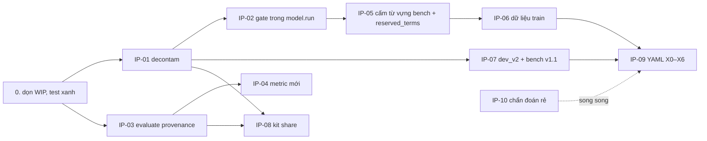

# Kế hoạch triển khai (bàn giao từ audit 17/11/2026)

Nguồn: [full_research_audit_vi.md](full_research_audit_vi.md). Mỗi mục IP-xx gắn với rủi ro Rxx trong sổ rủi ro (mục C).

Nguyên tắc chung:
- **Không sửa bản khoá.** `configs/bench/benchmarks/*_v1.yaml`, manifest và catalog đã khoá, `data/releases/*` giữ nguyên. Mọi thay đổi dữ liệu là **phiên bản mới**.
- **Không đổi số cũ.** Metric mới là *trường thêm*. Golden test (`tests/golden/`) và 6 kết quả v1 trong `results/general_asr/*_v1/` phải chấm lại ra đúng số cũ.
- **Giữ luật tầng** (`tests/test_boundaries.py`): code dùng chung cho model và bench đặt ở `core`. Model không import `bench`.
- Mỗi IP là một PR nhỏ, có test viết trước (test phải HỎNG trên `main` hiện tại).

---

## 0. Việc dọn trước (≤ 1 giờ)

| | |
| --- | --- |
| **Vấn đề** | Working tree có 5 file chưa commit; `test_boundaries` HỎNG: `src/gipbench/dataset/release/package.py:66,68` chứa chuỗi `gipbench.bench...` / `gipbench.model...` |
| **Sửa tối thiểu** | Chuyển danh sách module ra file cấu hình `configs/dataset/share_code.yaml` (`roots`, `forbidden`, `skip`, `configs`); `package.py` đọc file đó. Không thêm ngoại lệ vào `test_boundaries` |
| **Test** | `bash tests/run_tests.sh` 16 / 16 ĐẠT |
| **Rollback** | `git stash` / `git revert` |

---

## IP-01 · Bộ kiểm nhiễm bẩn đóng khi lỗi, chuẩn hoá khoá nguồn (R03)

**File:** `src/gipbench/core/decontam.py`, `src/gipbench/dataset/release/leak_audit.py`, `tests/core/test_leakage.py`.

**Thay đổi tối thiểu:**
1. Thêm `source_key(row) -> Optional[str]` trong `core/decontam.py`, trả khoá chuẩn theo thứ tự ưu tiên:
   - YouTube ID 11 ký tự trích từ bất kỳ trường `source`, `speaker`, `upstream_id`, `audio`: dạng `youtube:ID`, `yt_ID`, URL `watch?v=ID`, `youtu.be/ID`. Kết quả: `"yt:" + ID`.
   - CV: `client_id` / `speaker` dạng `cv_<hash>` / `cv17_<hash>`. Kết quả: `"cv:" + hash[:16]`.
   - VIVOS: `VIVOS(SPK|DEV)\d+`.
   - còn lại: `None` (**không** dùng id câu làm khoá).
2. `audit()` thêm finding `source_norm_overlap` (critical) so trên `source_key`. Giữ nguyên `speaker_overlap` / `source_overlap` cũ để không đổi báo cáo cũ.
3. Thêm tham số `require_audio_sha: bool`. Khi không lấy được sha (không có trường, không có file), tạo finding `audio_unverifiable` với `count`, `side` (test / train). Severity là `critical` nếu `require_audio_sha`, ngược lại `review`.
4. Thêm finding `identity_unknown` (review): tỉ lệ dòng test có `source_key` là `None`. Báo cáo ghi "trùng người nói / video: không kiểm được cho X% câu".
5. `leak_audit.py`:
   - in `stats` (gồm `audio_unreadable`) vào markdown;
   - thêm `--require-audio-sha` (mặc định **bật** khi `--fail-on critical`);
   - thêm `--exemptions exemptions.yaml` (danh sách `{kind, value|test_id, reason, approved_by, date}`). Finding được miễn vẫn in, đánh dấu `exempted`, không làm fail.
6. Tách trùng text: `text_exact_overlap` giữ critical. Khi cả hai dòng thuộc cùng họ bộ đọc có chủ ý (`domain: read` và cùng `dataset` family) thì xếp vào `lexical_overlap_read_corpus` (review, cần miễn).

**Test mới** (đều HỎNG trên `main`): 6 ca ở mục D.3 của audit. Thêm ca 7: `source_key` không bao giờ trả id câu.

**Đầu ra kỳ vọng:**
```bash
PYTHONPATH=src python -m gipbench.dataset.release.leak_audit --test <E0 vimedcss_test rows> \
  --train data/releases/pool/vimedcss_train@full/manifest.jsonl --no-audio-sha --fail-on critical
# -> source_norm_overlap: 898 giá trị, 1514 câu test; exit 1
```

**Kiểm chứng:**
- `reports/audits/scripts/a2_leak.py` và tool chính thức cho cùng số (388 / 1 514 / 194 / 55 / 71).
- Chạy lại golden test `tests/golden/compare.py`: mọi file output cũ không đổi, trừ `leak_report.*` (định dạng mới).

**Rollback:** finding mới là phần thêm; tắt bằng `--fail-on never`.

---

## IP-02 · Leak gate trong `model.run` phải dừng train và bao phủ mọi bench khoá (R02)

**File:** `src/gipbench/core/release.py`, `src/gipbench/model/run.py` (stage 0), `src/gipbench/model/recipe/experiment.py`, `configs/dataset/releases.yaml`, `configs/model/experiments/*.yaml` (chỉ YAML mới), `tests/model/test_model_pipeline.py`.

**Thay đổi tối thiểu:**
1. `core/release.py`: thêm `locked_bench_refs()` đọc `configs/dataset/releases.yaml`, trả mọi mục `bench/*` có `flags.locked: true`. Hàm nằm ở `core`, nên `model` gọi được mà không import `bench`. Chạy `python -m gipbench.dataset.release.register --all` để materialize `bench/{general,code-switch,cs-ggroup,external}-v1.0` (đã khai báo ở `bf47844`, nhưng `data/releases/bench/` hiện chỉ có `v0-draft`).
2. `experiment.py`: `leak_guard` nhận chuỗi hoặc danh sách. Thêm trường `leak_gate: {mode: fail|report, exemptions: <path>, reserved_terms: <path>}`, mặc định `fail`.
3. `run.py` stage 0:
   - với mỗi pool, dev và text TTS / LM (nếu khai báo), gọi `core.decontam.audit` lần lượt với **hợp** `leak_guard ∪ locked_bench_refs()`;
   - ghi `leak_report.json` + `.md` vào `work_dir` **và** chép vào artifact (stage 6 thêm `leak_report_sha256` vào `model_card.json`);
   - `mode: fail` + có critical chưa được miễn thì `sys.exit(3)` trước stage 1;
   - liệt kê bench khoá không có trong `leak_guard` ("bench khoá chưa được kiểm: …").
4. Giữ `LeakGuard` cũ trong `to_lhotse` (lọc câu), nhưng không coi nó là cổng.

**Test mới:**
- experiment giả có pool chứa 1 câu cùng `source_key` với bench khoá giả: stage 0 thoát mã 3.
- `mode: report`: thoát 0, có báo cáo.
- `--dry-run`: in danh sách bench sẽ kiểm.

**Đầu ra kỳ vọng:** `python -m gipbench.model.run configs/model/experiments/e3_v1.yaml --stages 0` (chỉ đọc manifest, không train) thoát mã 3, báo critical `source_norm_overlap` với C0 (259 câu) và E0 vimedcss_test.

**Kiểm chứng:** không chạy stage ≥ 1. Golden `select_ckpt`, `mix_plan` không đổi.

**Rollback:** `leak_gate.mode: report` trong YAML.

---

## IP-03 · `evaluate`: kiểm baseline, ghi đủ provenance (R07, R08, R13)

**File:** `src/gipbench/bench/evaluate.py`, `src/gipbench/core/normprofiles.py`, `tests/core/test_scoring_v1.py`, `tests/bench/test_registry.py`.

**Thay đổi tối thiểu:**
1. Chạy `check_hyps` cho `--baseline-hyps`. Lệch thì: final mode thoát mã 2; diagnostic ghi cảnh báo vào `summary.warnings`.
2. `summ` thêm các trường:
   - `label_field`;
   - `overrides: {manifest, catalog, profile, label_field}` (giá trị khác mặc định của benchmark);
   - `scorer_code_sha256`: sha256 nối của `core/{textnorm,normprofiles,align,scoring,evalstats}.py` + `bench/evaluate.py`, đọc bytes, đổi `\r\n` thành `\n`;
   - `baseline_hyps_sha256`, `baseline_hyp_check`.
3. Final mode: nếu `label_field` ≠ trường `primary_label_field` của benchmark (mặc định `text_tagged`), chỉ cho phép khi benchmark khai báo `alt_label_fields`. Report ghi rõ "chấm theo `text_tagged_orig`".
4. `Profile.spec()` thêm `code_sha256`, chỉ là thông tin. **Không** đổi `sha256()` của hồ sơ cũ, để không làm vô hiệu bản khoá.

**Test mới:**
- baseline thiếu 50% id: final thoát mã 2 (hiện thoát 0, Δ đảo dấu +12.13 → −2.57);
- `summary.json` có `label_field`, `scorer_code_sha256`;
- hai lần chạy cùng input cho cùng `scorer_code_sha256`.

**Kiểm chứng:**
```bash
python -m gipbench.bench.evaluate --benchmark cs_ggroup_v1 --hyps results/general_asr/cs_ggroup_v1/viegem_greedy/hyps.jsonl \
  --baseline-hyps results/general_asr/cs_ggroup_v1/gip15_mbs4_open/hyps.jsonl --mode final --out /tmp/c1
# số cũ không đổi: WER 34.38, CS-WER 82.39, Δ CS-WER +12.13 [9.24, 14.91]
```

**Rollback:** trường thêm; bỏ check baseline bằng `--allow-baseline-mismatch` (chỉ diagnostic).

---

## IP-04 · Metric bổ sung cho code-switching và giữ tiếng Việt (R08, R09)

**File:** `src/gipbench/core/scoring.py` (`score_utt`, `agg`), `src/gipbench/core/evalstats.py` (`RATIOS`), `src/gipbench/bench/evaluate.py` (`METRICS`, report), `tests/core/test_scoring_v1.py`, `docs/evaluation_metrics_v1.md` (thêm mục, không sửa định nghĩa cũ).

**Thay đổi tối thiểu** (mọi trường cũ giữ nguyên giá trị):

| Trường utt | Định nghĩa |
| --- | --- |
| `S_en`, `D_en`, `I_en_left`, `I_en_right_only` | đếm theo luật quy lỗi hiện tại, tách theo loại |
| `boundary_ins` | lỗi chèn mà token ref trái và phải thuộc hai ngôn ngữ khác nhau |
| `err_en_sd` = `S_en + D_en` | |
| `is_vi_only` | ref không có span `<en>` |
| `hyp_latin_extra` | số token hyp chỉ gồm `[a-z]` không dấu, dài ≥ 2, không có trong token ref (chỉ tính khi `is_vi_only`) |

Ratio mới:
- `cs_wer_sd = err_en_sd / n_en`;
- `boundary_ins_rate = boundary_ins / n_en`;
- `vi_only_wer` = `err / n` trên câu `is_vi_only`;
- `en_hallucination_per100` = 100 · `hyp_latin_extra` / số câu `is_vi_only`.

**Test mới:**
- ca "meeting" → "mít tinh" (1 S + 1 I trái) và ca chèn ở ranh giới Việt | Anh;
- câu thuần Việt, hyp có "ok" thừa: `hyp_latin_extra = 1`;
- bất biến: `err_en == S_en + D_en + I_en_left + I_en_right_only`.

**Đầu ra kỳ vọng trên C1** (đã đo trong audit, `a3_norm.py`):

| Hệ | `cs_wer` | `cs_wer_sd` | `I_en_right_only` |
| --- | --- | --- | --- |
| Gipformer | 70.25 | 56.37 | 328 |
| VieGem | 82.39 | 71.56 | 266 |

**Kiểm chứng:** golden và 6 kết quả v1 có `wer`, `cs_wer`, `n_wer`, `term_recall` không đổi (sai khác < 1e-9).

---

## IP-05 · Cấm từ vựng của bench trong curate / select / TTS; `reserved_terms` (R05, R23)

**File:** `src/gipbench/model/run.py`, `src/gipbench/model/recipe/curate.py`, `src/gipbench/model/select/select_ckpt.py`, `src/gipbench/dataset/synth/make_text.py`, `src/gipbench/core/release.py`, file mới `configs/dataset/reserved_terms_v1.txt` (người dùng chốt), tests tương ứng.

**Thay đổi tối thiểu:**
1. `core/release.py`: thêm `catalog_flags(path_or_ref)`. Hàm trả `flags` của release chứa catalog (vd `from_bench: true` của `catalog/v0-draft`). Với đường dẫn không thuộc release, so sha256 với mọi `catalog.tsv` trong `data/releases/catalog/*`.
2. `model.run` stage 0 / 1 / 5 / 6: catalog có `from_bench: true` thì thoát mã 3, trừ khi YAML ghi `catalog_use: oracle_diagnostic`. Khi đó artifact và system YAML được gắn `inference_mode: oracle_bias`, và không được xếp hạng.
3. `curate.py`: `--max-per-term` chỉ đếm thuật ngữ từ catalog **train** (không `from_bench`).
4. `select_ckpt.py`:
   - in luật đã dùng vào `select.json` (`rule: term_acc_macro|cs_wer`, `dev_refs`, `catalog_flags`);
   - từ chối dev không có cờ `independent: true` trong release (chỉ cảnh báo cho dev cũ, có `--allow-legacy-dev`).
5. `make_text.py`:
   - `--catalog` có `from_bench` thì thoát;
   - bắt buộc `--reserved-terms`: các thuật ngữ đó không bao giờ vào kịch bản;
   - ghi `tts_text.txt` để `leak_audit --text-files` kiểm.
6. Tạo `catalog/train-v1`: thuật ngữ từ text train (ViMedCSS `cs_terms_list` của split train, span vss_cs). Loại mọi thuật ngữ trong span của G0 / C0 / C1 / E0 và trong `reserved_terms_v1`.

**Test mới:**
- `make_text --catalog <catalog from_bench>`: thoát ≠ 0;
- `model.run` với `catalog: catalog/v0-draft`, không có `catalog_use`: thoát 3;
- `select_ckpt` ghi `rule`.

**Kiểm chứng:**
- `e3_v1.yaml` / `e3_v2.yaml` (giữ nguyên làm lịch sử) bị từ chối.
- YAML mới `e4_x0.yaml` (IP-09) với `catalog: catalog/train-v1` chạy được stage 0.

---

## IP-06 · Sửa dữ liệu train: dedupe, replay đa dạng, metadata (R14, R15, R16)

**File:** `src/gipbench/model/recipe/curate.py`, `src/gipbench/model/features/mix_cuts.py`, `configs/dataset/releases.yaml` (**mục mới**), `src/gipbench/dataset/ingest/local.py` (commonvoice), tests.

**Thay đổi tối thiểu:**
1. `curate.py`: bước "dedupe audio" ngay sau bước test_only, theo `audio_sha256` nếu có, không thì theo đường dẫn audio tuyệt đối đã chuẩn hoá. Báo cáo số câu trùng theo cặp nhóm. Câu trùng thuộc nhóm ưu tiên cao hơn được giữ; thứ tự ưu tiên ghi trong YAML.
2. `mix_cuts.py`:
   - in và ghi `views_per_source_audio` (đã nhân hệ số speed perturb) cho từng nhóm;
   - thêm `--max-views N`: vượt ngưỡng thì hạ trọng số nhóm và chuẩn hoá lại, ghi cảnh báo vào stats json.
3. Pool CV mới `pool/cv_validated@v2`: `validated.tsv` của CV27 trừ mọi `client_id` có trong `test.tsv` / `dev.tsv` CV27 và trừ clip trong CV17 test. Kỳ vọng nhiều người nói (≤ 229 − 221 − 7; **cần đo**: nếu quá ít thì ghi rõ và bỏ CV khỏi replay).
4. `releases.yaml`: thêm `pool/confusable_train@e3_v1b` với `label_source: human (VIVOS train)` và note "trùng audio với vivos_train@e3_v1". **Không sửa** mục cũ; thêm `errata:` trỏ tới mục mới.

**Test mới:**
- curate với 2 nhóm có cùng audio: 1 bản giữ lại;
- `mix_cuts --max-views 8` trên pool nhỏ: trọng số bị hạ, stats có cảnh báo.

**Kiểm chứng:** curate lại input E3 v1 với dedupe: 590 câu confusable bị gộp.

---

## IP-07 · `dev_v2` độc lập và bench phiên bản mới (R01, R04, R12, R20)

**File:** `src/gipbench/dataset/release/make_dev_split.py`, `src/gipbench/dataset/release/build_general.py`, `src/gipbench/dataset/ingest/evalsets.py` (chuẩn hoá `speaker` / `source` cho ViMedCSS test ở **phiên bản mới**), `configs/bench/benchmarks/{code_switch_v1_1,external_v1_1}.yaml` (mới), `configs/dataset/releases.yaml` (mục mới), tests.

**Thay đổi tối thiểu:**
1. `make_dev_split.py --exclude-from <mọi pool train + mọi bench khoá>`: loại dòng có `source_key` (IP-01) trùng.
   - `dev_v2_cs`: ViMedCSS validation còn lại sau khi loại video train / C0 / E0, cộng CS tự nhiên ngoài y khoa có id người nói (nguồn mới; nếu chưa có thì Phase 1 = NO-GO theo lộ trình).
   - `dev_v2_vi`: lời nói tự nhiên thuần Việt có id người nói (không phải VIVOS).
   - release ghi `flags: {independent: true, exclusion_sets: [...]}`.
2. `code_switch_v1.1`: cùng 658 câu, thêm trường `train_video_overlap` (true ở 388 câu) và `group_by: [dataset, train_video_overlap]`. Lát `video_unseen` = 270 câu, 156 video.
3. `external_v1.1`:
   - `audio_sha256` + `duration` cho mọi câu (sau khi `fetch` đủ);
   - `speaker` của ViMedCSS test đổi sang `yt_<ID>`, `source` sang `youtube:<ID>`;
   - FLEURS `boot_unit` theo `sentence_id` (thêm trường `boot_key` theo từng bộ: `boot_unit: per_dataset` với bảng `{fleurs_vi: source, default: speaker}`).
4. `evaluate`: hỗ trợ `boot_unit: per_dataset`.

**Test mới:**
- dev_v2 dựng từ dữ liệu giả có video trùng thì loại đúng;
- `external_v1.1` thiếu `audio_sha256` thì `registry` báo lỗi khi `evidence_level: locked`.

**Kiểm chứng:**
- `leak_audit --test dev_v2 --train <mọi pool> --fail-on critical` thoát 0;
- **Chẩn đoán đại diện:** chấm checkpoint `ck4132` (E3 v1) trên dev_v2. Kỳ vọng Δ cùng dấu với bench (xấu đi trên B1 / B5). Nếu dev_v2 vẫn báo "tốt lên" thì dev_v2 chưa đại diện.

---

## IP-08 · Gói share / Evaluation Kit (R06, R18, R19, R26)

**File:** `src/gipbench/dataset/release/package.py`, `src/gipbench/dataset/release/share_readme.md`, `configs/dataset/share_code.yaml` (mục 0), file mới `configs/dataset/share_policy.yaml`, docstring `src/gipbench/infer/decode.py`, comment trong `configs/bench/asr_models/gip15_mbs4_open.yaml`, `docs/benchmark_protocol_v1.md` (bản cho share sinh riêng).

**Thay đổi tối thiểu:**
1. `share_policy.yaml`:
   - allowlist file / thư mục được đóng gói;
   - danh sách bộ `text_redistributable: false` (thêm ViMD, LSVSC, Bud500, Speech-MASSIVE test cho tới khi rà xong);
   - regex cấm (`gipbench.model`, `pseudolabel`, `synth`, `distill`, `train_mix`, `consensus`, `hotword_distractors`, `/mnt/`, `C:\\Users`, `hf_[A-Za-z0-9]{30,}`, `vbwork2/`).
2. `package.py`:
   - lọc `datasets.yaml` chỉ giữ bộ có trong benchmark được đóng gói (bỏ `consensus_private`);
   - quét mọi file trong gói bằng regex cấm, có kết quả thì dừng;
   - tính `distinct_utterances` từ hợp `audio_sha256` / (dataset family, upstream_id), không cộng tay (đúng: 36 237 cho v1.1);
   - ghi `scorer_code_sha256` vào `release.json`.
3. Sửa docstring `decode.py` (bỏ nhắc E1 / `model/systems/...`); comment `gip15_mbs4_open.yaml` bỏ đường dẫn `results/v0_draft`.
4. Docs cho gói: sinh `docs/share/benchmark_protocol.md` không có mục lịch sử v0-draft và đường dẫn máy; datasheet bản mới sửa 308 / 201 thành 388 / 248.
5. (Phase 5) `package.py --emit-repo DIR`: xuất cây `gipbench-eval/` (mục G.3), `git init` với commit duy nhất.

**Test mới:**
- đóng gói giả có file chứa `gipbench.model`: dừng;
- `distinct_utterances` đúng trên dữ liệu giả có trùng CV;
- gói không chứa `consensus_private`.

**Kiểm chứng:**
```bash
python -m gipbench.dataset.release.package --name gipbench-bench-v1.1.3 ...
# venv sạch: pip install -e <gói>/code && evaluate cho 3 bench -> số khớp baseline (đã kiểm ở audit với v1.1.2)
grep -rEn "consensus|hotword_distractors|/mnt/|v0_draft" <gói>   # phải rỗng
```

**Việc không phải code (người dùng):**
- xác định gói v1.0.1 / v1.1 / v1.1.1 đã gửi cho ai; gửi bản thay thế;
- không cấp quyền repo `vbwork2/Gipbench`;
- rà license theo bảng G.4 của audit.

---

## IP-09 · Experiment YAML cho chuỗi ablation X0–X6 (chỉ cấu hình, không chạy trong audit)

**File:** `configs/model/experiments/e4_x0.yaml` … `e4_x6.yaml` (mới); `src/gipbench/model/run.py` (nếu cần cờ freeze encoder toàn bộ cho X2: `freeze: "encoder."`).

**Nội dung:**
- `catalog: catalog/train-v1`;
- `leak_guard: [dev/dev_v2@1]` (cộng mọi bench khoá tự động qua IP-02);
- `leak_gate.mode: fail`;
- `dev: {cs: dev/dev_v2_cs@1, vi: dev/dev_v2_vi@1}`;
- `seeds: [0, 1]`;
- `select.rule` ghi rõ;
- `mix.max_views: 8`.

X0: chỉ `replay_human` (VIVOS + `cv_validated@v2` + VI tự nhiên nếu có), LR 3e-4, 2 × 20 h. X2: `freeze: "encoder_embed.,encoder."`. Các mục khác theo bảng F.4.

**Kiểm chứng:** `python -m gipbench.model.run configs/model/experiments/e4_x0.yaml --stages 0-6 --dry-run` in lệnh; stage 0 thoát 0 (gate sạch).

---

## IP-10 · Chẩn đoán rẻ không cần train (làm song song)

| Việc | Lệnh | Đầu ra |
| --- | --- | --- |
| Độ phân mảnh tokenizer trên C1 | `python -m gipbench.model.systems.tokenizer_check --bpe models/gip15/bpe.model --terms <span C1>` (xem `--help`) | số token / thuật ngữ, % thuật ngữ ≥ 4 token |
| Thứ hạng checkpoint E3 trên lát thuần Việt + C1 (chẩn đoán, không chọn) | decode các ứng viên `results/e3_v1_dev/*` trên 787 câu G-Group thuần Việt + C1 bằng `bench.transcribe` (CPU) | xác nhận dev cũ đảo thứ hạng |
| VieGem + KenLM | `sudo apt install build-essential cmake` rồi `uv pip install kenlm`; `transcribe --model configs/bench/asr_models/viegem_lm.yaml` | hàng `lm` cho G0 / C0 / C1 |
| Whisper-large-v3 / Qwen3-ASR trên G0 / C1 | `transcribe --model configs/bench/asr_models/whisper_large_v3.yaml` (venv `gipbench-asr`) | hệ tham chiếu thứ ba |
| Nghe mẫu nhãn giả 300 câu | script mới `src/gipbench/dataset/pseudolabel/listen_sample.py` (lấy mẫu phân tầng theo E.3, xuất CSV cho trang duyệt `dataset/label/term_review_page.py`) | tỉ lệ lỗi span + CI, kappa |

---

## Thứ tự triển khai và phụ thuộc



| Thứ tự | IP | Ước lượng công | Chặn |
| --- | --- | --- | --- |
| 1 | 0 + IP-01 + IP-03 | 1–2 ngày | mọi thứ |
| 2 | IP-02 + IP-04 | 1–2 ngày | FT mới |
| 3 | IP-05 + IP-06 | 2 ngày + thời gian người dùng chốt `reserved_terms_v1` | E3 v2 / X-series |
| 4 | IP-07 | phụ thuộc nguồn CS tự nhiên có id người nói | Phase 3 |
| 5 | IP-08 | 1–2 ngày + rà license | share rộng |
| 6 | IP-09, IP-10 | cấu hình 0.5 ngày; chạy theo Phase 3 | – |

---

## Lệnh tái lập các phát hiện của audit

```bash
# từ gốc repo (Windows Git Bash hoặc WSL). a2–a4 chỉ cần stdlib; a1 cần pyyaml (~/.venvs/gipbench)
export PYTHONIOENCODING=utf-8
~/.venvs/gipbench/bin/python reports/audits/scripts/a1_bench.py        # hash 4/4, số câu, E0 thiếu sha, CV17∩CV27
python reports/audits/scripts/a2_leak.py /tmp/contam.csv               # ma trận nhiễm bẩn (~3 phút)
python reports/audits/scripts/a3_norm.py                               # chuẩn hoá số, phân rã CS-WER
python reports/audits/scripts/a4_ci.py                                 # CI theo câu vs speaker_cluster
# bộ kiểm hiện tại bỏ sót trùng video E0:
python -c "import json;open('/tmp/e0v.jsonl','w',encoding='utf-8').writelines(l for l in open('data/benchmarks/external_v1/manifest.jsonl',encoding='utf-8') if '\"vimedcss_test\"' in l)"
PYTHONPATH=src python -m gipbench.dataset.release.leak_audit --test /tmp/e0v.jsonl \
  --train data/releases/pool/vimedcss_train@full/manifest.jsonl --out /tmp/leak_e0v   # không có finding speaker/source
# baseline cắt cụt làm Δ đảo dấu:
head -630 results/general_asr/cs_ggroup_v1/gip15_mbs4_open/hyps.jsonl > /tmp/trunc.jsonl
PYTHONPATH=src python -m gipbench.bench.evaluate --benchmark cs_ggroup_v1 --mode final \
  --hyps results/general_asr/cs_ggroup_v1/viegem_greedy/hyps.jsonl --baseline-hyps /tmp/trunc.jsonl --out /tmp/trunc
# độ nhạy quy ước tag C0:
PYTHONPATH=src python -m gipbench.bench.evaluate --benchmark code_switch_v1 --mode final --label-field text_tagged_orig \
  --hyps results/general_asr/code_switch_v1/gip15_mbs4_open/hyps.jsonl --out /tmp/c0_orig      # CS-WER 100.62 (vs 107.12)
```

## Kiểm chứng tổng và rollback

- **Mỗi PR:**
  - `bash tests/run_tests.sh` ĐẠT;
  - `python tests/golden/compare.py` không có khác biệt ngoài các file đã khai báo;
  - chấm lại 6 kết quả v1 (`results/general_asr/{general,code_switch,cs_ggroup}_v1/{gip15_mbs4_open,viegem_greedy}`) cho cùng `wer` / `cs_wer` / `term_recall`.
- **Bản khoá:**
  - `python -m gipbench.bench.registry` thoát 0;
  - `--hash` của 4 bench khoá không đổi (e908c75a…, 744d4773…, e3c3cc1b…, f074d27f…).
- **Rollback:**
  - mọi thay đổi code là phần thêm hoặc có cờ tắt (`--fail-on never`, `leak_gate.mode: report`, `--allow-legacy-dev`);
  - dữ liệu mới là release / bench **phiên bản mới**, nên xoá mục mới trong YAML là quay về trạng thái cũ;
  - không có bước nào ghi đè `data/releases/*` hoặc manifest đã khoá.
